# ChessWhy — Concepts

The map of ChessWhy's ideas, from the whole project (L1) down to single rules (L3). It
holds no code: [CODE.md](CODE.md) says where each idea lives in the source. Every word on
a node is defined in [DEFINITIONS.md](DEFINITIONS.md); [TESTS.md](TESTS.md) and
[FIXTURES.md](FIXTURES.md) name the nodes each test and fixture checks.

ChessWhy is a DBC project (Driven by Concepts): the Captain leads it through this map. A
change she makes to a diagram is a directive; the orchestrator turns it into plans and
code, then brings the map back in line with what was built.

**Status:** first version by the Deputy, 2026-10-21; describes the project as built and
carries the Captain's prior approval. Her later edits are directives.

## How to read the diagrams

- **Levels.** L1 shows the whole project. Every L1 node has its own L2 diagram. An L2 node
  gets an L3 diagram only when it is a rule with steps worth seeing.
- **Arrows.** In L1 and L2 an arrow means information flows that way; its label says what
  flows. A dotted arrow means one node checks or limits another; nothing flows. In L3 the
  arrows are the steps of a rule, labelled with the answer to the question in the diamond.
- **Status.** Each diagram has a node table. `implemented`: solid border. `partial`: short
  dashes, some parts exist. `planned`: long dashes, nothing built yet. `external`: dotted
  grey, a node that belongs to another diagram and is shown only for context.
- **Node IDs.** Each ID is unique in this file. Use them to point at a node, for example
  "split `Urgency`".
- **Checking.** `python3 tools/check_dbc.py` checks that the diagrams, tables, terms, code
  references, tests and fixtures still agree.

## L1 · ChessWhy

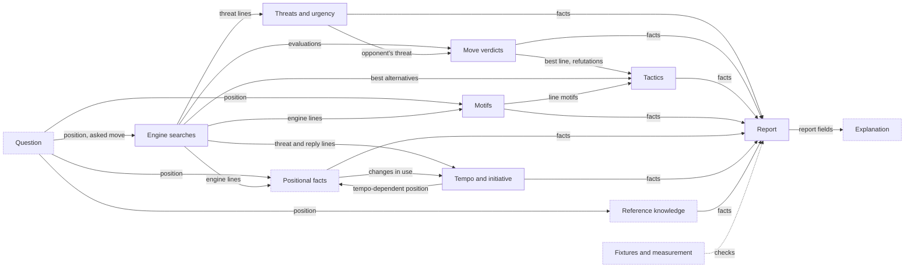

| Node | Meaning | Terms | Status |
|---|---|---|---|
| `Question` | What the user asks: a position and which moves to report (asked moves, the best move, the top N, or every move of a kind), with a budget and an audience level | FEN, asked move, `--moves`, budget, level | partial |
| `Searches` | Stockfish searches with fixed node budgets; the only source of evaluations and lines | A, null move, ES | implemented |
| `Threats` | What each side would do if it were its move, what that achieves, and which threat matters more | threat, consequence, urgency | implemented |
| `Verdicts` | How much each move loses against the best, which moves are playable, and why: parry, new threat, refutation, an allowed tactic | verdict, loss, playable move | implemented |
| `Motifs` | Patterns on the board, found by rules, on the position and along engine lines; they claim no gain | motif | implemented |
| `Tactics` | Whether a line wins material or mates (tactic), whether it beats the best alternative by the only-move margin (opportunity), and which motifs and labels make it work | tactic, opportunity, contribution judgement, tactic label | implemented |
| `Positional` | Pawn structure, king safety, piece activity and other lasting features, reported as changes along lines | positional fact | partial |
| `Tempo` | Whether having the move matters in the position, which moves of a line gain a tempo, and who holds the initiative and what becomes of it | tempo value, tempo ledger, initiative | implemented |
| `Reference` | Knowledge from outside the engine: opening names, game counts, book passages | provenance, opening name, game counts, book passage | partial |
| `Report` | The full report holds every fact, each with its provenance; one move report per selected move holds only the facts that bear on it, in impact order; nothing is claimed outside them | report, full report, move report, provenance, facts first, impact rating | implemented |
| `Explanation` | The words a reader gets: template text today, language-model prose checked against the report later | explanation, template rendering | partial |
| `Proof` | Fixtures and measurements that show the facts are right | fixture, recall | partial |

## Level 2

### L2 · Question (`Question`)

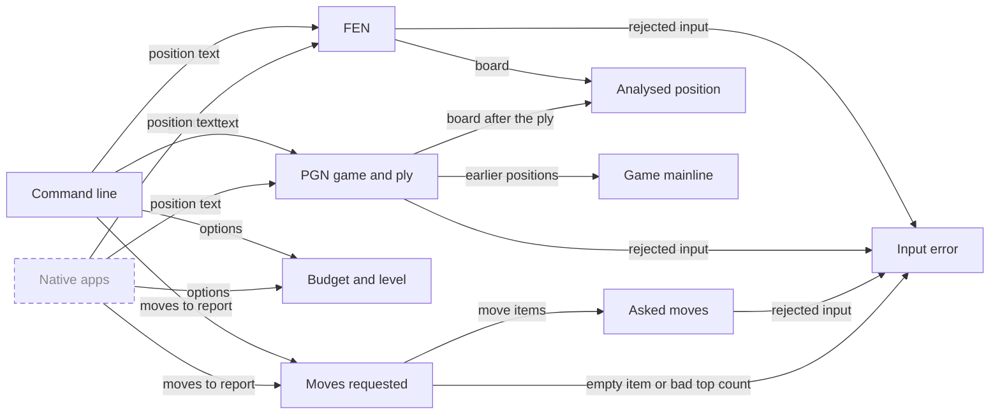

| Node | Meaning | Terms | Status |
|---|---|---|---|
| `CommandLine` | `chesswhy` with flags: the way a question arrives today | command line | implemented |
| `NativeApps` | Apps on Linux and Windows, possibly Android, through which a player asks without technical setup; design open (called `LocalApi`, "local HTTP API", before 2026-10-22: the question as JSON over HTTP on this machine) | native apps | planned |
| `FenInput` | A position as one FEN string, checked for legality | FEN | implemented |
| `PgnInput` | A game from a PGN file, mainline only, and the ply to stop at | PGN, ply | implemented |
| `AskedMove` | The moves the user asks about, each in SAN or UCI and legal in the position; several may be asked at once, each reported once (one move only before 2026-10-23) | asked move, SAN | implemented |
| `MoveRequest` | Which moves to report, as one list: asked moves and keywords for the best move, the top N moves, every playable move, every move of one or all not-playable verdicts, or every legal move; nothing given means the best move. Keywords that judge every legal move are slow and say so in the help (called `PlayableRequest`, "how many playable moves", before the 2026-10-23 revision; never built) | `--moves`, whole-board keyword, selection | implemented |
| `Settings` | Search budget (quick, standard, deep) and audience level; the level does not change the analysis | budget, level | implemented |
| `AnalysedPosition` | The board every fact is about, with side to move `S` and opponent `O`; position-only: the moves that led to it are not an input to the analysis | analysed position, S | implemented |
| `GameMainline` | The positions of a PGN game from its start to the analysed one, used to name the last opening reached | game mainline | implemented |
| `InputError` | Input that cannot be used stops with one clear message, an input-error exit code and no report | input error | implemented |

### L2 · Engine searches (`Searches`)

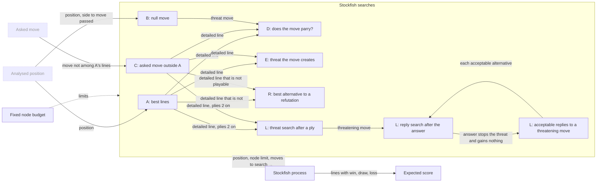

| Node | Meaning | Terms | Status |
|---|---|---|---|
| `AnalysedPosition` | See Question | — | external |
| `AskedMove` | See Question | — | external |
| `NodeBudget` | Every search stops after a fixed number of nodes, one thread, fixed hash: the same input gives the same report | budget, nodes, reproducible | implemented |
| `SearchA` | The best moves from the position, each with its line; the first line is `S`'s threat. Five lines, N for a top-N request above five, every legal move when the request needs every move judged | A, MultiPV K, PV, whole-board keyword | implemented |
| `SearchB` | `S` passes; what `O` would play is `O`'s threat. Skipped when `S` is in check | B, null move | implemented |
| `SearchC` | Search restricted to one asked move when it is not among A's lines; once per such move | C | implemented |
| `SearchD` | After a move, `O` must play its threat move: does the threat still work? Only for detailed lines | D, detailed line | implemented |
| `SearchE` | After a move, `S` moves again: which threat the move created. Only for detailed lines | E, detailed line | implemented |
| `SearchR` | After a move that is not playable, `O`'s best move other than the refutation, to judge the refutation as an opportunity; only for detailed lines | R, detailed line | implemented |
| `ThreatSearch` | On each ply of a detailed line from the second on, the side that just moved moves again: is the ply a threatening move? Ply 1 uses E; a check needs no search. Not run when `S` is in check or `null_move_reliable` is false | L, threat search, threatening move | implemented |
| `ReplySearch` | After the answer to a threatening move, the threatening side to move: did the answer stop the threat? Runs after a threatening move and, from 2026-10-25, after each acceptable alternative of the forced test | L, reply search, pure reply, forced test | implemented |
| `ForcedSearch` | On the board before a reply that stops the threat, does not threaten and keeps no reply gain: the replier's five best moves, to find the acceptable replies | L, forced test, acceptable reply | implemented |
| `StockfishProcess` | Stockfish runs as a separate program and answers over UCI; each line's first move is kept once | UCI, MultiPV K | implemented |
| `ExpectedScore` | Win/draw/loss turned into one score from 0 to 1; every threshold uses it, never centipawns | WDL, ES, es_units | implemented |

### L2 · Threats and urgency (`Threats`)

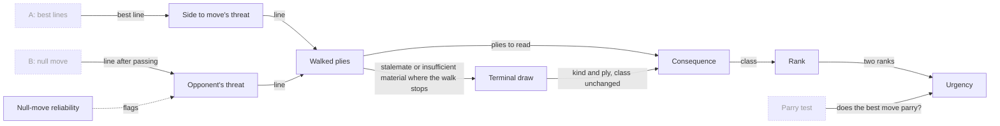

| Node | Meaning | Terms | Status |
|---|---|---|---|
| `SearchA` | See Engine searches | — | external |
| `SearchB` | See Engine searches | — | external |
| `ParryTest` | See Move verdicts | — | external |
| `SideThreat` | What `S` would do with its move: A's best line | threat, S | implemented |
| `OpponentThreat` | What `O` would do if it were its move: B's line. "White's biggest problem" is Black's threat | threat, O | implemented |
| `NullMoveReliable` | Passing misleads when `S` has almost no pieces (zugzwang); the report says so | `null_move_reliable` | implemented |
| `WalkedPlies` | How far a line is read: six plies, then on while the next move is a continuation move (a capture, a check or the answer to a check), at most ten, stopping at the first game-over board; settled unless ply ten stops it while the engine line would still go on (from 2026-10-25; before: six plies, then on while captures continue, at most ten) | walked plies, settled walk, continuation move, game over | implemented |
| `Consequence` | What a line achieves for the side playing it: mate, material, promotion or only position | consequence, consequence class | implemented |
| `TerminalDraw` | The walk ends in stalemate or with insufficient material: the consequence names it and its ply, class and rank stay as measured, and a move that ends the game has no refutation | terminal draw, game over, `refutation_skipped` | implemented |
| `ConsequenceRank` | The consequence as a number, so two threats can be compared | rank | implemented |
| `Urgency` | Which side's threat matters more now, and by which rule | urgency | implemented |

### L2 · Move verdicts (`Verdicts`)

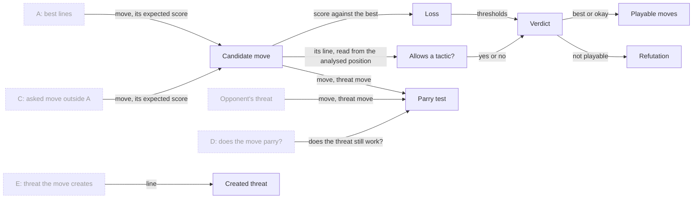

| Node | Meaning | Terms | Status |
|---|---|---|---|
| `SearchA` | See Engine searches | — | external |
| `SearchC` | See Engine searches | — | external |
| `SearchD` | See Engine searches | — | external |
| `SearchE` | See Engine searches | — | external |
| `OpponentThreat` | See Threats and urgency | — | external |
| `CandidateMove` | A move being judged: one of A's lines in engine order (five, more for a top-N request, every legal move when every move must be judged), or an asked move outside them, with the depth its line reached and how many plies its facts were read from; only detailed lines get the parry test, created threat and the refutation's opportunity judgement | candidates, asked move, line depth, `walked_plies`, detailed line | implemented |
| `Loss` | How much expected score the move gives up against the best move | loss | implemented |
| `AllowsTactic` | Does the move let the opponent win at least a pawn or mate? Read along the move's own line from the analysed position, so an even trade allows nothing | allows a tactic | implemented |
| `Verdict` | best or okay (playable), inaccuracy, mistake or blunder, from the loss, the same-score test against the top line and whether the move allows a tactic (called fine, inaccuracy, mistake or blunder from the loss alone before 2026-10-23) | verdict, playable move | implemented |
| `PlayableSet` | The playable moves among A's lines, in engine order; the engine's lines only, so unlisted moves are not judged and may also be playable; the number of legal moves stands beside it. Called `FineSet`, "the fine moves among the candidates", before 2026-10-23 | playable move, `playable_truncated`, `legal_moves` | implemented |
| `ParryTest` | Does the move stop `O`'s threat? "Stop" means the threat no longer wins against the pass baseline, not that it was prevented | parry test, `parries_threat` | implemented |
| `CreatedThreat` | The threat `S` would have after the move if `O` passed, from E; none when the move gives check, ends the game or leaves `O` no legal move, and the report names which | `creates_threat`, `creates_threat_skipped` | implemented |
| `Refutation` | For a move that is not playable: `O`'s best reply line, read like a threat (for a move that is not fine before 2026-10-23); none after a move that ends the game, and the report says so (from 2026-10-25) | refutation, `refutation_skipped`, game over | implemented |

### L2 · Motifs (`Motifs`)

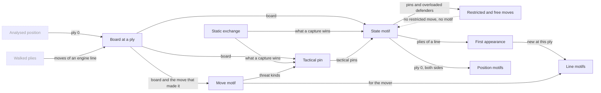

| Node | Meaning | Terms | Status |
|---|---|---|---|
| `AnalysedPosition` | See Question | — | external |
| `WalkedPlies` | See Threats and urgency | — | external |
| `BoardAtPly` | One board: the position itself, or the board after k moves of a line | ply, line | implemented |
| `StaticExchange` | Net material a side wins by the best capture sequence on one square, without search | SEE, piece values | implemented |
| `StateMotif` | A pattern of the board alone, for both sides: hanging piece, pins, back-rank weakness, overloaded defender, trapped piece, tactical pin; pins, overloaded defenders and tactical pins exist only when they restrict at least one move | state motif, motif tag, existence condition | implemented |
| `MoveMotif` | A pattern that also needs the move that made the board: fork, skewer, discovered check or attack, double check, back-rank mate, promotion | move motif, motif tag | implemented |
| `TacticalPin` | A piece held in place because removing it would let the other side make a threat; only when at least one of its moves would let that threat through | `pin_tactical`, existence condition | implemented |
| `Restriction` | For a pin, overloaded defender or tactical pin: the held piece, how it is held (at its square, along one file, rank or diagonal, or only to the listed squares), its restricted moves (illegal or costly because of the motif) and its free moves, with the held side to move. A pawn's moves include a capture onto each square diagonally in front of it, whatever stands there (since 2026-10-22, Captain; before: legal moves only) | restricted moves, free moves, held piece, held to, move set, hypothetical capture, `restriction` | implemented |
| `FirstAppearance` | Inside a line, a state motif is listed only at a ply where it holds and did not hold at the ply before (before 2026-10-22 worded "where it first holds") | first-appearance rule, motif instance | implemented |
| `PositionMotifs` | State motifs of the analysed position, both sides | position motifs | implemented |
| `LineMotifs` | Motifs along a threat, refutation or move line | line motifs | implemented |

### L2 · Tactics (`Tactics`)

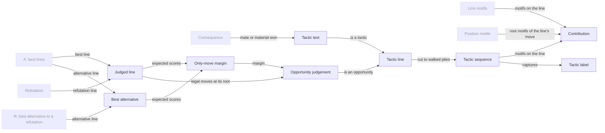

| Node | Meaning | Terms | Status |
|---|---|---|---|
| `SearchA` | See Engine searches | — | external |
| `SearchR` | See Engine searches | — | external |
| `Refutation` | See Move verdicts | — | external |
| `LineMotifs` | See Motifs | — | external |
| `PositionMotifs` | See Motifs | — | external |
| `Consequence` | See Threats and urgency | — | external |
| `JudgedLine` | A line that gets an opportunity judgement: the best move's line and every refutation of a detailed line | judged line | implemented |
| `BestAlternative` | The move the line is compared with: A's second line, or R's line for a refutation | best alternative | implemented |
| `OnlyMoveMargin` | How much better the line scores than the best alternative | only-move margin | implemented |
| `OpportunityJudgement` | Forced, an opportunity (margin ≥ 0.13), or neither. Called `TacticJudgement`, "forced, a tactic, or neither", before 2026-10-23 | opportunity judgement, opportunity, forced | implemented |
| `TacticTest` | Is the line a tactic: does the side playing it mate or win at least a pawn net over the walked plies? Any line can be tested | tactic, consequence | implemented |
| `TacticLine` | A line that is an opportunity or a tactic; only these get contributions and labels (before 2026-10-23: a judged line that is a tactic by margin) | tactic line | implemented |
| `TacticSequence` | The tactic line cut to its walked plies: the moves contributions and labels read | tactic sequence | implemented |
| `Contribution` | Each motif's role in the tactic: direct, indirect or none; `none` means the tactic works without the motif (Captain, 2026-10-22; before, an attack on a landing square made a motif indirect). The position's motifs are judged against each tactic line's move as root motifs | contribution judgement, root motifs | implemented |
| `TacticLabel` | A fact about the whole tactic line that reads later moves, so it is not a motif: `removal_of_defender`; the defended piece must still stand on its square when it is won | tactic label, `removal_of_defender` | implemented |

### L2 · Positional facts (`Positional`)

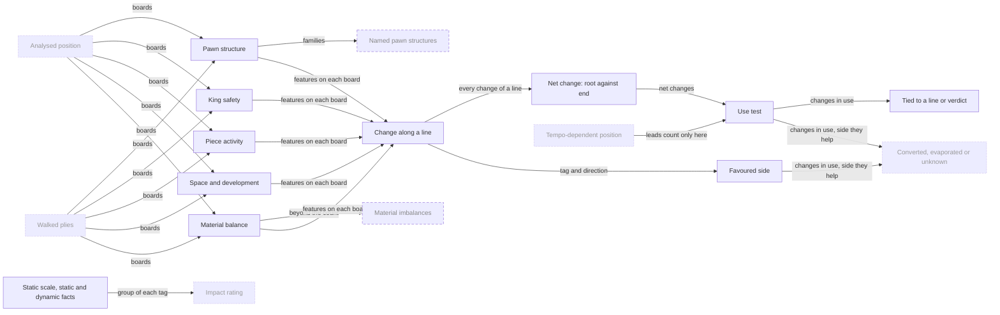

| Node | Meaning | Terms | Status |
|---|---|---|---|
| `AnalysedPosition` | See Question | — | external |
| `WalkedPlies` | See Threats and urgency | — | external |
| `TempoLabel` | See Tempo and initiative | — | external |
| `RunOutcome` | See Tempo and initiative | — | external |
| `ImpactRating` | See Report | — | external |
| `PawnStructure` | Isolated, doubled, tripled, backward, passed and connected passed pawns, pawn islands, pawn chains. Since 2026-10-21; before, it also held named structures (now `NamedStructures`); tripled pawns since 2026-10-23 | positional fact, `isolated_pawn`, `doubled_pawns`, `tripled_pawns`, `backward_pawn`, `passed_pawn`, `connected_passed_pawns`, `pawn_islands`, `pawn_chain` | implemented |
| `NamedStructures` | Named pawn-structure families (isolated queen's pawn, hanging pawns, Carlsbad and the like); deferred on 2026-10-21, part of `PawnStructure` before | positional fact | planned |
| `KingSafety` | Castling rights, gaps in the king's pawn shield, open and half-open files next to the king, enemy pieces attacking the squares around it | positional fact, king files, `castling_kingside`, `king_shield_gap`, `open_file_near_king`, `half_open_file_near_king`, `king_zone_attacker` | implemented |
| `PieceActivity` | Bishop pair, rooks on open or half-open files or the seventh rank, outposts, bad bishops. Mobility moved to `SpaceDevelopment` on 2026-10-21 | positional fact, `bishop_pair`, `rook_open_file`, `rook_half_open_file`, `rook_seventh`, `outpost`, `bad_bishop` | implemented |
| `SpaceDevelopment` | A side ahead in mobility, space or development by at least the lead threshold (mobility was under `PieceActivity` before 2026-10-21) | mobility, space, undeveloped, lead threshold | implemented |
| `MaterialBalance` | Who is ahead in material and by how much, and an exchange up. Called `MaterialImbalance` before 2026-10-21, when it meant which pieces each side has beyond the count (now `Imbalances`) | `material_ahead`, `exchange_up` | implemented |
| `Imbalances` | Which pieces each side has beyond the material count (two minor pieces against a rook and the like); deferred on 2026-10-21 | positional fact | planned |
| `PositionalChange` | A positional feature that appears or disappears along a line, judged by its identity, and whether that still holds at the end | positional change, feature identity, `holds_at_end` | implemented |
| `TiedToLine` | A positional fact enters the move report only when it is a net change of the line that passes the use test (since 2026-10-24; before, the last change per feature identity that holds at the end). The full report keeps every change, marked as passing or failing the use test | positional fact, net change, use test | implemented |
| `NetChange` | For one line, the last change per feature identity, kept only when the root and the end of the walk differ (the feature is there at one and not at the other); the rest are passing changes | net change, passing change, `net_change` | implemented |
| `UseTest` | Whether a later move of the walk uses a net change (attacks or wins a weak pawn, advances a passed pawn, moves a rook along its file, presses a weakened king), or the move or its reply made it; per-tag rules in the L3 diagram. A change to a file next to the king needs a shelter witness on that file (from 2026-10-25; before, any press on the king zone) | use test, `in_use`, king pressed, shelter witness | implemented |
| `FavouredSide` | The side a change helps: a weakness that appears helps the opponent of its owner, any other feature that appears helps its owner, a disappearance helps the other side, except a captured weakness, which helps nobody (from 2026-10-25); pawn islands and pawn chains help nobody | favoured side, captured weakness | implemented |
| `StaticScale` | The group of each positional tag on the static scale (king safety, material, pawn structure, pieces, space and development) and whether the fact is dynamic (castling rights, king zone attackers, mobility and development leads) or static | static scale, static fact, dynamic fact | implemented |

### L2 · Tempo and initiative (`Tempo`)

```mermaid
flowchart LR
    SearchA["A: best lines"]
    SearchB["B: null move"]
    SearchE["E: threat the move creates"]
    ThreatSearch["L: threat search after a ply"]
    ReplySearch["L: reply search after the answer"]
    ForcedSearch["L: acceptable replies to a threatening move"]
    WalkedPlies["Walked plies"]
    UseTest["Use test"]
    FavouredSide["Favoured side"]
    TempoValue["Tempo value"]
    TempoLabel["Tempo-dependent position"]
    ThreatTest["Threatening move"]
    ReplyTest["Reply stops the threat"]
    SettlePoint["Settle point"]
    ReplyGain["Reply gain"]
    ForcedTest["Forced reply"]
    PlyLabel["Ply label"]
    TempoGained["Tempo gained"]
    TempoLedger["Tempo ledger"]
    InitiativeRun["Initiative run"]
    RunEnding["How a run ends"]
    RunOutcome["Converted, evaporated or unknown"]
    SearchA -->|side to move moves| TempoValue
    SearchB & SearchE -->|side to move passes| TempoValue
    TempoValue -->|value| TempoLabel
    SearchE & ThreatSearch -->|threat after a ply| ThreatTest
    ThreatTest -->|threatening move| ReplySearch
    ReplySearch -->|threat after the answer| ReplyTest
    WalkedPlies -->|continuation moves| SettlePoint
    ReplyTest & SettlePoint -->|answer stops the threat, exchange after it| ReplyGain
    ReplyGain -->|gains nothing| ForcedSearch
    ForcedSearch & ReplySearch -->|acceptable replies, does each stop it?| ForcedTest
    ThreatTest & ReplyTest & ReplyGain & ForcedTest -->|each ply| PlyLabel
    PlyLabel -->|threatening move, then pure reply| TempoGained
    PlyLabel & TempoGained -->|one line| TempoLedger
    TempoGained -->|tempi one after another| InitiativeRun
    InitiativeRun & PlyLabel -->|the holder's next move and its answer| RunEnding
    InitiativeRun & SettlePoint -->|material to the run's settled end, mate| RunOutcome
    UseTest & FavouredSide -->|static changes in use, side they help| RunOutcome
    classDef planned stroke-dasharray:6 4,color:#888
    classDef partial stroke-dasharray:2 2
    classDef external stroke-dasharray:1 3,color:#999
    class SearchA,SearchB,SearchE,ThreatSearch,ReplySearch,ForcedSearch,WalkedPlies,UseTest,FavouredSide external
```

| Node | Meaning | Terms | Status |
|---|---|---|---|
| `SearchA` | See Engine searches | — | external |
| `SearchB` | See Engine searches | — | external |
| `SearchE` | See Engine searches | — | external |
| `ThreatSearch` | See Engine searches | — | external |
| `ReplySearch` | See Engine searches | — | external |
| `ForcedSearch` | See Engine searches | — | external |
| `WalkedPlies` | See Threats and urgency | — | external |
| `UseTest` | See Positional facts | — | external |
| `FavouredSide` | See Positional facts | — | external |
| `TempoValue` | What having the move is worth to the side to move: its score when it moves minus its score when it passes. At the root from A and B; after each move from A's line (or C) and E. Null when that side is in check or a search is missing | tempo value | implemented |
| `TempoLabel` | Tempo-dependent position above 0.10, non-tempo position below 0.05, zugzwang below 0, no label in between. The root's label decides the impact order and whether leads pass the use test | tempo-dependent position, non-tempo position, zugzwang | implemented |
| `ThreatTest` | A ply is a threatening move when its side's threat after it reaches rank 2 or more; a check is one by rule | threatening move, rank | implemented |
| `ReplyTest` | After the answer to a threatening move, the threatening side's best line stays below rank 2; an answer that ends the game stops the threat | reply search, game over | implemented |
| `SettlePoint` | From a ply, on while the next walked move is a continuation move: where the exchange it starts is over; unknown when the walk ends unsettled there | settle point, continuation move, settled walk | implemented |
| `ReplyGain` | For an answer that stops the threat and does not threaten: what the replier keeps from the board before the threatening move to the settle point after the answer, material of at least a pawn or mate | reply gain | implemented |
| `ForcedTest` | For an answer that stops the threat and gains nothing: forced when every acceptable reply stops the threat too, not forced when one leaves it, unknown when all five searched lines are acceptable and all stop it (Captain, 2026-10-25, option A) | forced reply, forced test, acceptable reply | implemented |
| `PlyLabel` | Each ply is threatening, a pure reply, a counter-threat, a gaining, unforced or unresolved reply, or neither; rule in the L3 diagram. Before 2026-10-25: threatening, pure reply (any answer that stops the threat without threatening), counter-threat, neither | ply label, counter-threat, pure reply, gaining reply, unforced reply, unresolved reply | implemented |
| `TempoGained` | A threatening move whose answer is a pure reply: a forced answer that gains nothing (from 2026-10-25; before: any answer that stops the threat without threatening) | tempo gained | implemented |
| `TempoLedger` | Per detailed line: every walked ply with its label, its reply gain and forced test where they apply, the tempi gained per side and the initiative runs. Not built when `S` is in check, when `null_move_reliable` is false, or for a line that is not detailed | tempo ledger, `tempo_ledger_skipped` | implemented |
| `InitiativeRun` | A side gains tempi one after another: it starts at a tempo gained and goes on while each of the holder's next moves also gains one | initiative, initiative run | implemented |
| `RunEnding` | The holder's next move does not threaten (spent), mates (runs), is answered by a counter-threat (contested), by a move that does not stop the threat (runs), by a gaining or unforced reply (answered) or by an unresolved reply (unresolved); or the walk ends first (unfinished). Answered and unresolved from 2026-10-25 | run ending | implemented |
| `RunOutcome` | Converted when the run has conversion evidence: the holder's material grows to the run's settled end, a static change in use inside the run helps the holder, or the holder mates; unknown when the run is unfinished or ends unsettled without other evidence; evaporated otherwise. From 2026-10-25; before: material to the end of the walk or any change in use, no unknown | converted, evaporated, unknown, conversion evidence | implemented |

### L2 · Reference knowledge (`Reference`)

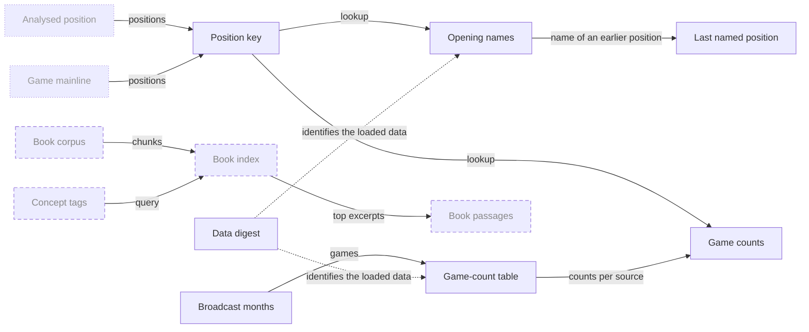

| Node | Meaning | Terms | Status |
|---|---|---|---|
| `AnalysedPosition` | See Question | — | external |
| `GameMainline` | See Question | — | external |
| `PositionKey` | Placement, side to move, castling and a usable en-passant square, so transpositions match | position key | implemented |
| `OpeningNames` | The name and ECO code of a named position; never guessed for an unnamed one | opening name | implemented |
| `LastNamed` | For a game: the last named position on the mainline, up to and including the analysed one | last named position | implemented |
| `BroadcastMonths` | Monthly files of strong over-the-board games relayed by Lichess, each pinned by its checksum | broadcast month | implemented |
| `GameTable` | Position-to-move counts built offline from the pinned games, each source kept apart, with a recorded table id | game-count table, table id, rating floor, ply limit, minimum game count | implemented |
| `GameCounts` | How often players chose each move in the analysed position, with results, per source and platform; never a judgement of the move | game counts | implemented |
| `BookCorpus` | The Captain's local books as text, kept out of the repository | book corpus | planned |
| `BookIndex` | A search index over book chunks | book index | planned |
| `ConceptTags` | The report's motif and positional tags, widened by a keyword map, used as the book query | concept tag | planned |
| `BookPassages` | One to three short excerpts, cited by book and page, offered as general advice; shown only when on topic, applicable to the position and with their stance kept | book passage | planned |
| `DataDigest` | The loaded game-count table and opening-name files are identified by the SHA-256 of their bytes: the shipped id when it matches the pin, a custom id otherwise | data digest, `custom@` id | implemented |

### L2 · Report (`Report`)

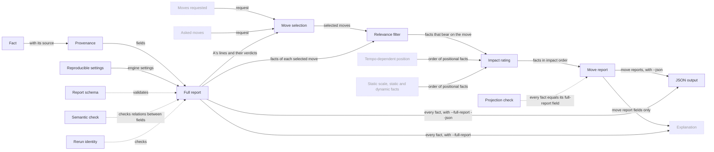

| Node | Meaning | Terms | Status |
|---|---|---|---|
| `Fact` | One claim about the position, computed before any words are written | fact | implemented |
| `Provenance` | Where a fact comes from: engine search, board rule, reference material or game counts | provenance | implemented |
| `Reproducible` | The settings that make a report repeat exactly, recorded in the report: budget, threads, hash and nodes. The engine binary and the ChessWhy revision are not identified (named 2026-10-22) | reproducible | implemented |
| `ReportDocument` | The full report: the JSON document of one question with every computed fact; the only place chess claims live; what fixtures and checks read. Called "report document" before 2026-10-23 | report, full report, facts first | implemented |
| `ReportSchema` | The versioned JSON Schema every report must satisfy, with a description on every field and if/then rules for local relations | report schema | implemented |
| `SemanticCheck` | Relations between fields checked against the board and each other: verdict and loss, mate and score, parry test, urgency, side to move, legal lines, the asked-move copy, tactic invariants, restricted moves; tempo values and labels, ledger labels and tempi, initiative runs and outcomes, net changes and the use test; from 2026-10-25 also the settled walk and terminal draws, skipped refutations, reply gains, forced tests, the new labels, endings and outcomes, captured weaknesses and the shelter witness | semantic check | implemented |
| `RerunIdentity` | Two fresh runs on the same input give the same bytes | rerun identity | implemented |
| `JsonOutput` | A report printed as JSON when `--json` is given, for programs and for checking: the move report document, or the full report with `--full-report` (before 2026-10-23: the one report; until the Captain's P9 revision that day, `--full-report` alone printed JSON) | JSON output, move report document, `--full-report` | implemented |
| `MoveSelection` | Which moves get a move report: everything the request names, together and each once, in the engine's order with asked moves outside A last; a keyword that matches no move adds nothing | selection, playable move, asked move | implemented |
| `RelevanceFilter` | The rule that keeps, for one move, only the facts that bear on it: its verdict, line and refutation, a parried threat, a winning created threat, motifs that contribute with motif repeats merged into one motif that lists the other labels (from 2026-10-24), the net changes of its line that pass the use test, its tempo facts; other moves and their facts are left out (positional changes before 2026-10-24: the last change per feature that holds at the end) | relevance filter, net change, use test, motif repeats | implemented |
| `ImpactRating` | The order of a move report's facts after the core claims (verdict, line, tactic and opportunity, refutation, conditions): parried threat, created threat, motifs, tempo facts and positional facts ranked by the consequence they bear on; ties and positional facts follow the static scale, dynamic facts first in a tempo-dependent position, static facts first otherwise | impact rating, `impact_order`, static scale | implemented |
| `MoveReport` | The output for one selected move, each fact copied unchanged from the full report with its provenance | move report | implemented |
| `ProjectionCheck` | Every move report fact equals the full-report field it came from, with the filter written a second time independently | projection check | implemented |
| `MoveRequest` | See Question | — | external |
| `AskedMove` | See Question | — | external |
| `Explanation` | See L1 | — | external |
| `TempoLabel` | See Tempo and initiative | — | external |
| `StaticScale` | See Positional facts | — | external |

### L2 · Explanation (`Explanation`)

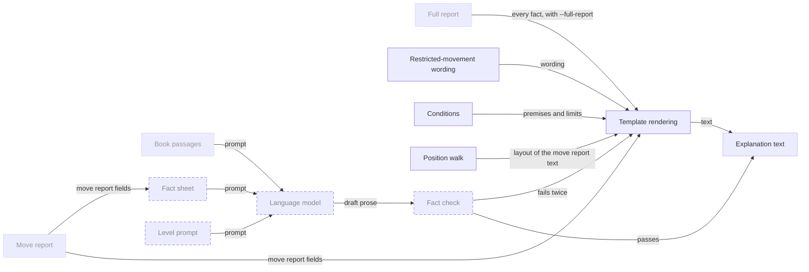

| Node | Meaning | Terms | Status |
|---|---|---|---|
| `MoveReport` | See Report | — | external |
| `ReportDocument` | See Report | — | external |
| `BookPassages` | See Reference knowledge | — | external |
| `RestrictedMovement` | Pins, overloaded defenders and tactical pins are all worded "restricted movement"; restricted means the piece cannot move in all the ways it otherwise could, not that it cannot move (Captain, 2026-10-22); how the piece is held ("at square e5", "along file e") is printed. The move report text prints a compact row naming every label of a merged motif ("relative pin; tactic: Ba7-f2 capture"); the full report text also prints the restricted and free moves (Captain, 2026-10-24; before, move report rows listed the moves too) | restricted movement, held to, restricted moves, free moves, motif repeats | implemented |
| `Conditions` | What a fact depends on, printed beside it: a threat line assumes the opponent passes, a parry by check only defers the threat, why no created threat was searched, how far a line was read and whether it stopped at a terminal draw or unsettled, why a move has no refutation, which engine and budget, how many legal moves were not judged (the terminal draw, unsettled walk and skipped refutation from 2026-10-25) | conditions, `creates_threat_skipped`, `walked_plies`, `legal_moves`, terminal draw, settled walk, `refutation_skipped` | implemented |
| `PositionWalk` | From 2026-10-25 (Captain): the move report text is laid out per move as a walk through the positions of its line: the move-level rows, then one position block per position (the position as a FEN, its evaluation, the root evaluation first and the line score after, the move played from it and its side, its tempo facts, the motifs present there as uses, then its other facts in impact order). Tempo facts: the root's and the move's tempo value in the first two blocks, a tempo gained in the block its move is played from, an initiative run in the block of its first ply (from 2026-10-25, R13; before: no tempo facts). Engine, budget and opening rows come first, always. Called `PlyWalk` from 2026-10-24 to 2026-10-25: a start block, then per walked ply the move followed by the position it reaches, tempo and initiative facts included (before that: the position facts in the header and each move's facts in one list) | position walk, position block, line score, `line_fens`, tempo value, tempo gained, initiative run | implemented |
| `TemplateRendering` | Fixed sentences filled from report fields, adding no claim; the output never says "candidate". Without `--full-report`: one block per move report, with their conditions and `SEE` for a capture's value; today's output, later the fallback. With `--full-report`: the full report text, every computed fact, always template text (before 2026-10-23: filled from the whole report, the only text) | template rendering, full report text | implemented |
| `FactSheet` | A compact text form of the report for the model; the core claims (verdict, refutation, conditions) at every level, tactic and blunder evidence first | fact sheet, fact selection | planned |
| `LevelPrompt` | Instructions for a beginner, club or advanced reader | level | planned |
| `LanguageModel` | A local model that turns the fact sheet into prose and decides no chess content | language model | planned |
| `FactCheck` | The prose split into claim units, each checked against report fields with its relations, not only its moves, squares and pieces (before 2026-10-22: names only); opening names and game counts must match exactly | fact check, claim unit | planned |
| `ExplanationText` | What the reader sees | explanation | partial |

### L2 · Fixtures and measurement (`Proof`)

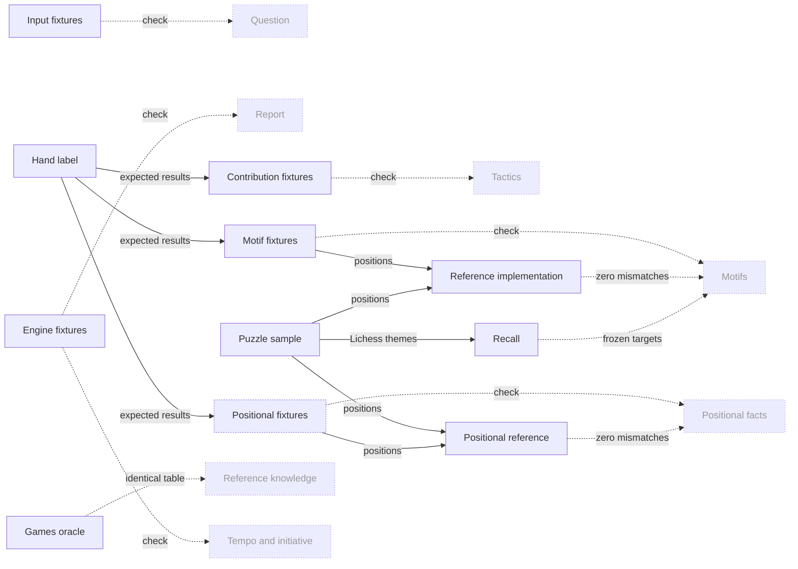

| Node | Meaning | Terms | Status |
|---|---|---|---|
| `Question` | See L1 | — | external |
| `Motifs` | See L1 | — | external |
| `Tactics` | See L1 | — | external |
| `Report` | See L1 | — | external |
| `HandLabel` | An expected result a person sets from the chess meaning, with a reason, before seeing what the rule says | hand label | implemented |
| `EngineFixtures` | Real and constructed positions with expected threats, urgency, verdicts and tactic judgements, run end to end with the engine | F fixtures, invariant check, re-blessing | implemented |
| `InputFixtures` | Opening names, PGN plies, move notation and input errors, without the engine | U, E, parse fixtures | implemented |
| `MotifFixtures` | Positions where a motif must or must not be reported | T fixtures, positive, near miss | implemented |
| `ContributionFixtures` | Tactic lines with each motif's expected contribution and the labels that must or must not appear | C fixtures | implemented |
| `ReferenceImplementation` | A second, plain implementation of the motif definitions; both must agree everywhere | reference implementation | implemented |
| `PuzzleSample` | Fixed samples of Lichess puzzles: one for tuning, one committed for testing | Lichess puzzle database, split | implemented |
| `Recall` | When Lichess names a theme, how often we find it for the solver: coverage of Lichess-tagged puzzles, not precision; held above frozen targets; the untagged firing rate is printed beside it | recall, target (metric), untagged firing rate | implemented |
| `Positional` | See L1 | — | external |
| `Reference` | See L1 | — | external |
| `Tempo` | See L1 | — | external |
| `PositionalFixtures` | Positions where a positional feature must or must not be reported, lines where a change must or must not be, and (planned, decided 2026-10-24) lines where a net change must pass or fail the use test and a passing change must not be a net change | P fixtures, use-test fixture, `positional_include` | partial |
| `PositionalReference` | A second, plain implementation of the positional definitions; both must agree on every puzzle board and every P fixture board | `positional_oracle` | implemented |
| `GamesOracle` | A second, independent counter that rebuilds the game-count table from the same games; both tables must be identical | `games_oracle` | implemented |

## Level 3

### L3 · Consequence class (`Consequence`)

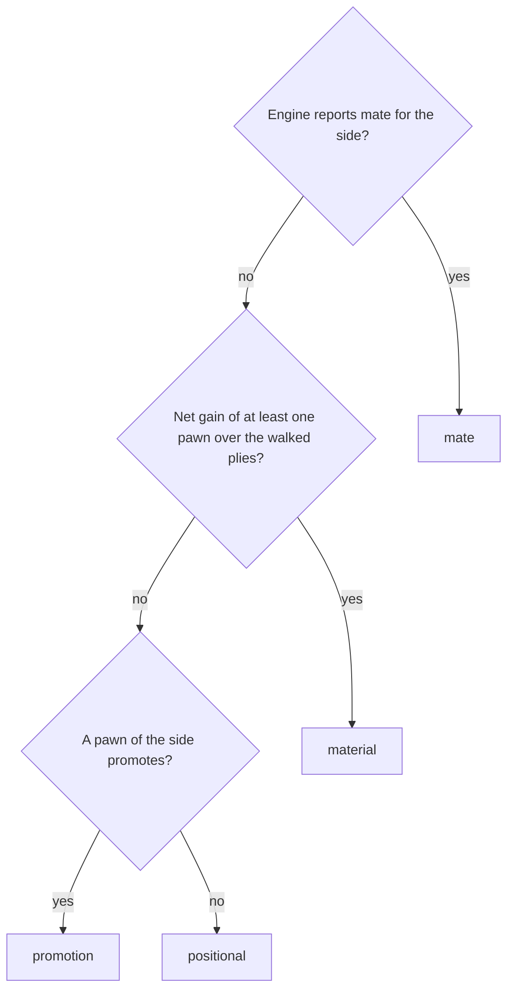

| Node | Meaning | Terms | Status |
|---|---|---|---|
| `CqMate` | Mate comes first and only from the engine's score | consequence class | implemented |
| `CqMaterial` | Captures along the walked plies, counted with the piece values | walked plies, piece values | implemented |
| `CqPromotion` | A promotion inside the walked plies | consequence class | implemented |
| `CqIsMate` | Rank 4 | rank | implemented |
| `CqIsMaterial` | Rank 3 from three pawns up, else rank 2 | rank | implemented |
| `CqIsPromotion` | Rank 1 | rank | implemented |
| `CqIsPositional` | Rank 0: only the evaluation changes | rank | implemented |

### L3 · Urgency rules (`Urgency`)

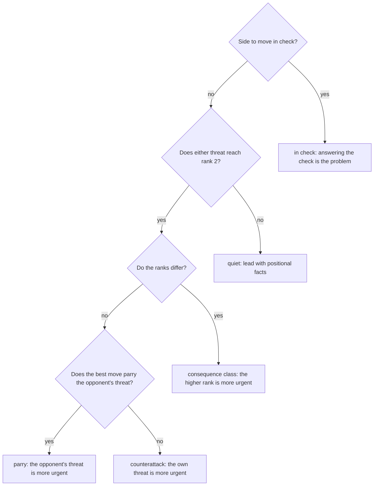

| Node | Meaning | Terms | Status |
|---|---|---|---|
| `UrInCheck` | Checked first: in check, the check is the problem | `in_check` | implemented |
| `UrQuiet` | Rank 2 means at least one pawn of material | rank, `quiet` | implemented |
| `UrRanks` | Compare the two threats' ranks | rank | implemented |
| `UrParry` | Equal ranks: "who is faster" decided by the parry test on the best move | parry test | implemented |
| `UrRuleInCheck` | Rule `in_check` | `in_check` | implemented |
| `UrRuleQuiet` | Rule `quiet`: no side is more urgent | `quiet` | implemented |
| `UrRuleClass` | Rule `consequence_class` | `consequence_class` | implemented |
| `UrRuleParry` | Rule `parry` | parry | implemented |
| `UrRuleCounter` | Rule `counterattack` | counterattack | implemented |

### L3 · Parry test (`ParryTest`)

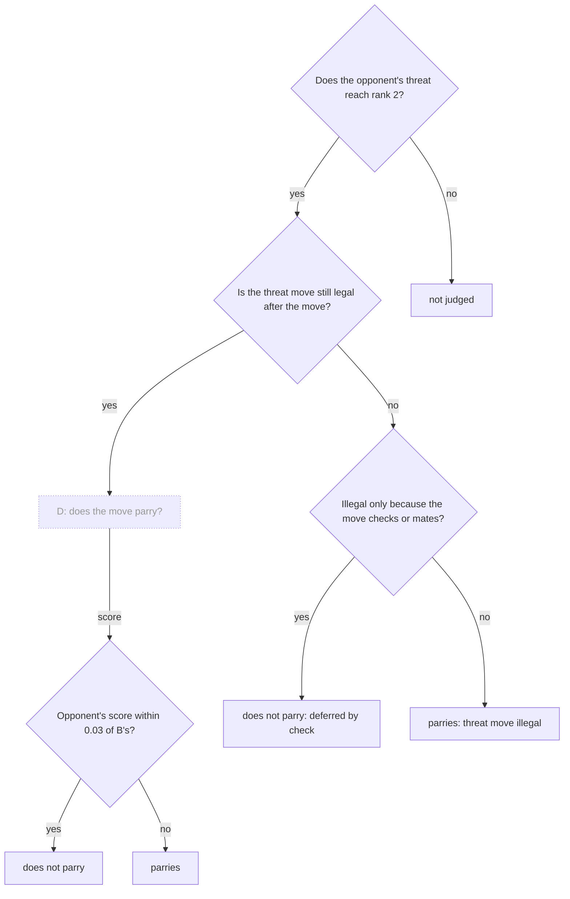

| Node | Meaning | Terms | Status |
|---|---|---|---|
| `SearchD` | See Engine searches | — | external |
| `PtRank` | Threats below one pawn of material are not tested | rank, `parries_threat` | implemented |
| `PtLegal` | A threat move that cannot be played is decided by rule, without search | parry test | implemented |
| `PtByCheck` | A check only postpones the threat | parry test | implemented |
| `PtWorks` | The threat still works if `O` keeps nearly all of B's score | parry test, ES | implemented |
| `PtNotJudged` | `parries_threat` is null | `parries_threat` | implemented |
| `PtDeferred` | Rule fact, test `deferred_by_check` | parry test, provenance | implemented |
| `PtIllegal` | Rule fact, test `threat_move_illegal` | parry test, provenance | implemented |
| `PtStillWorks` | Engine fact, test `searched` | parry test, provenance | implemented |
| `PtStopped` | Engine fact, test `searched` | parry test, provenance | implemented |

### L3 · Verdict (`Verdict`)

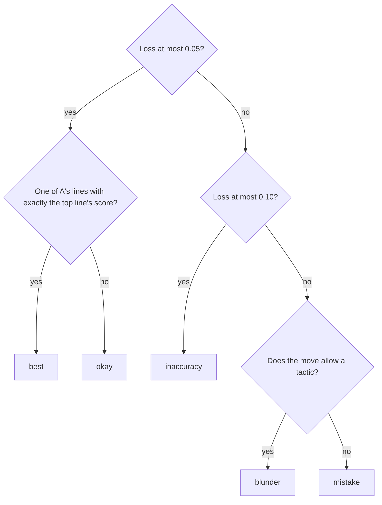

| Node | Meaning | Terms | Status |
|---|---|---|---|
| `VdPlayable` | Playable moves lose at most 0.05 expected score against the best | playable move, loss | implemented |
| `VdSameScore` | Same centipawns or same mate distance as the top line; the top line itself always passes; an asked move outside A never does | verdict | implemented |
| `VdBest` | The engine's best move, or tied with it exactly | verdict | implemented |
| `VdOkay` | Playable but scored below the best | verdict | implemented |
| `VdSmall` | Inaccuracies lose more than 0.05 and at most 0.10 (more than 0.03 and less than 0.13 before 2026-10-23) | verdict, loss | implemented |
| `VdInaccuracy` | Not playable, a small loss | verdict | implemented |
| `VdAllows` | Along the move's own line `S` loses at least a pawn net or is mated, counted from the analysed position | allows a tactic | implemented |
| `VdBlunder` | Loses more than 0.10 and allows a tactic (at least 0.27, from the loss alone, before 2026-10-23) | verdict | implemented |
| `VdMistake` | Loses more than 0.10 without allowing a tactic (from 0.13 to below 0.27 before 2026-10-23) | verdict | implemented |

### L3 · Opportunity judgement (`OpportunityJudgement`)

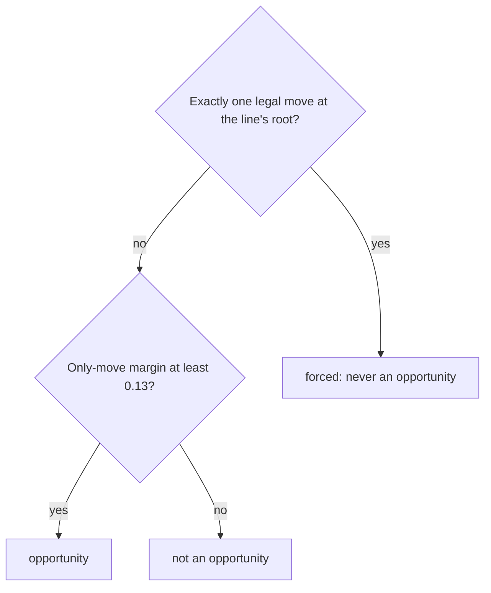

| Node | Meaning | Terms | Status |
|---|---|---|---|
| `TjForced` | A lone legal move has no alternative to compare with | forced | implemented |
| `TjMargin` | 0.13: every alternative is clearly worse. Its own constant from 2026-10-23; before, it was the mistake threshold | only-move margin, opportunity | implemented |
| `TjIsForced` | Rule fact; no alternative, no margin | forced (in the report) | implemented |
| `TjIsOpportunity` | Engine fact; the line is a tactic line and gets contributions and labels. Near a decided result scores flatten, so no line is an opportunity there. Called `TjIsTactic` before 2026-10-23 | opportunity, saturation limit | implemented |
| `TjNotOpportunity` | Engine fact; also the case when two moves win equally; the line can still be a tactic. Called `TjNotTactic` before 2026-10-23 | opportunity, two-winners limit | implemented |

### L3 · Contribution (`Contribution`)

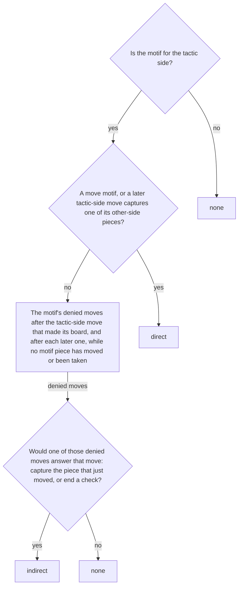

| Node | Meaning | Terms | Status |
|---|---|---|---|
| `CoSide` | Only the tactic side's motifs can help its tactic | contribution judgement, X | implemented |
| `CoDirect` | The tactic's own moves make the motif or take its pieces | contribution judgement, move motif | implemented |
| `CoDenied` | What the motif takes away from the defender: the held piece's restricted moves, or for a back-rank weakness the king's steps onto its own blockers' squares | denied move, restricted moves | implemented |
| `CoIndirect` | The motif takes away an answer the defender would have: a recapture, an escape, an interposition, a capture of the checker (before 2026-10-22: an other-side motif piece attacked where a later tactic-side move lands) | contribution judgement, answer | implemented |
| `CoOtherSide` | A motif of the other side | `contribution` | implemented |
| `CoIsDirect` | Direct contribution | `contribution` | implemented |
| `CoIsIndirect` | Indirect contribution | `contribution` | implemented |
| `CoNotUsed` | The tactic works without it: without the motif the defender gains no answer (Captain, 2026-10-22; before: no landing-square attack) | `contribution` | implemented |

### L3 · Tactical pin (`TacticalPin`)

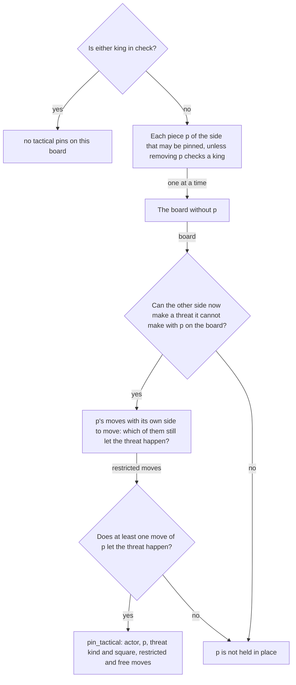

| Node | Meaning | Terms | Status |
|---|---|---|---|
| `TpKings` | Not computed while a king is in check | `pin_tactical`, `in_check` | implemented |
| `TpPiece` | Candidates for being held in place, including a piece that guards an empty square | `pin_tactical` | implemented |
| `TpRemove` | Ask what changes if p were gone | `pin_tactical` | implemented |
| `TpNewThreat` | Threats: fork, skewer, discovered check or attack, double check, back-rank mate, promotion, mate, or winning a piece by static exchange | move motif, SEE | implemented |
| `TpNone` | Nothing reported | `pin_tactical` | implemented |
| `TpMoves` | A move of p is restricted when the threat still works after it; the others are free. A pawn p also has a capture onto each square diagonally in front of it (since 2026-10-22) | restricted moves, free moves, move set, hypothetical capture | implemented |
| `TpAnyRestricted` | A piece with no move, or whose every move closes the threat, is not held in place by it (existence condition); a pawn's diagonal captures count even onto an empty square | existence condition, hypothetical capture | implemented |
| `TpFound` | Reported as a state motif, with the threat's kind and square and its restricted and free moves | `pin_tactical`, `threat`, `restriction` | implemented |
| `TpFree` | Nothing reported for p, also when no move of p is restricted | `pin_tactical` | implemented |

### L3 · Fact check (`FactCheck`)

```mermaid
flowchart TD
    FcClaims["Split the prose into claim units"]
    FcSupported{"Does every claim unit match report fields, relations included?"}
    FcFirstFailure{"First failure?"}
    FcRegenerate["Generate the prose again"]
    FcPass["Show the prose"]
    TemplateRendering["Template rendering"]
    FcClaims -->|claim units| FcSupported
    FcSupported -->|yes| FcPass
    FcSupported -->|no| FcFirstFailure
    FcFirstFailure -->|yes| FcRegenerate
    FcRegenerate -->|new prose| FcClaims
    FcFirstFailure -->|no| TemplateRendering
    classDef planned stroke-dasharray:6 4,color:#888
    classDef partial stroke-dasharray:2 2
    classDef external stroke-dasharray:1 3,color:#999
    class TemplateRendering external
    class FcClaims,FcSupported,FcFirstFailure,FcRegenerate,FcPass planned
```

| Node | Meaning | Terms | Status |
|---|---|---|---|
| `TemplateRendering` | See Explanation; shown with a notice that the prose failed | — | external |
| `FcClaims` | Each unit is one fact or one relation (who threatens what, at which ply, under which condition), so a wrong relation between correct words is caught | claim unit, fact check | planned |
| `FcSupported` | Every unit must match report fields, including the relations between them, not only the moves, squares, pieces, opening names and game counts it names (before 2026-10-22: names only). Moves quoted from books refer to other games and are marked so they are not checked against the position | fact check, book passage, claim unit | planned |
| `FcFirstFailure` | One retry only | fact check | planned |
| `FcRegenerate` | A second attempt from the same fact sheet | fact check, fact sheet | planned |
| `FcPass` | The checked prose is the explanation | explanation | planned |

### L3 · Change along a line (`PositionalChange`)

```mermaid
flowchart TD
    PcBoards["Boards of the line: the start, then one per ply up to the walked plies"]
    PcFeatures["Positional features of each board"]
    PcCompare{"Is a feature with the same identity on the board before?"}
    PcAppears["Appears at this ply"]
    PcDisappears["Disappears at this ply"]
    PcSame["No change, even if its pieces or value moved"]
    PcEnd{"Still so on the last board?"}
    PcHolds["Holds at the end"]
    PcUndone["Undone by the end"]
    PcBoards --> PcFeatures --> PcCompare
    PcCompare -->|only on this board| PcAppears
    PcCompare -->|only on the board before| PcDisappears
    PcCompare -->|on both| PcSame
    PcAppears & PcDisappears --> PcEnd
    PcEnd -->|yes| PcHolds
    PcEnd -->|no| PcUndone
    classDef planned stroke-dasharray:6 4,color:#888
    classDef partial stroke-dasharray:2 2
    classDef external stroke-dasharray:1 3,color:#999
```

| Node | Meaning | Terms | Status |
|---|---|---|---|
| `PcBoards` | The boards a line passes through, as far as the walked plies reach | walked plies | implemented |
| `PcFeatures` | Every positional feature on each of those boards, for both sides | positional feature | implemented |
| `PcCompare` | Compares each ply's features with the ply before by identity | feature identity | implemented |
| `PcAppears` | A feature that was not there one ply earlier | positional change | implemented |
| `PcDisappears` | A feature that is gone one ply later | positional change | implemented |
| `PcSame` | The same feature on both boards, even if its pieces or value differ (a lead that grows). Where the identity holds the number (pawn islands, material ahead), a new number is a disappearance plus an appearance | feature identity | implemented |
| `PcEnd` | Looks at the last walked board | `holds_at_end` | implemented |
| `PcHolds` | The change survives the line | `holds_at_end` | implemented |
| `PcUndone` | The change is reversed before the line ends | `holds_at_end` | implemented |

### L3 · Use test (`UseTest`)

```mermaid
flowchart TD
    UtMate{"Does the walk end in checkmate?"}
    UtContext{"Lost by castling, material changed hands, attacker gone, or the king moved away?"}
    UtKind{"Which kind of fact?"}
    UtLead{"Tempo-dependent position?"}
    UtCastle{"King-file fact of a king that can still castle?"}
    UtOwn{"Made at ply 1 or 2?"}
    UtUsed{"Used later in the walk?"}
    UtPressed{"Is the king pressed?"}
    UtWitness{"Is the king pressed on the changed file?"}
    UtKeep["Kept in the move report"]
    UtCut["Full report only"]
    UtMate -->|yes| UtCut
    UtMate -->|no| UtContext
    UtContext -->|yes| UtCut
    UtContext -->|no| UtKind
    UtKind -->|material, exchange, bishop pair, seventh rank, outpost, bad bishop| UtKeep
    UtKind -->|pawn islands, pawn chain| UtCut
    UtKind -->|mobility, space or development lead| UtLead
    UtKind -->|other| UtCastle
    UtLead -->|yes| UtKeep
    UtLead -->|no| UtCut
    UtCastle -->|yes| UtPressed
    UtCastle -->|no| UtOwn
    UtOwn -->|yes, not a king zone attacker| UtKeep
    UtOwn -->|no| UtUsed
    UtUsed -->|yes| UtKeep
    UtUsed -->|no| UtCut
    UtPressed -->|yes| UtWitness
    UtPressed -->|no| UtCut
    UtWitness -->|yes| UtKeep
    UtWitness -->|no| UtCut
    classDef planned stroke-dasharray:6 4,color:#888
    classDef partial stroke-dasharray:2 2
    classDef external stroke-dasharray:1 3,color:#999
```

| Node | Meaning | Terms | Status |
|---|---|---|---|
| `UtMate` | A walk that ends in mate needs no positional facts | use test | implemented |
| `UtContext` | The change only records something else: castling rights lost by castling, material that changed hands while some side is still ahead at the end, a king zone attacker that left, a king-file fact of a king that stands elsewhere at the end | use test, superseded change | implemented |
| `UtKind` | Material, the exchange, the bishop pair, a rook on the seventh, an outpost and a bad bishop always count; pawn islands and pawn chains never do | use test, static fact | implemented |
| `UtLead` | A lead in mobility, space or development counts only in a tempo-dependent position | tempo-dependent position, dynamic fact | implemented |
| `UtCastle` | While the king can still castle, a gap or open file next to it counts only if the king is pressed | king files, king pressed | implemented |
| `UtOwn` | The move or its reply made the change (weak pawns, passed pawns, castling rights, king files, rook files) | use test | implemented |
| `UtUsed` | Weak pawn attacked at the end or captured, or won; passed pawn advanced, or gone by moving or capture; rook moved along its file; castling rights and king zone attackers: the king is pressed; king files: the king is pressed on the changed file (from 2026-10-25; before: the king is pressed) | use test, king pressed, shelter witness | implemented |
| `UtPressed` | From the change's ply on, the opponent checks or captures next to the king, or at the end two of its pieces attack the king's zone | king pressed | implemented |
| `UtWitness` | For a king-file fact: the check, the capture or the end-of-walk attack lands on or passes through a square of the changed file next to the king; a check from elsewhere does not count | shelter witness | implemented |
| `UtKeep` | The change is in use and enters the move report | `in_use` | implemented |
| `UtCut` | The change stays in the full report only | `in_use` | implemented |

### L3 · Ply label (`PlyLabel`)

```mermaid
flowchart TD
    PlFirst{"Was the ply before a threatening move?"}
    PlStops{"Does this ply stop that threat?"}
    PlOwn{"Is this ply a threatening move?"}
    PlCounter{"Is this ply a threatening move?"}
    PlThreatening["Threatening"]
    PlNeither["Neither"]
    PlCounterThreat["Counter-threat: the tempo goes back"]
    PlPure["Pure reply: the ply before gained a tempo"]
    PlGains{"Does the reply keep a gain after the exchange settles?"}
    PlForced{"Was the reply forced?"}
    PlGaining["Gaining reply"]
    PlUnforced["Unforced reply"]
    PlUnresolved["Unresolved reply"]
    PlFirst -->|no, or ply 1| PlOwn
    PlFirst -->|yes| PlStops
    PlStops -->|no| PlOwn
    PlStops -->|yes| PlCounter
    PlOwn -->|yes| PlThreatening
    PlOwn -->|no| PlNeither
    PlCounter -->|yes| PlCounterThreat
    PlCounter -->|no| PlGains
    PlGains -->|yes| PlGaining
    PlGains -->|unknown| PlUnresolved
    PlGains -->|no| PlForced
    PlForced -->|yes| PlPure
    PlForced -->|no| PlUnforced
    PlForced -->|unknown| PlUnresolved
    classDef planned stroke-dasharray:6 4,color:#888
    classDef partial stroke-dasharray:2 2
    classDef external stroke-dasharray:1 3,color:#999
```

| Node | Meaning | Terms | Status |
|---|---|---|---|
| `PlFirst` | Only a ply answering a threatening move can be a reply | threatening move | implemented |
| `PlStops` | The reply search: the threatening side's best line after this ply stays below rank 2 | reply search, rank | implemented |
| `PlOwn` | The threat search (or E on ply 1, or a check) | threat search, threatening move | implemented |
| `PlCounter` | Same test as `PlOwn`, for a ply that stopped the threat | threat search, counter-threat | implemented |
| `PlThreatening` | A threatening move that answers no threat, or answers one without stopping it | threatening move, ply label | implemented |
| `PlNeither` | No threat made, none stopped | ply label | implemented |
| `PlCounterThreat` | Stops the threat and threatens back | counter-threat | implemented |
| `PlPure` | Stops the threat, threatens nothing, keeps no gain and was forced: the threatening ply gained a tempo. Before 2026-10-25: any reply that stops the threat and threatens nothing | pure reply, tempo gained | implemented |
| `PlGains` | The reply gain, to the settle point after the reply: at least a pawn or mate; unknown when the walk ends before the exchange settles | reply gain, settle point | implemented |
| `PlForced` | The forced test: every acceptable reply stops the threat too; unknown when all five searched lines are acceptable and all stop it | forced test, acceptable reply | implemented |
| `PlGaining` | Stops the threat and keeps a gain: no tempo for the threatening ply | gaining reply | implemented |
| `PlUnforced` | Stops the threat, gains nothing, but another acceptable reply would have left it: no tempo | unforced reply | implemented |
| `PlUnresolved` | The gain or the forced test is unknown: no tempo | unresolved reply | implemented |

### L3 · Game-count table (`GameTable`)

```mermaid
flowchart TD
    GtGame["A game from the broadcast months"]
    GtStandard{"Standard chess from the usual start?"}
    GtRating{"Both players rated at the rating floor or above?"}
    GtResult{"Finished with a result?"}
    GtLegal{"Every move legal up to the ply limit?"}
    GtExcluded["Excluded, counted by reason"]
    GtCount["Each position up to the ply limit counted once, with the move played and the result"]
    GtKeep{"Reached in at least the minimum game count?"}
    GtRow["Table row: games, results, every move with its count"]
    GtDropped["Left out of the table"]
    GtGame --> GtStandard
    GtStandard -->|yes| GtRating
    GtRating -->|yes| GtResult
    GtResult -->|yes| GtLegal
    GtLegal -->|yes| GtCount
    GtStandard & GtRating & GtResult & GtLegal -->|no| GtExcluded
    GtCount --> GtKeep
    GtKeep -->|yes| GtRow
    GtKeep -->|no| GtDropped
    classDef planned stroke-dasharray:6 4,color:#888
    classDef partial stroke-dasharray:2 2
    classDef external stroke-dasharray:1 3,color:#999
```

| Node | Meaning | Terms | Status |
|---|---|---|---|
| `GtGame` | One game of the pinned monthly files | broadcast month | implemented |
| `GtStandard` | No variant and no custom start position | excluded game | implemented |
| `GtRating` | Both players have a rating, at 2200 or above | rating floor | implemented |
| `GtResult` | A win, a loss or a draw, not an unfinished game | excluded game | implemented |
| `GtLegal` | The moves read so far replay legally; moves after the ply limit are never read | broken game, ply limit | implemented |
| `GtExcluded` | The game adds nothing; its reason is counted in the table's header | excluded game | implemented |
| `GtCount` | A position repeated within one game counts once | game counts | implemented |
| `GtKeep` | Rare positions are left out to keep the table small | minimum game count | implemented |
| `GtRow` | The row the report reads for the analysed position | game-count table | implemented |
| `GtDropped` | Too rare to be kept; the report says the position is not in the table | minimum game count | implemented |
