# ChessWhy — Concepts

The map of ChessWhy's ideas, from the whole project (L1) down to single rules (L3). It
holds no code: [CODE.md](CODE.md) says where each idea lives in the source. Every word on
a node is defined in [DEFINITIONS.md](DEFINITIONS.md); [TESTS.md](TESTS.md) and
[FIXTURES.md](FIXTURES.md) name the nodes each test and fixture checks.

ChessWhy is a DBC project (Driven by Concepts): the Captain leads it through this map. A
change she makes to a diagram is a directive; the orchestrator turns it into plans and
code, then brings the map back in line with what was built.

**Status:** first draft by the Deputy, 2026-10-21, for the Captain to correct.

## How to read the diagrams

- **Levels.** L1 shows the whole project. Every L1 node has its own L2 diagram. An L2 node
  gets an L3 diagram only when it is a rule with steps worth seeing.
- **Arrows.** In L1 and L2 an arrow means information flows that way; its label says what
  flows. A dotted arrow means one node checks or limits another; nothing flows. In L3 the
  arrows are the steps of a rule, labelled with the answer to the question in the diamond.
- **Status.** Each diagram has a node table. `implemented`: solid border. `partial`: short
  dashes, some parts exist. `planned`: long dashes, nothing built yet. `external`: dotted
  grey, a node that belongs to another diagram and is shown only for context.
- **Node IDs.** Each ID is unique in this file. Use them to point at a node, for example
  "split `Urgency`".
- **Checking.** `python3 tools/check_dbc.py` checks that the diagrams, tables, terms, code
  references, tests and fixtures still agree.

## L1 · ChessWhy

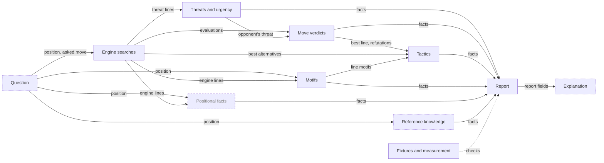

| Node | Meaning | Terms | Status |
|---|---|---|---|
| `Question` | What the user asks: a position, optionally one move to judge, with a budget and an audience level | FEN, asked move, budget, level | partial |
| `Searches` | Stockfish searches with fixed node budgets; the only source of evaluations and lines | A, null move, ES | implemented |
| `Threats` | What each side would do if it were its move, what that achieves, and which threat matters more | threat, consequence, urgency | implemented |
| `Verdicts` | How much each candidate or asked move loses against the best, and why: parry, new threat, refutation | verdict, loss, fine set | implemented |
| `Motifs` | Patterns on the board, found by rules, on the position and along engine lines; they claim no gain | motif | implemented |
| `Tactics` | Whether a line wins against the best alternative, and which motifs and labels make it work | tactic, contribution judgement, tactic label | implemented |
| `Positional` | Pawn structure, king safety, piece activity and other lasting features, reported as changes along lines | positional fact | planned |
| `Reference` | Knowledge from outside the engine: opening names, game counts, book passages | provenance, opening name, game counts, book passage | partial |
| `Report` | The one document holding every fact, each with its provenance; nothing is claimed outside it | report, provenance, facts first | implemented |
| `Explanation` | The words a reader gets: template text today, language-model prose checked against the report later | explanation, template rendering | partial |
| `Proof` | Fixtures and measurements that show the facts are right | fixture, recall | implemented |

## Level 2

### L2 · Question (`Question`)

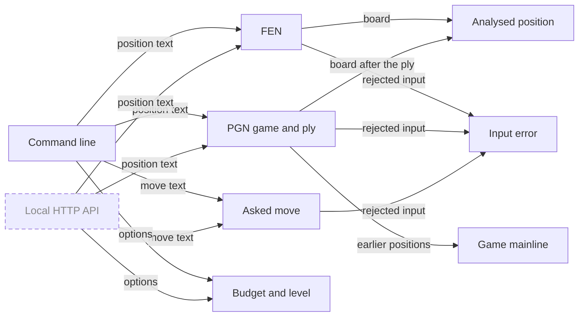

| Node | Meaning | Terms | Status |
|---|---|---|---|
| `CommandLine` | `chesswhy` with flags: the way a question arrives today | command line | implemented |
| `LocalApi` | The same question as JSON over HTTP on this machine only, with engine and model kept loaded | local HTTP API | planned |
| `FenInput` | A position as one FEN string, checked for legality | FEN | implemented |
| `PgnInput` | A game from a PGN file, mainline only, and the ply to stop at | PGN, ply | implemented |
| `AskedMove` | The move the user asks about, in SAN or UCI, legal in the position | asked move, SAN | implemented |
| `Settings` | Search budget (quick, standard, deep) and audience level; the level does not change the analysis | budget, level | implemented |
| `AnalysedPosition` | The board every fact is about, with side to move `S` and opponent `O` | analysed position, S | implemented |
| `GameMainline` | The positions of a PGN game from its start to the analysed one, used to name the last opening reached | game mainline | implemented |
| `InputError` | Input that cannot be used stops with one clear message, an input-error exit code and no report | input error | implemented |

### L2 · Engine searches (`Searches`)

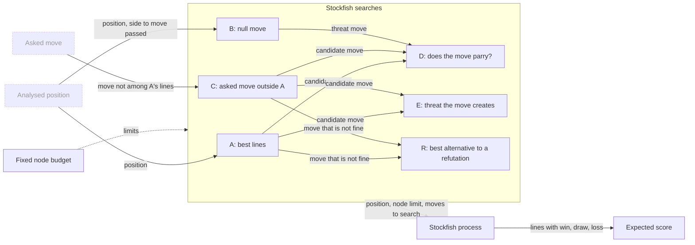

| Node | Meaning | Terms | Status |
|---|---|---|---|
| `AnalysedPosition` | See Question | — | external |
| `AskedMove` | See Question | — | external |
| `NodeBudget` | Every search stops after a fixed number of nodes, one thread, fixed hash: the same input gives the same report | budget, nodes, reproducible | implemented |
| `SearchA` | The five best moves from the position, each with its line; the first line is `S`'s threat | A, MultiPV K, PV | implemented |
| `SearchB` | `S` passes; what `O` would play is `O`'s threat. Skipped when `S` is in check | B, null move | implemented |
| `SearchC` | Search restricted to the asked move when it is not among A's five | C | implemented |
| `SearchD` | After a move, `O` must play its threat move: does the threat still work? | D | implemented |
| `SearchE` | After a move, `S` moves again: which threat the move created | E | implemented |
| `SearchR` | After a move that is not fine, `O`'s best move other than the refutation, to judge the refutation as a tactic | R | implemented |
| `StockfishProcess` | Stockfish runs as a separate program and answers over UCI; each line's first move is kept once | UCI, MultiPV K | implemented |
| `ExpectedScore` | Win/draw/loss turned into one score from 0 to 1; every threshold uses it, never centipawns | WDL, ES, es_units | implemented |

### L2 · Threats and urgency (`Threats`)

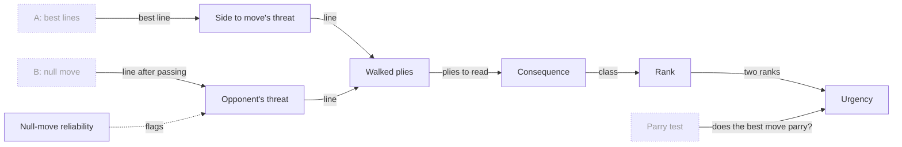

| Node | Meaning | Terms | Status |
|---|---|---|---|
| `SearchA` | See Engine searches | — | external |
| `SearchB` | See Engine searches | — | external |
| `ParryTest` | See Move verdicts | — | external |
| `SideThreat` | What `S` would do with its move: A's best line | threat, S | implemented |
| `OpponentThreat` | What `O` would do if it were its move: B's line. "White's biggest problem" is Black's threat | threat, O | implemented |
| `NullMoveReliable` | Passing misleads when `S` has almost no pieces (zugzwang); the report says so | `null_move_reliable` | implemented |
| `WalkedPlies` | How far a line is read: six plies, then on while captures continue, at most ten | walked plies | implemented |
| `Consequence` | What a line achieves for the side playing it: mate, material, promotion or only position | consequence, consequence class | implemented |
| `ConsequenceRank` | The consequence as a number, so two threats can be compared | rank | implemented |
| `Urgency` | Which side's threat matters more now, and by which rule | urgency | implemented |

### L2 · Move verdicts (`Verdicts`)

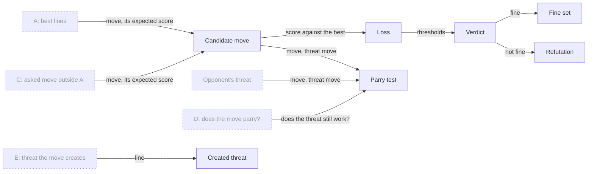

| Node | Meaning | Terms | Status |
|---|---|---|---|
| `SearchA` | See Engine searches | — | external |
| `SearchC` | See Engine searches | — | external |
| `SearchD` | See Engine searches | — | external |
| `SearchE` | See Engine searches | — | external |
| `OpponentThreat` | See Threats and urgency | — | external |
| `CandidateMove` | A move being judged: one of A's five, or the asked move | candidates, asked move | implemented |
| `Loss` | How much expected score the move gives up against the best move | loss | implemented |
| `Verdict` | fine, inaccuracy, mistake or blunder, from the loss | verdict, fine | implemented |
| `FineSet` | Every fine move: the answer to "what can I play here?" | fine set, `fine_truncated` | implemented |
| `ParryTest` | Does the move stop `O`'s threat? | parry test, `parries_threat` | implemented |
| `CreatedThreat` | The threat the move creates, from E; none when the move gives check | `creates_threat` | implemented |
| `Refutation` | For a move that is not fine: `O`'s best reply line, read like a threat | refutation | implemented |

### L2 · Motifs (`Motifs`)

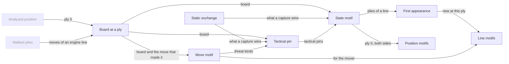

| Node | Meaning | Terms | Status |
|---|---|---|---|
| `AnalysedPosition` | See Question | — | external |
| `WalkedPlies` | See Threats and urgency | — | external |
| `BoardAtPly` | One board: the position itself, or the board after k moves of a line | ply, line | implemented |
| `StaticExchange` | Net material a side wins by the best capture sequence on one square, without search | SEE, piece values | implemented |
| `StateMotif` | A pattern of the board alone, for both sides: hanging piece, pins, back-rank weakness, overloaded defender, trapped piece, tactical pin | state motif, motif tag | implemented |
| `MoveMotif` | A pattern that also needs the move that made the board: fork, skewer, discovered check or attack, double check, back-rank mate, promotion | move motif, motif tag | implemented |
| `TacticalPin` | A piece held in place because removing it would let the other side make a threat | `pin_tactical` | implemented |
| `FirstAppearance` | Inside a line, a state motif is listed only at the ply where it first holds | first-appearance rule, motif instance | implemented |
| `PositionMotifs` | State motifs of the analysed position, both sides | position motifs | implemented |
| `LineMotifs` | Motifs along a threat, refutation or move line | line motifs | implemented |

### L2 · Tactics (`Tactics`)

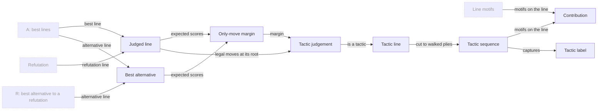

| Node | Meaning | Terms | Status |
|---|---|---|---|
| `SearchA` | See Engine searches | — | external |
| `SearchR` | See Engine searches | — | external |
| `Refutation` | See Move verdicts | — | external |
| `LineMotifs` | See Motifs | — | external |
| `JudgedLine` | A line that gets a tactic judgement: the best move's line and every refutation | judged line | implemented |
| `BestAlternative` | The move the line is compared with: A's second line, or R's line for a refutation | best alternative | implemented |
| `OnlyMoveMargin` | How much better the line scores than the best alternative | only-move margin | implemented |
| `TacticJudgement` | Forced, a tactic, or neither | tactic judgement, tactic, forced | implemented |
| `TacticLine` | A judged line that is a tactic; only these get contributions and labels | tactic line | implemented |
| `TacticSequence` | The tactic line cut to its walked plies: the moves contributions and labels read | tactic sequence | implemented |
| `Contribution` | Each motif's role in the tactic: direct, indirect or none | contribution judgement | implemented |
| `TacticLabel` | A fact about the whole tactic line that reads later moves, so it is not a motif: `removal_of_defender` | tactic label, `removal_of_defender` | implemented |

### L2 · Positional facts (`Positional`)

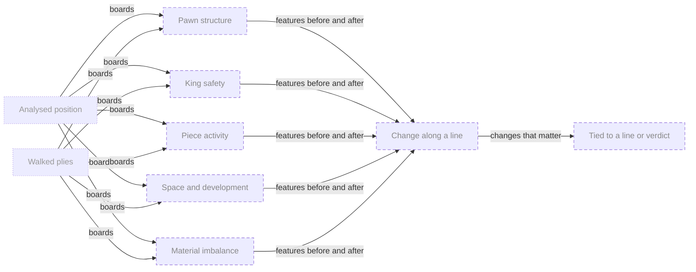

| Node | Meaning | Terms | Status |
|---|---|---|---|
| `AnalysedPosition` | See Question | — | external |
| `WalkedPlies` | See Threats and urgency | — | external |
| `PawnStructure` | Isolated, doubled, backward, passed and connected pawns, islands, chains, named structures | positional fact | planned |
| `KingSafety` | Pawn shield, open files toward the king, attackers near it, castling rights | positional fact | planned |
| `PieceActivity` | Mobility, outposts, bad bishop, bishop pair, rooks on open files or the seventh rank | positional fact | planned |
| `SpaceDevelopment` | Space and development lead | positional fact | planned |
| `MaterialImbalance` | Which pieces each side has, beyond the material count | positional fact | planned |
| `PositionalChange` | A feature that appears or disappears along a line | positional fact | planned |
| `TiedToLine` | A positional fact enters the explanation only when a line or verdict changes it | positional fact | planned |

### L2 · Reference knowledge (`Reference`)

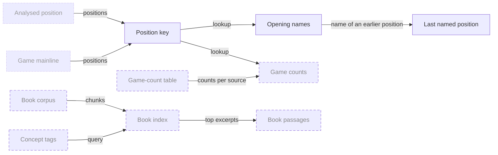

| Node | Meaning | Terms | Status |
|---|---|---|---|
| `AnalysedPosition` | See Question | — | external |
| `GameMainline` | See Question | — | external |
| `PositionKey` | Placement, side to move, castling and a usable en-passant square, so transpositions match | position key | implemented |
| `OpeningNames` | The name and ECO code of a named position; never guessed for an unnamed one | opening name | implemented |
| `LastNamed` | For a game: the last named position on the mainline, up to and including the analysed one | last named position | implemented |
| `GameTable` | Position-to-move counts built offline from pinned game collections, each source kept apart | game-count table | planned |
| `GameCounts` | How often players chose each move, per source and platform; never a judgement of the move | game counts | planned |
| `BookCorpus` | The Captain's local books as text, kept out of the repository | book corpus | planned |
| `BookIndex` | A search index over book chunks | book index | planned |
| `ConceptTags` | The report's motif and positional tags, widened by a keyword map, used as the book query | concept tag | planned |
| `BookPassages` | One to three short excerpts, cited by book and page, offered as general advice | book passage | planned |

### L2 · Report (`Report`)

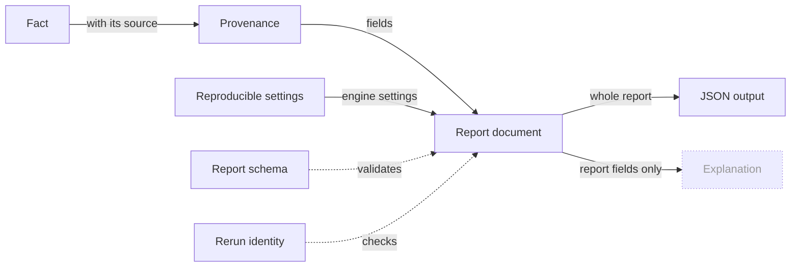

| Node | Meaning | Terms | Status |
|---|---|---|---|
| `Fact` | One claim about the position, computed before any words are written | fact | implemented |
| `Provenance` | Where a fact comes from: engine search, board rule, reference material or game counts | provenance | implemented |
| `Reproducible` | The settings that make a report repeat exactly, recorded in the report | reproducible | implemented |
| `ReportDocument` | The JSON document of one question; the only place chess claims live | report, facts first | implemented |
| `ReportSchema` | The versioned JSON Schema every report must satisfy | report schema | implemented |
| `RerunIdentity` | Two fresh runs on the same input give the same bytes | rerun identity | implemented |
| `JsonOutput` | The report printed as it is, for programs and for checking | JSON output | implemented |
| `Explanation` | See L1 | — | external |

### L2 · Explanation (`Explanation`)

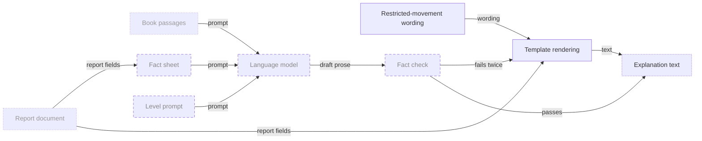

| Node | Meaning | Terms | Status |
|---|---|---|---|
| `ReportDocument` | See Report | — | external |
| `BookPassages` | See Reference knowledge | — | external |
| `RestrictedMovement` | Pins, overloaded defenders and tactical pins are all worded "restricted movement" | restricted movement | implemented |
| `TemplateRendering` | Fixed sentences filled from report fields; adds no claim. Today's output, later the fallback | template rendering | implemented |
| `FactSheet` | A compact text form of the report for the model | fact sheet | planned |
| `LevelPrompt` | Instructions for a beginner, club or advanced reader | level | planned |
| `LanguageModel` | A local model that turns the fact sheet into prose and decides no chess content | language model | planned |
| `FactCheck` | Every move, square and piece the prose mentions must be in the report; opening names and game counts must match it exactly | fact check | planned |
| `ExplanationText` | What the reader sees | explanation | partial |

### L2 · Fixtures and measurement (`Proof`)

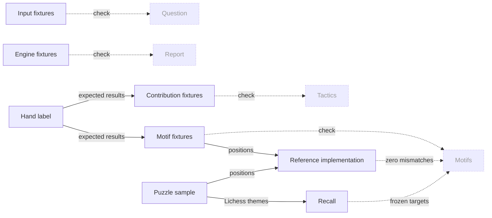

| Node | Meaning | Terms | Status |
|---|---|---|---|
| `Question` | See L1 | — | external |
| `Motifs` | See L1 | — | external |
| `Tactics` | See L1 | — | external |
| `Report` | See L1 | — | external |
| `HandLabel` | An expected result a person sets from the chess meaning, with a reason, before seeing what the rule says | hand label | implemented |
| `EngineFixtures` | Real and constructed positions with expected threats, urgency, verdicts and tactic judgements, run end to end with the engine | F fixtures, invariant check, re-blessing | implemented |
| `InputFixtures` | Opening names, PGN plies, move notation and input errors, without the engine | U, E, parse fixtures | implemented |
| `MotifFixtures` | Positions where a motif must or must not be reported | T fixtures, positive, near miss | implemented |
| `ContributionFixtures` | Tactic lines with each motif's expected contribution and the labels that must or must not appear | C fixtures | implemented |
| `ReferenceImplementation` | A second, plain implementation of the motif definitions; both must agree everywhere | reference implementation | implemented |
| `PuzzleSample` | Fixed samples of Lichess puzzles: one for tuning, one committed for testing | Lichess puzzle database, split | implemented |
| `Recall` | When Lichess names a theme, how often we find it for the solver; held above frozen targets | recall, target (metric) | implemented |

## Level 3

### L3 · Consequence class (`Consequence`)

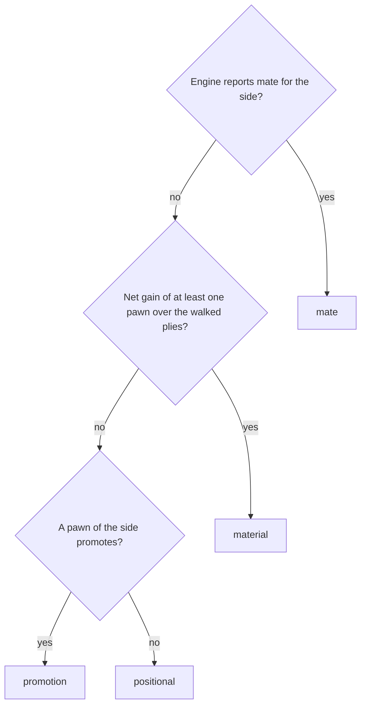

| Node | Meaning | Terms | Status |
|---|---|---|---|
| `CqMate` | Mate comes first and only from the engine's score | consequence class | implemented |
| `CqMaterial` | Captures along the walked plies, counted with the piece values | walked plies, piece values | implemented |
| `CqPromotion` | A promotion inside the walked plies | consequence class | implemented |
| `CqIsMate` | Rank 4 | rank | implemented |
| `CqIsMaterial` | Rank 3 from three pawns up, else rank 2 | rank | implemented |
| `CqIsPromotion` | Rank 1 | rank | implemented |
| `CqIsPositional` | Rank 0: only the evaluation changes | rank | implemented |

### L3 · Urgency rules (`Urgency`)

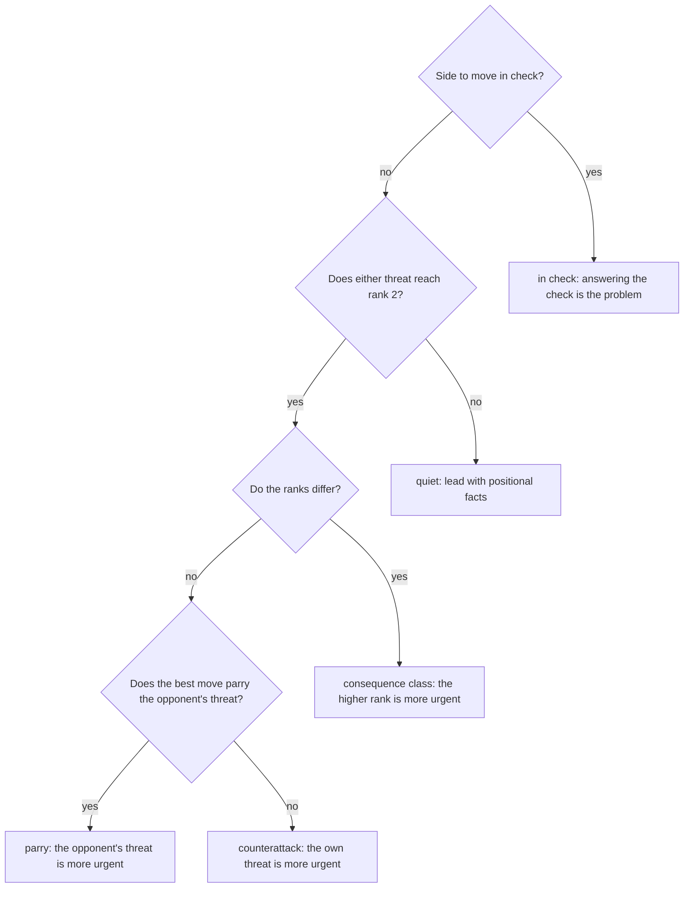

| Node | Meaning | Terms | Status |
|---|---|---|---|
| `UrInCheck` | Checked first: in check, the check is the problem | `in_check` | implemented |
| `UrQuiet` | Rank 2 means at least one pawn of material | rank, `quiet` | implemented |
| `UrRanks` | Compare the two threats' ranks | rank | implemented |
| `UrParry` | Equal ranks: "who is faster" decided by the parry test on the best move | parry test | implemented |
| `UrRuleInCheck` | Rule `in_check` | `in_check` | implemented |
| `UrRuleQuiet` | Rule `quiet`: no side is more urgent | `quiet` | implemented |
| `UrRuleClass` | Rule `consequence_class` | `consequence_class` | implemented |
| `UrRuleParry` | Rule `parry` | parry | implemented |
| `UrRuleCounter` | Rule `counterattack` | counterattack | implemented |

### L3 · Parry test (`ParryTest`)

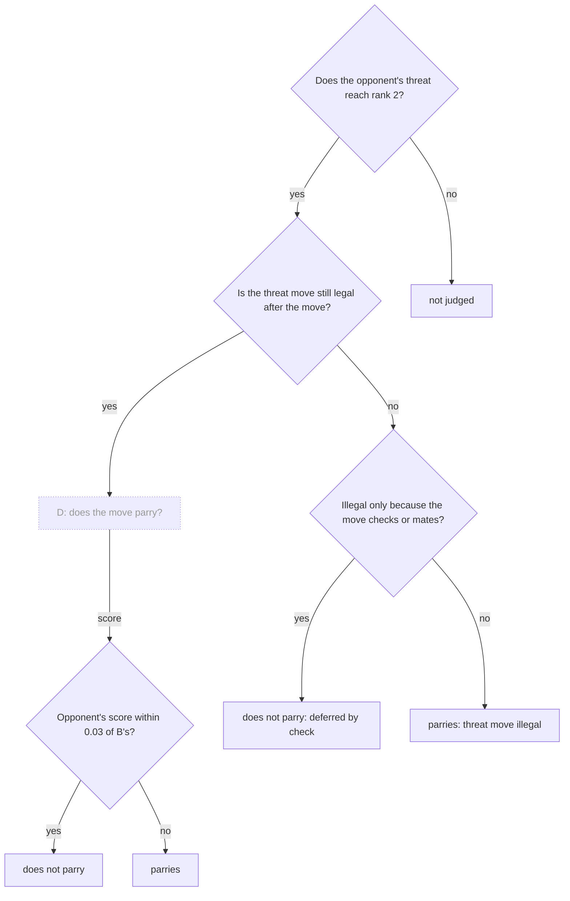

| Node | Meaning | Terms | Status |
|---|---|---|---|
| `SearchD` | See Engine searches | — | external |
| `PtRank` | Threats below one pawn of material are not tested | rank, `parries_threat` | implemented |
| `PtLegal` | A threat move that cannot be played is decided by rule, without search | parry test | implemented |
| `PtByCheck` | A check only postpones the threat | parry test | implemented |
| `PtWorks` | The threat still works if `O` keeps nearly all of B's score | parry test, ES | implemented |
| `PtNotJudged` | `parries_threat` is null | `parries_threat` | implemented |
| `PtDeferred` | Rule fact, test `deferred_by_check` | parry test, provenance | implemented |
| `PtIllegal` | Rule fact, test `threat_move_illegal` | parry test, provenance | implemented |
| `PtStillWorks` | Engine fact, test `searched` | parry test, provenance | implemented |
| `PtStopped` | Engine fact, test `searched` | parry test, provenance | implemented |

### L3 · Tactic judgement (`TacticJudgement`)

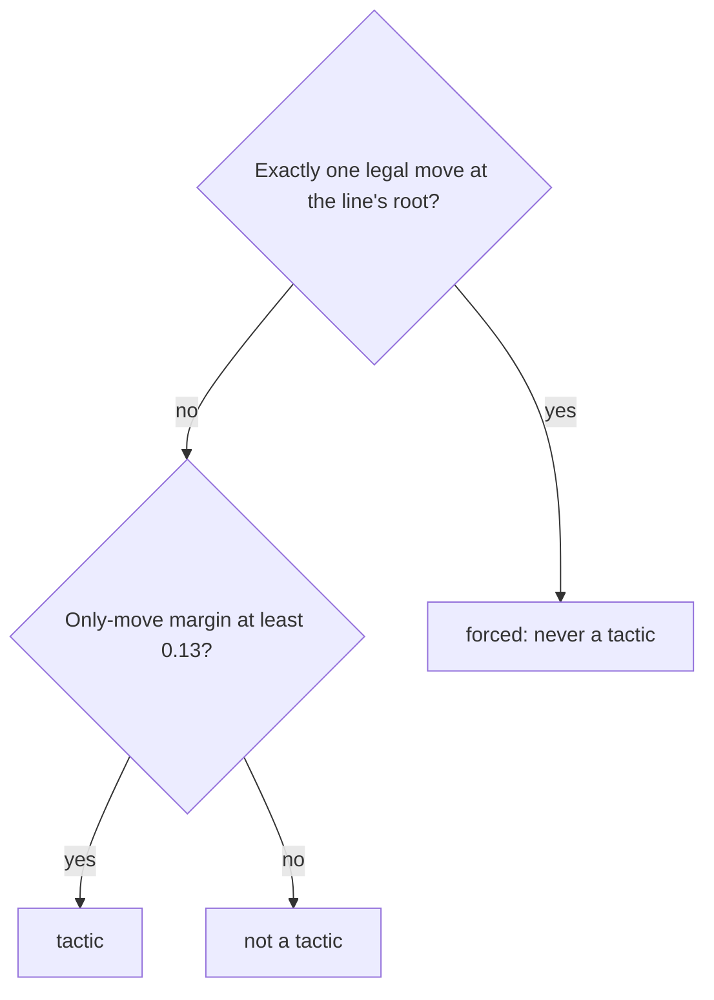

| Node | Meaning | Terms | Status |
|---|---|---|---|
| `TjForced` | A lone legal move has no alternative to compare with | forced | implemented |
| `TjMargin` | 0.13 is the mistake threshold: every alternative is at least a mistake | only-move margin | implemented |
| `TjIsForced` | Rule fact; no alternative, no margin | forced (in the report) | implemented |
| `TjIsTactic` | Engine fact; the line gets contributions and labels. Near a decided result scores flatten, so no line is a tactic there | tactic, saturation limit | implemented |
| `TjNotTactic` | Engine fact; also the case when two moves win equally | tactic, two-winners limit | implemented |

### L3 · Contribution (`Contribution`)

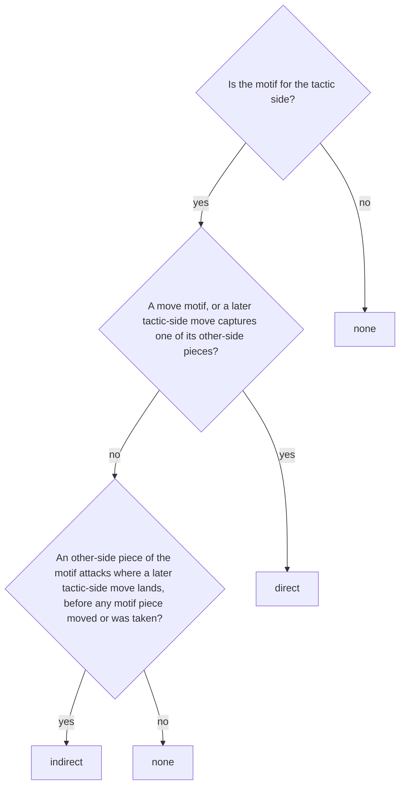

| Node | Meaning | Terms | Status |
|---|---|---|---|
| `CoSide` | Only the tactic side's motifs can help its tactic | contribution judgement, X | implemented |
| `CoDirect` | The tactic's own moves make the motif or take its pieces | contribution judgement, move motif | implemented |
| `CoIndirect` | The motif stops the defender answering a move: a pin that stops a recapture, an overloaded defender | contribution judgement | implemented |
| `CoOtherSide` | A motif of the other side | `contribution` | implemented |
| `CoIsDirect` | Direct contribution | `contribution` | implemented |
| `CoIsIndirect` | Indirect contribution | `contribution` | implemented |
| `CoNotUsed` | The tactic works without it | `contribution` | implemented |

### L3 · Tactical pin (`TacticalPin`)

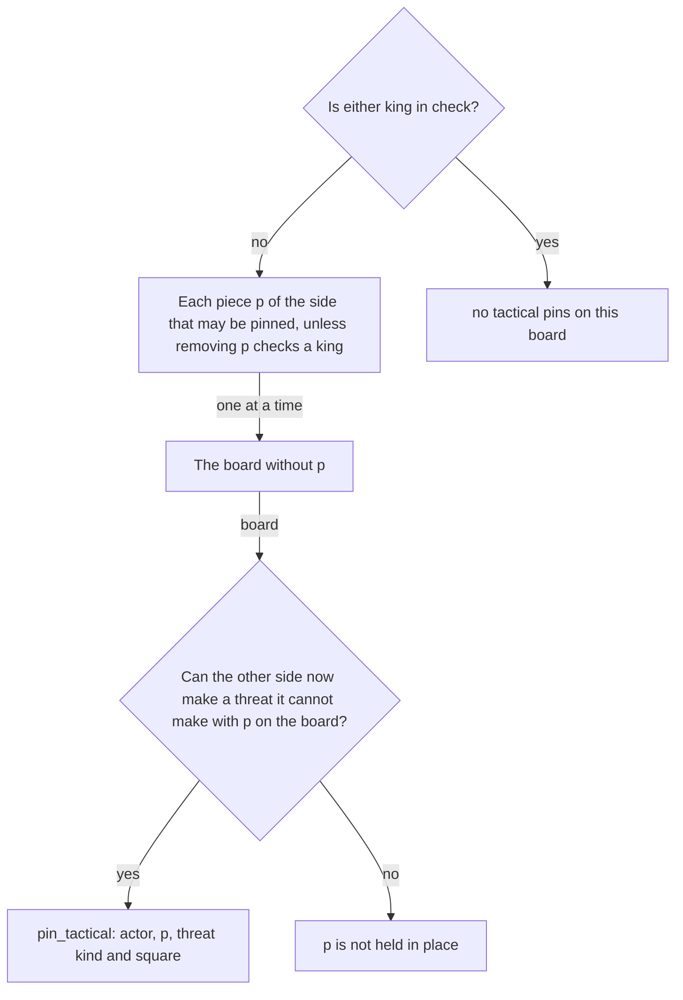

| Node | Meaning | Terms | Status |
|---|---|---|---|
| `TpKings` | Not computed while a king is in check | `pin_tactical`, `in_check` | implemented |
| `TpPiece` | Candidates for being held in place, including a piece that guards an empty square | `pin_tactical` | implemented |
| `TpRemove` | Ask what changes if p were gone | `pin_tactical` | implemented |
| `TpNewThreat` | Threats: fork, skewer, discovered check or attack, double check, back-rank mate, promotion, mate, or winning a piece by static exchange | move motif, SEE | implemented |
| `TpNone` | Nothing reported | `pin_tactical` | implemented |
| `TpFound` | Reported as a state motif, with the threat's kind and square | `pin_tactical`, `threat` | implemented |
| `TpFree` | Nothing reported for p | `pin_tactical` | implemented |

### L3 · Fact check (`FactCheck`)

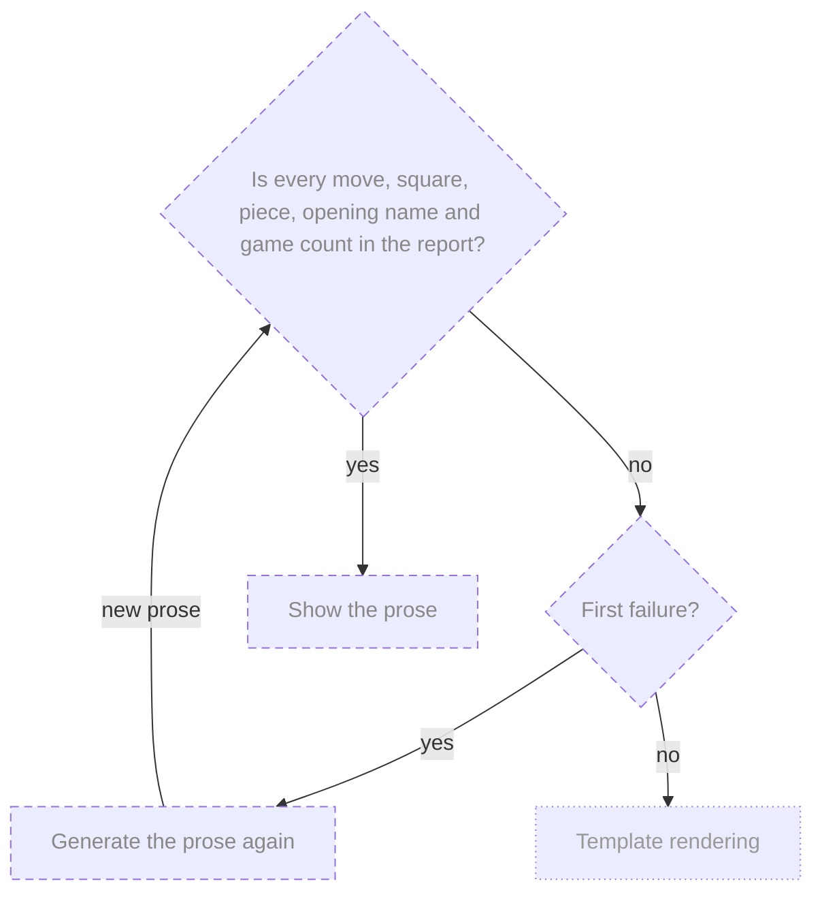

| Node | Meaning | Terms | Status |
|---|---|---|---|
| `TemplateRendering` | See Explanation; shown with a notice that the prose failed | — | external |
| `FcSupported` | Moves quoted from books refer to other games and are marked so they are not checked against the position | fact check, book passage | planned |
| `FcFirstFailure` | One retry only | fact check | planned |
| `FcRegenerate` | A second attempt from the same fact sheet | fact check, fact sheet | planned |
| `FcPass` | The checked prose is the explanation | explanation | planned |
