# ChessWhy — Fixtures

Every fixture the tests use, with its board, what it claims, what the code
reports today and the concept nodes of [CONCEPTS.md](CONCEPTS.md) it checks (their
code is in [CODE.md](CODE.md)). Terms are defined in [DEFINITIONS.md](DEFINITIONS.md)
(§6.2 for the fixture kinds); the tests that read each set are in [TESTS.md](TESTS.md).

**Snapshot:** F01–F39 and E01–E22: 2026-10-23, M4 batch 3, reconfirmed at the M4 gate 2026-10-24 (report v6, move reports,
`--moves`; every F fixture runs `--json --full-report` plus its move report document,
checked by schema and the projection check). T/C/U rows: 2026-10-21, PostM2_EM1 gate;
their tests still pass unchanged. §8 P rows: 2026-10-22, M3 batch 1.
Release build, Stockfish 19 from `assets/`, `Threads=1`, game-count table
`lichess_broadcast_2200@e0cb7fab3212`. F reports now also list `pin_tactical`
instances, positional facts and game counts; the columns below name only the fixture
claims.

**Comments column.** Any agent or the Captain may add a dated comment to a
fixture's last column when the fixture looks wrong: a bad position, a claim that
contradicts the engine or the rules, an unclear title. Sign it, e.g.
`2026-10-21 Deputy: …`. Leave the other columns to the orchestrator.

**Keeping it current.** The orchestrator updates this file whenever a fixture is
added, changed or dropped, and checks the "Codebase today" column at each
milestone end. Boards are generated; the tables are written by hand so the
comments survive. Regenerate the boards after any fixture change:

```sh
.venv/bin/python tools/render_fixture_boards.py   # needs `pip install -r tools/requirements-dev.txt`
```

Boards show White at the bottom. The arrow marks the asked move (F), the first
move of the line (T, C) or the trainer's move (V); a red king square marks check. Rendered with
[python-chess](https://github.com/niklasf/python-chess) (GPL-3.0-or-later, a
development tool only, never linked into ChessWhy); piece drawings by Colin M.L.
Burnett, used under their BSD licence option.

**Reading the "Codebase today" column.** ES is the expected score for the side
to move (1 = win, 0.5 = draw, 0 = loss) unless the cell says "White ES". "Tactic"
and "margin" are the tactic judgement of DEFINITIONS §4.5; contributions are
`direct`, `indirect` or `none`. Plies count positions: ply 0 is the start
position, ply 1 the position after the first move of the line.

## 1. F fixtures — full reports (`tests/fixtures/positions.json`, `engine_fixtures`)

**Concepts:** `EngineFixtures`, `Urgency`, `ParryTest`, `Verdict`, `OpportunityJudgement`, `StateMotif`, `MoveMotif`, `TacticalPin`, `InputFixtures`, `OpeningNames`, `SearchB`, `PositionalFixtures`, `PositionalChange`, `GameCounts`, `Conditions`, `RestrictedMovement`

Run end to end through the CLI with the engine by `cli_fixture_<ID>`. Each
fixture runs `--json --full-report` and pins exact full report fields (`equals`),
required playable moves (`playable_includes`), motifs and line prefixes; the plain
command for `text_contains` (move report text), `--full-report` for
`full_text_contains`, and `--json` for the move report document, which `report_schema`
checks against its schema and by the projection check. A fixture can carry extra
runs with their own `--moves` (`runs`). See the JSON for the complete list. F16 was
dropped (M1 §9). Verdicts below are on the M4 scale (best, okay, inaccuracy, mistake,
blunder); "Asked" moves are the fixture's `--moves` items.
All F fixtures pass when run one at a time; under `ctest -j8` on the 8-core
laptop, eight of them exceeded the 12-second timing check (`CHESSWHY_CHECK_TIMING`),
which is a load effect, not a wrong result. So the F tests run one at a time only when
the timing check is on; without it they run in parallel (from 2026-10-23), since a
report does not depend on load (`Threads=1`, fixed node budgets).

| ID | Board | Position | Fixture claims | Codebase today | Comments |
|---|---|---|---|---|---|
| F01 |  | `r4r1k/pppb2bp/2q1n1p1/4p3/8/1BPPBN2/PP2QPP1/R3K2R w KQ - 6 19`<br>Asked: **O-O-O**<br><sub>Steinitz, Wilhelm - Chigorin, Michael, Wch4-Havana 1892, before 19.O-O-O</sub> | quiet; asked queenside castling is the only playable move; 48 legal moves; the move report text prints the created threat under "Threatens (if Black passes):" | Eval: White ES 0.98 (+172 cp).<br>Best **O-O-O**, not a tactic; an opportunity (margin 0.38 over Kf1).<br>Playable moves: O-O-O.<br>No concrete Black threat; more urgent: neither (quiet).<br>Asked **O-O-O**: best. | |
| F02 | 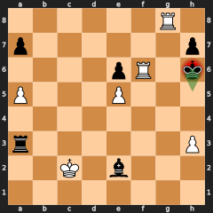 | `6R1/p6p/4pR1k/P3P3/8/r6P/2K1b3/8 b - - 2 46`<br>Asked: **Kh5**<br><sub>Alekhine, Alexander - Euwe, Max, Wch16 1935, before 46...Kh5</sub> | in check with exactly one legal move; the move report text prints "Forced: only legal move" | Eval: White ES 1.00 (+459 cp).<br>Best **Kh5**, not a tactic; forced (only legal move).<br>Playable moves: Kh5.<br>Asked **Kh5**: best. | |
| F03 | 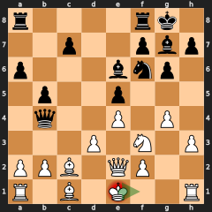 | `r4rk1/2p2pbp/p3bnp1/1p2p3/1q2P1P1/3P1N1P/PPB1QP2/R1B1K2R w KQ - 2 17`<br>Asked: **Kf1**<br><sub>Gunsberg, Isidor - Chigorin, Michael, Havana 1890, before 17.Kf1</sub> | in check; best, inaccuracy, mistake and blunder replies; the text names the engine (Stockfish 19, Threads=1, Hash=64 MB) and the standard budget's node counts | Eval: White ES 0.48 (-26 cp).<br>Best **Kf1**, not a tactic; not an opportunity (margin 0.08 over Qd2).<br>Playable moves: Kf1.<br>Asked **Kf1**: best. | |
| F04 | 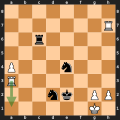 | `8/7R/2r5/8/P3n3/R7/3nk1PP/6K1 w - - 3 39`<br>Asked: **Ra1**<br><sub>Korchnoi, Viktor - Karpov, Anatoly, Wch29 1978, before 39.Ra1</sub> | opponent threatens mate in one; asked move parries it but allows another mate; the move report text prints "Asked: Ra1 (a3a1): blunder"; the full report text heads A's lines "Engine lines" | Eval: White ES 0.50 (+0 cp).<br>Best **g3**, not a tactic; not an opportunity (margin 0.00 over g4).<br>Playable moves: g3, g4.<br>Black threatens Rc1# (mate); more urgent: black (consequence class).<br>Asked **Ra1**: blunder, loses 0.50 ES. Refutation Nf3+ gxf3 Rg6+ is a tactic. | |
| F05 | 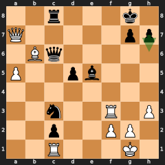 | `2r3k1/Q5pp/1Bq5/P2pb3/8/2n2R1P/2p2PP1/2R3K1 b - - 3 34`<br>Asked: **h6**<br><sub>Anand, Viswanathan - Karpov, Anatoly, FIDE-Wch k.o. final 1998, before 34...h6</sub> | own material threat against the opponent's mate threat; the full report text prints a checking line's parry as deferred ("the move checks, so the threat only waits") | Eval: White ES 0.00 (-616 cp).<br>Best **Ne2+**, a tactic; not an opportunity (margin 0.07 over Qe8).<br>Playable moves: Ne2+.<br>White threatens Qf7+ (mate); more urgent: white (consequence class).<br>Asked **h6**: blunder, loses 1.00 ES. Refutation Qf7+ Kh8 Re3 is a tactic. | |
| F06 | 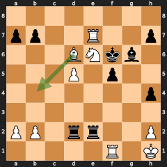 | `8/pp2R2p/3BNkb1/3P1p2/7p/8/PP1rr2P/5R1K w - - 1 32`<br>Asked: **Bb4**<br><sub>Chigorin, Michael - Steinitz, Wilhelm, Wch4-Havana 1892, before 32.Bb4</sub> | opponent threatens material; asked move allows mate | Eval: White ES 1.00 (+437 cp).<br>Best **Rxb7**, not a tactic; not an opportunity (margin 0.02 over Kg1).<br>Playable moves: Rxb7, Kg1.<br>Black threatens Bh5 (material); more urgent: black (consequence class).<br>Asked **Bb4**: blunder, loses 1.00 ES. Refutation Rxh2+ Kg1 Rdg2# is a tactic. | |
| F07 | 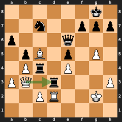 | `6k1/2n2ppp/p3q3/1pB1p1P1/1Pr1P3/PQ1r3P/2PR2K1/8 w - - 0 31`<br>Asked: **Qxd3**<br><sub>Alekhine, Alexander - Euwe, Max, The Netherlands 1927, before 31.Qxd3</sub> | equal material threats; the best move parries by capture | Eval: White ES 0.93 (+135 cp).<br>Best **cxd3**, a tactic; an opportunity (margin 0.43 over Qxd3).<br>Playable moves: cxd3.<br>Black threatens Rxd2+ (material); more urgent: black (parry).<br>Asked **Qxd3**: mistake, loses 0.43 ES. Refutation h6 Qd8+ Ne8 is not a tactic. | |
| F08 | 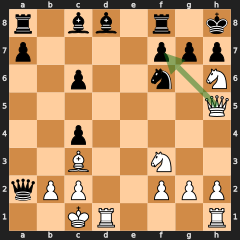 | `r1bb1r1k/p4ppp/2p2n1N/7Q/2p5/2B2N2/qPP2PPP/2KR3R w - - 2 19`<br>Asked: **Qxf7**<br><sub>Tal, Mikhail - Smyslov, Vasily, Candidates' tournament 1959, before 19.Qxf7</sub> | equal material threats; checking move does not parry; the full report text prints its created threat as "not searched (gives check)" | Eval: White ES 1.00 (+586 cp).<br>Best **Qxf7**, a tactic; an opportunity (margin 0.31 over Qe5).<br>Playable moves: Qxf7.<br>Black threatens Nxh5 (material); more urgent: black (parry).<br>Asked **Qxf7**: best. | |
| F09 | 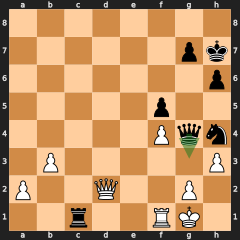 | `8/6pk/7p/5p2/5Pqn/1P5P/P2Q2P1/2r2RK1 b - - 0 39`<br>Asked: **Qg3**<br><sub>Euwe, Max - Keres, Paul, Wch18 1948, before 39...Qg3</sub> | counterattack: own threat outweighs the opponent's | Eval: White ES 0.00 (-1041 cp).<br>Best **Nf3+**, a tactic; not an opportunity (margin 0.00 over Qg3).<br>Playable moves: Nf3+, Qg3, Qg6, Rxf1+.<br>White threatens hxg4 (material); more urgent: black (counterattack).<br>Asked **Qg3**: okay. | |
| F10 | 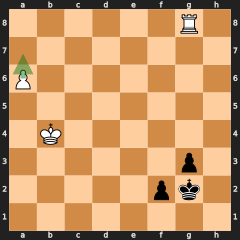 | `6R1/8/P7/8/1K6/6p1/5pk1/8 w - - 0 58`<br>Asked: **a7**<br><sub>Korchnoi, Viktor - Karpov, Anatoly, Candidates' final 1974, before 58.a7</sub> | rook against pawns: null move unreliable, promotion threat | Eval: White ES 0.54 (+58 cp).<br>Best **a7**, not a tactic; not an opportunity (margin 0.04 over Rf8).<br>Playable moves: a7, Rf8, Rb8, Rxg3+.<br>Black threatens f1=Q (material); more urgent: black (consequence class).<br>Asked **a7**: best. | |
| F11 | 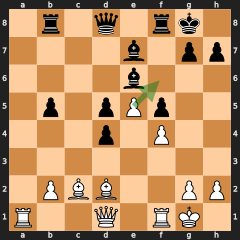 | `1r1q1rk1/4b1pp/4b3/1p1pPp2/3p1P2/8/1PBB2PP/R2Q1RK1 w - f6 0 18`<br>Asked: **exf6**<br><sub>Lasker, Emanuel - Schlechter, Carl, Wch10 1910, before 18.exf6</sub> | en passant capture outside the engine's top lines | Eval: White ES 0.88 (+124 cp).<br>Best **Bd3**, not a tactic; not an opportunity (margin 0.06 over Be1).<br>Playable moves: Bd3.<br>No concrete Black threat; more urgent: neither (quiet).<br>Asked **exf6**: mistake, loses 0.37 ES. Refutation Bxf6 Bd3 Qd7 is not a tactic. | |
| F12 | 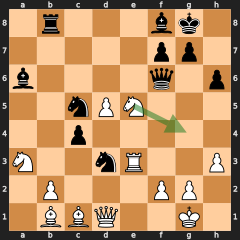 | `1r3bk1/5pp1/b4q1p/2nPN3/2p5/N2nR2P/1P3PP1/1BBQ2K1 w - - 1 26`<br>Asked: **Ng4**<br><sub>Kasparov, Gary - Karpov, Anatoly, Wch33-KK3 1986, before 26.Ng4</sub> | mistake against a material threat | Eval: White ES 0.52 (+39 cp).<br>Best **Qc2**, not a tactic; not an opportunity (margin 0.03 over Bxd3).<br>Playable moves: Qc2, Bxd3, Naxc4.<br>Black threatens Nxe5 (material); more urgent: black (consequence class).<br>Asked **Ng4**: blunder, loses 0.17 ES. Refutation Qf5 Rg3 Kh8 is a tactic. | |
| F13 | 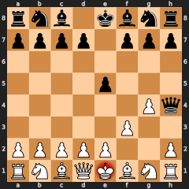 | `rnb1kbnr/pppp1ppp/8/4p3/6Pq/5P2/PPPPP2P/RNBQKBNR w KQkq - 1 3` | checkmate: terminal, no searches | Terminal: checkmate; no candidates.<br>Opening: Barnes Opening: Fool's Mate. | |
| F14 | 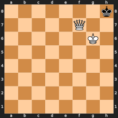 | `7k/5Q2/6K1/8/8/8/8/8 b - - 0 1` | stalemate: terminal, no searches | Terminal: stalemate; no candidates. | |
| F15 | 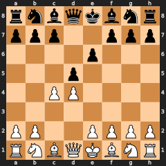 | PGN `two_games.pgn` game 2, ply 4 | PGN input: second game, ply 4 | Eval: White ES 0.52 (+28 cp).<br>Best **Nf3**, not a tactic; not an opportunity (margin 0.00 over Nc3).<br>Playable moves: Nf3, Nc3, cxd5, g3, e3 and more.<br>No concrete Black threat; more urgent: neither (quiet).<br>Opening: Queen's Gambit Declined; last named: Queen's Gambit Declined.<br>Games: 10,213 (White 3,538, draws 4,441, Black 2,234); Nc3 5,388, Nf3 4,654, g3 90, cxd5 68, e3 10. | |
| F17 | 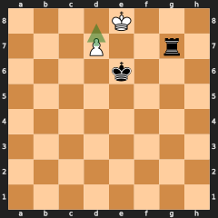 | `4K3/3P2r1/4k3/8/8/8/8/8 w - - 3 70`<br>Asked: **d8=N+**<br><sub>Korchnoi, Viktor - Kasparov, Gary, London 1983, round 6, annotator's line 60...Rg6 61.Rg2, before 70.d8=N+</sub> | underpromotion is the only playable move; queening allows mate | Eval: White ES 0.49 (-20 cp).<br>Best **d8=N+**, a tactic; an opportunity (margin 0.49 over Kd8).<br>Playable moves: d8=N+.<br>Black threatens Rg8# (mate); more urgent: black (consequence class).<br>Asked **d8=N+**: best. | |
| F18 | 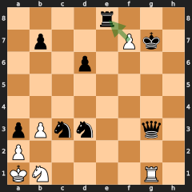 | `4r3/1p3Pk1/3p4/8/8/pPnn2q1/P7/KN4R1 w - - 0 36`<br>Asked: **fxe8=N+**<br><sub>De la Bourdonnais, Louis Mahe - McDonnell, Alexander, London m1 1834, annotator's line 34.Nb1 Kxg7 35.gxf7+ Qxg3, before 36.fxe8=N+</sub> | underpromotion by capture is the only playable move | Eval: White ES 1.00 (+656 cp).<br>Best **fxe8=N+**, a tactic; an opportunity (margin 0.50 over fxe8=Q).<br>Playable moves: fxe8=N+.<br>Black threatens Qxg1 (mate); more urgent: black (consequence class).<br>Asked **fxe8=N+**: best. | |
| F19 | 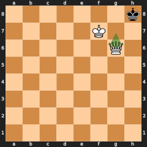 | `7k/5K2/6Q1/8/8/8/8/8 w - - 0 1`<br>Asked: **Qg7**<br><sub>constructed: stalemate in the null-move position (search B)</sub> | search B skips a stalemated null-move position | Eval: mate in 1 for White.<br>Best **Qh5#**, a tactic; not an opportunity (margin 0.00 over Qg8#).<br>Playable moves: Qh5#, Qg8#, Qh6#, Qg7#, Qf6+ and more.<br>Asked **Qg7#**: best. | |
| F20 | 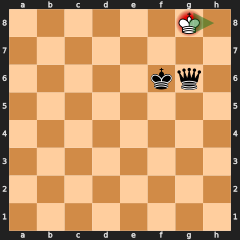 | `6K1/8/5kq1/8/8/8/8/8 w - - 0 1`<br>Asked: **Kh8**<br><sub>constructed: stalemate in the null-move position (search E)</sub> | search E skips a stalemated null-move position | Eval: mate in 1 for Black.<br>Best **Kf8**, not a tactic; not an opportunity (margin 0.00 over Kh8).<br>Playable moves: Kf8, Kh8.<br>Asked **Kh8**: best. | |
| F21 | 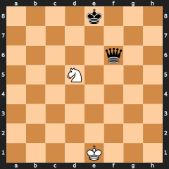 | `4k3/8/5q2/3N4/8/8/8/4K3 w - - 0 1`<br><sub>constructed: knight captures the exposed queen with check</sub> | only-move capture of the exposed queen with check; `creates_threat_skipped` is `gives_check`; the move report text prints the used hanging queen as `SEE 9`; the full report text prints the root `hanging_piece` N d5 as `SEE 3` | Eval: White ES 0.50 (+6 cp).<br>Best **Nxf6+**, a tactic; an opportunity (margin 0.50 over Ke2).<br>Playable moves: Nxf6+.<br>No concrete Black threat; more urgent: white (consequence class). | |
| F22 | 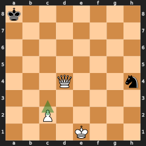 | `k7/8/8/8/3Q3n/8/2P5/4K3 w - - 0 1`<br>Asked: **c3**<br><sub>constructed: PostM2_EM1 smoke position</sub> | refutation fork wins the queen after the quiet pawn move; the text says how far each line's facts were read ("facts read to ply k of n") | Eval: mate in 10 for White.<br>Best **Qxh4**, a tactic; not an opportunity (margin 0.00 over Qe4+).<br>Playable moves: Qxh4, Qe4+, Qh8+, Qa4+, Qd8+ and more.<br>Black threatens Nf3+ (material); more urgent: white (consequence class).<br>Asked **c3**: blunder, loses 0.49 ES. Refutation Nf3+ Kf2 Nxd4 is a tactic. | |
| F23 | 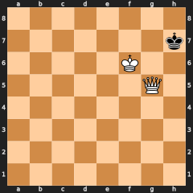 | `8/7k/5K2/6Q1/8/8/8/8 w - - 0 1`<br><sub>constructed: mate-in-one versus mate-in-two saturation</sub> | decisive mate-in-one position is saturated | Eval: mate in 1 for White.<br>Best **Qg7#**, a tactic; not an opportunity (margin 0.00 over Qg1).<br>Playable moves: Qg7#, Qg1, Qg4, Qg2, Qg3 and more.<br>No concrete Black threat; more urgent: white (consequence class). | |
| F24 |  | `7k/5Q2/6K1/8/8/8/8/8 w - - 0 1`<br><sub>constructed: four legal queen mates</sub> | four equally winning mate-in-one moves | Eval: mate in 1 for White.<br>Best **Qg7#**, a tactic; not an opportunity (margin 0.00 over Qf8#).<br>Playable moves: Qg7#, Qf8#, Qh7#, Qe8#, Qf4 and more. | |
| F25 | 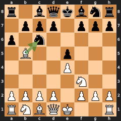 | `r1bqkbnr/1ppp1ppp/p1n5/1B2p3/4P3/5N2/PPPP1PPP/RNBQK2R w KQkq - 0 4`<br>Asked: **Bxc6**<br><sub>constructed: Exchange Ruy Lopez after 1.e4 e5 2.Nf3 Nc6 3.Bb5 a6</sub> | Position: `bishop_pair` white and black.<br>Asked line: + `doubled_pawns` black, c file (ply 2); − `bishop_pair` white (ply 2); both hold at the end | Eval: White ES 0.54 (+40 cp).<br>Best **Ba4**, not a tactic; not an opportunity (margin 0.03 over Bxc6).<br>Playable moves: Ba4, Bxc6, Bc4.<br>Position: `bishop_pair` both sides.<br>Asked **Bxc6**: okay, loses 0.03 ES. Line: + doubled pawns Black c file (ply 2), − bishop pair White (ply 2), both hold at the end.<br>Games: 12900 (White 4344, draws 5596, Black 2960); Ba4 in 12424, Bxc6 in 474.<br>Test passes. | |
| F26 |  | `6R1/8/P7/8/1K6/6p1/5pk1/8 w - - 0 58`<br>Asked: **a7**<br><sub>Korchnoi - Karpov, Candidates' final 1974, before 58.a7 (F10 position)</sub> | Position: `passed_pawn` white, a file (P a6); `passed_pawn` black, g file (p g3); `material_ahead` white 4 | Eval: White ES 0.54 (+58 cp).<br>Best **a7**, not a tactic; not an opportunity (margin 0.04 over Rf8).<br>Playable moves: a7, Rf8, Rb8, Rxg3+.<br>Position: passed pawns White a file, Black f and g files; connected passed pawns Black; material ahead White 4.<br>Asked **a7**: best.<br>Games: position not in the table.<br>Test passes. | |
| F27 |  | `k7/8/8/8/8/8/8/4K2R w K - 0 1`<br>Asked: **O-O**<br><sub>constructed</sub> | Asked line: − `castling_kingside` white (ply 1), holds at the end | Eval: mate in 11 for White.<br>Best **Rh7**, a tactic; not an opportunity (margin 0.00 over Kf2).<br>Playable moves: Rh7, Kf2, Rh6, Rg1, Kd2 and more.<br>Asked **O-O**: okay. Line: − kingside castling right White (ply 1), holds at the end.<br>Games: position not in the table.<br>Test passes. | |
| F28 | 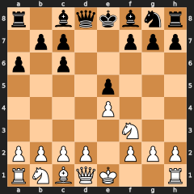 | `r1bqkbnr/1pp2ppp/p1p5/4p3/4P3/5N2/PPPP1PPP/RNBQK2R w KQkq - 0 5`<br><sub>constructed: Exchange Ruy Lopez after 1.e4 e5 2.Nf3 Nc6 3.Bb5 a6 4.Bxc6 dxc6</sub> | Position: `doubled_pawns` black, c file; `bishop_pair` black | Eval: White ES 0.50 (-4 cp).<br>Best **d3**, not a tactic; not an opportunity (margin 0.01 over O-O).<br>Playable moves: d3, O-O, Nc3, d4, Qe2 and more.<br>Position: doubled pawns Black c file; bishop pair Black.<br>Games: 470 (White 126, draws 234, Black 110); O-O in 369, Nc3 in 69, d4 in 15.<br>Test passes. | |
| F29 |  | `rnbqkbnr/pppppppp/8/8/8/8/PPPPPPPP/RNBQKBNR w KQkq - 0 1`<br><sub>constructed: standard starting position</sub> | Games: found in `lichess_broadcast_2200@e0cb7fab3212` with 262026 games (White 91439, draws 105183, Black 65404); first moves e4 123657, d4 87792, Nf3 28707; the move report text prints "Played in 123657 of 262026 games" | Eval: White ES 0.53 (+36 cp).<br>Best **e4**, not a tactic; not an opportunity (margin 0.02 over d4).<br>Playable moves: e4, d4, Nf3, e3, c4 and more.<br>Games: as claimed; the move report text prints "Played in 123657 of 262026 games" for e4.<br>Test passes. | |
| F30 | 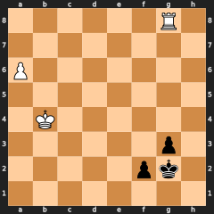 | `6R1/8/P7/8/1K6/6p1/5pk1/8 w - - 0 58`<br><sub>Korchnoi - Karpov, Candidates' final 1974, before 58.a7 (after 114 plies)</sub> | Games: not found (the table keeps positions within the first 40 plies); counts null, no moves | Eval: White ES 0.60 (+75 cp, quick budget).<br>Best **a7**, not a tactic; not an opportunity (margin 0.10 over Rf8).<br>Playable moves: a7.<br>Games: not found, as claimed.<br>Test passes. | |
| F31 |  | `8/8/6k1/3N2p1/8/8/4q3/K7 b - - 0 1`<br><sub>constructed: T46's board</sub> | the full report text prints the tactical pin's restriction: "at square g5; restricted: g5-f4, g5-g4, g5-h4; free: none"; the move report text prints "Tactic: mate in 8 [engine]" | Eval: mate in 8 for Black.<br>Best **Qe5+**, a tactic; not an opportunity (margin 0.00 over Qd1+).<br>Playable moves: Qe5+, Qd1+, Qf1+, Qe1+, Qa6+ and more.<br>Full report text contains the restriction line; move report text contains "Tactic: mate in 8 [engine]".<br>Test passes. | |

## 2. U fixtures — opening names (`positions.json`, `unit_fixtures`)

**Concepts:** `InputFixtures`, `GameMainline`, `PositionKey`, `OpeningNames`, `LastNamed`

Read by `PGN unit fixtures preserve mainline positions` and `PGN opening
fixtures describe current and last named positions`.

| ID | Board | Position | Fixture claims | Codebase today | Comments |
|---|---|---|---|---|---|
| U01 | 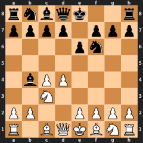 | PGN `three_games.pgn` game 1, ply 6<br>`rnbqk2r/pppp1ppp/4pn2/8/1bPP4/2N5/PP2PPPP/R1BQKBNR w KQkq - 1 4` | **transposition reaches a named position**<br>Current: Nimzo-Indian Defense; last named: Nimzo-Indian Defense (ply 6) | Matches. | |
| U02 | 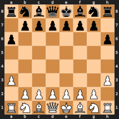 | PGN `three_games.pgn` game 2, ply 4<br>`rnbqkbnr/1pppppp1/p6p/8/8/P6P/1PPPPPP1/RNBQKBNR w KQkq - 0 3` | **unnamed position: last named ancestor, never a guess**<br>Current: unnamed; last named: Anderssen's Opening (ply 1) | Matches. | |
| U03 | 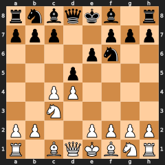 | PGN `two_games.pgn` game 2, ply 6<br>`rnbqkb1r/ppp2ppp/4pn2/3p4/2PP4/2N5/PP2PPPP/R1BQKBNR w KQkq - 2 4` | **PGN default ply is the final position; comments, variations, NAGs ignored**<br>Current: Queen's Gambit Declined: Normal Defense; last named: Queen's Gambit Declined: Normal Defense (ply 6) | Matches. | |
| U04 | 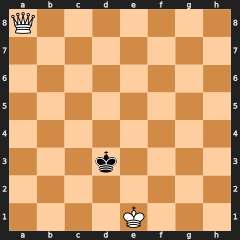 | PGN `fen_tag.pgn` game 1, ply 2<br>`Q7/8/8/8/8/3k4/8/4K3 w - - 1 2` | **PGN with FEN and SetUp tags; no names off the standard start**<br>Current: unnamed; last named: none | Matches. | |
| U05 | 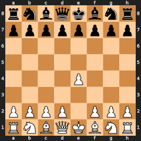 | Input `rnbqkbnr/pppppppp/8/8/4P3/8/PPPP1PPP/RNBQKBNR b KQkq e3 0 1`<br>Normalised `rnbqkbnr/pppppppp/8/8/4P3/8/PPPP1PPP/RNBQKBNR b KQkq - 0 1` | **en-passant square without a legal capture is not part of the key**<br>Current: King's Pawn Game; last named: none | Matches. | |
| U06 | 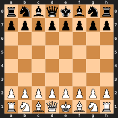 | `rnbqkbnr/pppppppp/8/8/8/8/PPPPPPPP/RNBQKBNR w KQkq - 0 1` | **start position is unnamed**<br>Current: unnamed; last named: none | Matches. | |

## 3. E fixtures — input errors (`positions.json`, `error_fixtures`)

**Concepts:** `InputFixtures`, `InputError`, `FenInput`, `PgnInput`, `AskedMove`, `CommandLine`, `StockfishProcess`, `OpeningNames`

Read by `CLI error fixtures return the required status and one diagnostic`;
E01–E11 also by `input error fixtures report the required function-level fragments`. Exit 2 is a
usage or input error, exit 3 a missing engine or data file. PGN names refer to
files in `tests/fixtures/`.

| ID | Arguments | Fixture claims | Codebase today | Comments |
|---|---|---|---|---|
| E01 | `--fen rnbqkbnr/pppppppp/8/8/8/8/PPPPPPPP/RNBQKBN w KQkq - 0 1` | Exit 2; message contains “invalid FEN” | Matches. | |
| E02 | `--fen 8/8/8/8/8/8/8/8 w - - 0 1` | Exit 2; message contains “invalid FEN” | Matches. | |
| E03 | `--fen 4k3/8/8/8/8/8/4R3/4K3 w - - 0 1` | Exit 2; message contains “invalid FEN” | Matches. | |
| E04 | `--fen rnbqkbnr/pppppppp/8/8/8/8/PPPPPPPP/RNBQKBNR w KQkq - 0 1 --moves Ke2` | Exit 2; message contains “illegal move”, “Ke2” | Matches. | |
| E05 | `--fen rnbqkb1r/ppp1pppp/5n2/3p4/3P4/5N2/PPP1PPPP/RNBQKB1R w KQkq - 2 3 --moves Nd2` | Exit 2; message contains “ambiguous move”, “Nd2” | Matches. | |
| E06 | `--fen rnbqkbnr/pppppppp/8/8/8/8/PPPPPPPP/RNBQKBNR w KQkq - 0 1 --moves Zz9` | Exit 2; message contains “cannot parse move”, “Zz9” | Matches. | |
| E07 | `--fen rnbqkbnr/ppppp1pp/5p2/7Q/4P3/8/PPPP1PPP/RNB1KBNR b KQkq - 1 2 --moves Nf6` | Exit 2; message contains “illegal move”, “Nf6” | Matches. | |
| E08 | `--pgn three_games.pgn --game 3` | Exit 2; message contains “game 3”, “move 2”, “Ke3” | Matches. | |
| E09 | `--pgn two_games.pgn --game 3` | Exit 2; message contains “game 3” | Matches. | |
| E10 | `--pgn two_games.pgn --game 2 --ply 99` | Exit 2; message contains “ply 99” | Matches. | |
| E11 | `--pgn does_not_exist.pgn` | Exit 2; message contains “does_not_exist.pgn” | Matches. | |
| E12 | `--fen rnbqkbnr/pppppppp/8/8/8/8/PPPPPPPP/RNBQKBNR w KQkq - 0 1 --pgn two_games.pgn` | Exit 2; message contains “exactly one of --fen or --pgn” | Matches. | |
| E13 | `(no arguments)` | Exit 2; message contains “exactly one of --fen or --pgn” | Matches. | |
| E14 | `--fen rnbqkbnr/pppppppp/8/8/8/8/PPPPPPPP/RNBQKBNR w KQkq - 0 1 --level expert` | Exit 2; message contains “--level” | Matches. | |
| E15 | `--fen rnbqkbnr/pppppppp/8/8/8/8/PPPPPPPP/RNBQKBNR w KQkq - 0 1 --engine /nonexistent/stockfish` | Exit 3; message contains “engine”, “/nonexistent/stockfish” | Matches. | |
| E16 | `--fen rnbqkbnr/pppppppp/8/8/8/8/PPPPPPPP/RNBQKBNR w KQkq - 0 1 --openings /nonexistent/openings` | Exit 3; message contains “openings”, “/nonexistent/openings” | Matches. | |
| E17 | `--fen 7k/5Q2/6K1/8/8/8/8/8 b - - 0 10000` | Exit 2; message contains “invalid FEN”, “counter” | Matches. | |
| E18 | `--fen 7k/5Q2/6K1/8/8/8/8/8 b - - 151 40` | Exit 2; message contains “invalid FEN”, “counter” | Matches. | |
| E19 | `--fen rnbqkbnr/pppppppp/8/8/8/8/PPPPPPPP/RNBQKBNR w KQkq - 0 1 --moves Nf3,,e4` | Exit 2; message “chesswhy: error: empty item in --moves” | Matches. | |
| E20 | `--fen rnbqkbnr/pppppppp/8/8/8/8/PPPPPPPP/RNBQKBNR w KQkq - 0 1 --moves top0` | Exit 2; message “chesswhy: error: invalid value for --moves: top0” | Matches. | |
| E21 | `--fen rnbqkbnr/pppppppp/8/8/8/8/PPPPPPPP/RNBQKBNR w KQkq - 0 1 --moves foo` | Exit 2; message “chesswhy: error: cannot parse move foo” | Matches. | |
| E22 | `--fen rnbqkbnr/pppppppp/8/8/8/8/PPPPPPPP/RNBQKBNR w KQkq - 0 1 --move Nf6` | Exit 2; message “chesswhy: error: unknown flag --move” (`--move` retired in M4) | Matches. | |

## 4. Parse fixtures — move notation (`positions.json`, `parse_fixtures`)

**Concepts:** `InputFixtures`, `FenInput`, `AskedMove`

These entries have no IDs in the JSON; P01–P13 is their order in the file, used
here only so comments can name them. Each says a SAN or UCI move in the position
resolves to the given UCI move. Read by `all move parsing fixtures resolve to
their expected UCI moves` and `FEN and SAN/UCI parse fixtures identify the same
moves`.

| # | FEN | Move → UCI | Codebase today | Comments |
|---|---|---|---|---|
| P01 | `rnbqkbnr/pppppppp/8/8/8/8/PPPPPPPP/RNBQKBNR w KQkq - 0 1` | `Nf3` → `g1f3` | Matches. | |
| P02 | `rnbqkbnr/pppppppp/8/8/8/8/PPPPPPPP/RNBQKBNR w KQkq - 0 1` | `g1f3` → `g1f3` | Matches. | |
| P03 | `r1bqk1nr/pppp1ppp/2n5/2b1p3/2B1P3/5N2/PPPP1PPP/RNBQK2R w KQkq - 4 4` | `O-O` → `e1g1` | Matches. | |
| P04 | `r1bqk1nr/pppp1ppp/2n5/2b1p3/2B1P3/5N2/PPPP1PPP/RNBQK2R w KQkq - 4 4` | `e1g1` → `e1g1` | Matches. | |
| P05 | `rnbqkbnr/ppp1p1pp/8/3pPp2/8/8/PPPP1PPP/RNBQKBNR w KQkq f6 0 3` | `exf6` → `e5f6` | Matches. | |
| P06 | `rnbqkbnr/ppp1p1pp/8/3pPp2/8/8/PPPP1PPP/RNBQKBNR w KQkq f6 0 3` | `e5f6` → `e5f6` | Matches. | |
| P07 | `8/P7/8/8/8/8/2k5/4K3 w - - 0 1` | `a8=N` → `a7a8n` | Matches. | |
| P08 | `8/P7/8/8/8/8/2k5/4K3 w - - 0 1` | `a7a8n` → `a7a8n` | Matches. | |
| P09 | `8/P7/8/8/8/8/2k5/4K3 w - - 0 1` | `a8=Q` → `a7a8q` | Matches. | |
| P10 | `rnbqkb1r/ppp1pppp/5n2/3p4/3P4/5N2/PPP1PPPP/RNBQKB1R w KQkq - 2 3` | `Nbd2` → `b1d2` | Matches. | |
| P11 | `rnbqkb1r/ppp1pppp/5n2/3p4/3P4/5N2/PPP1PPPP/RNBQKB1R w KQkq - 2 3` | `Nfd2` → `f3d2` | Matches. | |
| P12 | `6k1/1q3ppp/8/8/5n2/8/5PPP/4R1K1 w - - 0 1` | `Re8#` → `e1e8` | Matches. | |
| P13 | `6k1/1q3ppp/8/8/5n2/8/5PPP/4R1K1 w - - 0 1` | `Re8` → `e1e8` | Matches. | |

## 5. T fixtures — motif recognition (`tests/fixtures/motifs.json`)

**Concepts:** `MotifFixtures`, `StateMotif`, `MoveMotif`, `FirstAppearance`, `StaticExchange`, `TacticalPin`, `TpKings`, `TpNewThreat`, `Restriction`, `TpAnyRestricted`

Each lists motif instances the detectors must report and instances they must not
report, on the position and along the line. Read by `motif fixtures exercise
every frozen include and exclude`, and compared against the reference
implementation by `tactics_oracle` (zero mismatches today). Piece letters are
the piece on the actor square at that ply; pawns have none. T33 and T34 left this file
in M2 when `removal_of_defender` stopped being a motif (IDs not reused); their
positions now live in the test `removal-of-defender labels revive T33 and reject T34`.
T42–T56 freeze `pin_tactical` (PostM2_EM1 §4.5, "tactical pin" below), written as
actor → p, then the threat's targets, then the threat ("fork on f4"). T46, T47, T58,
T59 and T60 also freeze the restriction (restricted moves, free moves, held at); T57
freezes the existence condition and T60 the rule that a move set never captures a king.
Since checkpoint 2 (2026-10-22) a pawn's hypothetical captures count, so T07, T48, T49,
T50 and T52 keep their includes; the test passes.

| ID | Board | Position | Fixture claims | Codebase today | Comments |
|---|---|---|---|---|---|
| T01 | 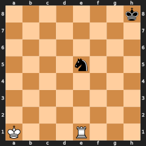 | `7k/8/8/4n3/8/8/8/K3R3 w - - 0 1`<br><sub>constructed</sub> | **rook attacks undefended knight**<br>Must report: hanging piece Ne5 (white, ply 0) | Matches: every listed instance reported, none of the excluded ones. | |
| T02 | 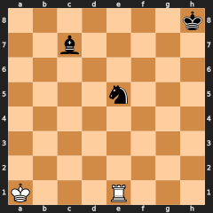 | `7k/2b5/8/4n3/8/8/8/K3R3 w - - 0 1`<br><sub>constructed</sub> | **attacked knight is defended by bishop**<br>Must not report: hanging piece (white, ply 0) | Matches: every listed instance reported, none of the excluded ones. | |
| T03 | 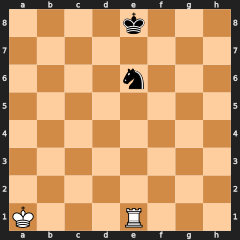 | `4k3/8/4n3/8/8/8/8/K3R3 w - - 0 1`<br><sub>constructed</sub> | **rook pins knight to king**<br>Must report: pin absolute Re1 → e6, e8 (white, ply 0) | Matches: every listed instance reported, none of the excluded ones. | |
| T04 | 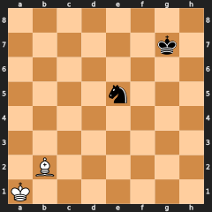 | `8/6k1/8/4n3/8/8/1B6/K7 w - - 0 1`<br><sub>constructed</sub> | **bishop pins knight to king**<br>Must report: pin absolute Bb2 → e5, g7 (white, ply 0) | Matches: every listed instance reported, none of the excluded ones. | |
| T05 | 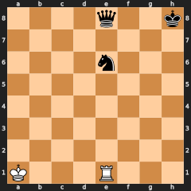 | `4q2k/8/4n3/8/8/8/8/K3R3 w - - 0 1`<br><sub>constructed</sub> | **rook lines up pieces with a queen behind the knight**<br>Must not report: pin absolute (white, ply 0) | Matches: every listed instance reported, none of the excluded ones. | |
| T06 | 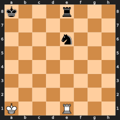 | `k3r3/8/4n3/8/8/8/8/K3R3 w - - 0 1`<br><sub>constructed</sub> | **rook lines up pieces with a rook behind the knight**<br>Must not report: pin absolute (white, ply 0) | Matches: every listed instance reported, none of the excluded ones. | |
| T07 | 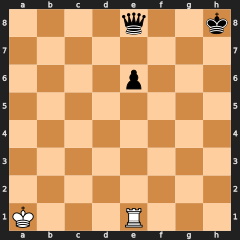 | `4q2k/8/4p3/8/8/8/8/K3R3 w - - 0 1`<br><sub>constructed</sub> | **pawn is pinned in front of queen**<br>Must report: pin relative Re1 → e6, e8 (white, ply 0) | Matches: every listed instance reported, none of the excluded ones. | |
| T08 | 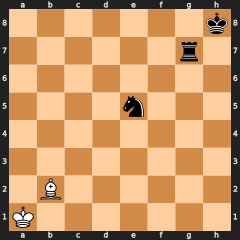 | `7k/6r1/8/4n3/8/8/1B6/K7 w - - 0 1`<br><sub>constructed</sub> | **bishop pins knight in front of rook**<br>Must report: pin relative Bb2 → e5, g7 (white, ply 0) | Matches: every listed instance reported, none of the excluded ones. | |
| T09 | 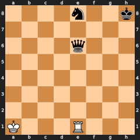 | `4n2k/8/4q3/8/8/8/8/K3R3 w - - 0 1`<br><sub>constructed</sub> | **queen behind a more valuable front piece**<br>Must not report: pin relative (white, ply 0) | Matches: every listed instance reported, none of the excluded ones. | |
| T10 | 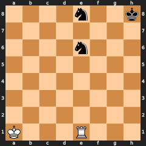 | `4n2k/8/4n3/8/8/8/8/K3R3 w - - 0 1`<br><sub>constructed</sub> | **equal knights do not make a relative pin**<br>Must not report: pin relative (white, ply 0) | Matches: every listed instance reported, none of the excluded ones. | |
| T11 |  | `rnbqkbnr/pppppppp/8/8/8/8/PPPPPPPP/RNBQKBNR w KQkq - 0 1`<br><sub>Lasker, Emanuel - Schlechter, Carl, Wch10 1910, before 1.e4</sub> | **both kings have an opposing rook or queen on their first rank**<br>Must not report: back rank weakness (white, ply 0); back rank weakness (black, ply 0) | Matches: every listed instance reported, none of the excluded ones. | |
| T12 | 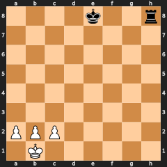 | `4k2r/8/8/8/8/8/PPP5/1K6 b - - 0 1`<br><sub>constructed</sub> | **white king's three front squares are occupied**<br>Must report: back rank weakness Kb1 (black, ply 0) | Matches: every listed instance reported, none of the excluded ones. | |
| T13 | 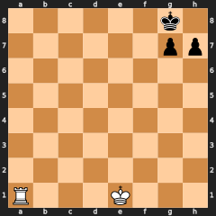 | `6k1/6pp/8/8/8/8/8/R3K3 w - - 0 1`<br><sub>constructed</sub> | **black king has luft on f7**<br>Must not report: back rank weakness (white, ply 0) | Matches: every listed instance reported, none of the excluded ones. | |
| T14 | 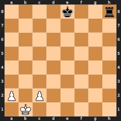 | `4k2r/8/8/8/8/8/P1P5/1K6 b - - 0 1`<br><sub>constructed</sub> | **white king has luft on b2**<br>Must not report: back rank weakness (black, ply 0) | Matches: every listed instance reported, none of the excluded ones. | |
| T15 | 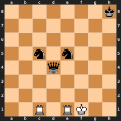 | `7k/8/8/2n1n3/3q4/8/8/2R1RK2 w - - 0 1`<br><sub>constructed</sub> | **queen defends both attacked knights**<br>Must report: overloaded defender Qd4 → c5, e5 (white, ply 0) | Matches: every listed instance reported, none of the excluded ones. | |
| T16 | 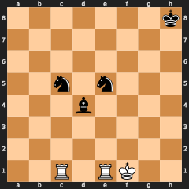 | `7k/8/8/2n1n3/3b4/8/8/2R1RK2 w - - 0 1`<br><sub>constructed</sub> | **bishop defends both attacked knights**<br>Must report: overloaded defender Bd4 → c5, e5 (white, ply 0) | Matches: every listed instance reported, none of the excluded ones. | |
| T17 | 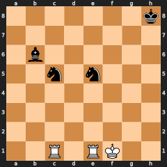 | `7k/8/1b6/2n1n3/8/8/8/2R1RK2 w - - 0 1`<br><sub>constructed</sub> | **defender only protects one attacked knight**<br>Must not report: overloaded defender (white, ply 0) | Matches: every listed instance reported, none of the excluded ones. | |
| T18 | 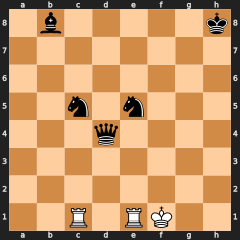 | `1b5k/8/8/2n1n3/3q4/8/8/2R1RK2 w - - 0 1`<br><sub>constructed</sub> | **second defender survives removal of queen**<br>Must not report: overloaded defender (white, ply 0) | Matches: every listed instance reported, none of the excluded ones. | |
| T19 | 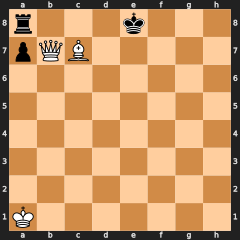 | `r3k3/pQB5/8/8/8/8/8/K7 b - - 0 1`<br><sub>constructed</sub> | **rook's file exit is blocked and rank exits are attacked**<br>Must report: trapped piece Ra8 (white, ply 0)<br>Must not report: hanging piece (white, ply 0) | Matches: every listed instance reported, none of the excluded ones. | |
| T20 | 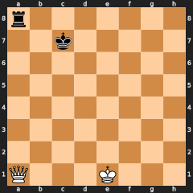 | `r7/2k5/8/8/8/8/8/Q3K3 b - - 0 1`<br><sub>constructed</sub> | **corner rook can escape to b8**<br>Must not report: trapped piece (white, ply 0) | Matches: every listed instance reported, none of the excluded ones. | |
| T21 | 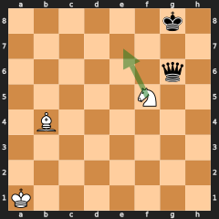 | `6k1/8/6q1/5N2/1B6/8/8/K7 w - - 0 1`<br>Line: Ne7+<br><sub>constructed</sub> | **knight forks queen and king from a safe square**<br>Must report: fork Ne7 → g6, g8 (white, ply 1) | Matches: every listed instance reported, none of the excluded ones. | |
| T22 |  | `6k1/8/6q1/2b2N2/8/8/8/K7 w - - 0 1`<br>Line: Ne7+<br><sub>constructed</sub> | **forking knight can be taken on its landing square**<br>Must not report: fork (white, ply 1) | Matches: every listed instance reported, none of the excluded ones. | |
| T23 |  | `4n2k/8/4q3/8/R7/8/8/KB6 w - - 0 1`<br>Line: Re4<br><sub>constructed</sub> | **rook skewers queen in front of knight**<br>Must report: skewer Re4 → e6, e8 (white, ply 1) | Matches: every listed instance reported, none of the excluded ones. | |
| T24 |  | `4q2k/8/4n3/8/R7/8/8/KB6 w - - 0 1`<br>Line: Re4<br><sub>constructed</sub> | **front knight is no more valuable than rear queen**<br>Must not report: skewer (white, ply 1) | Matches: every listed instance reported, none of the excluded ones. | |
| T25 |  | `K7/8/8/8/8/8/8/R2B3k w - - 0 1`<br>Line: Be2+<br><sub>constructed</sub> | **bishop vacates rook's line to king**<br>Must report: discovered check Ra1 → h1 (white, ply 1) | Matches: every listed instance reported, none of the excluded ones. | |
| T26 |  | `K7/8/8/8/8/8/7k/R2B4 w - - 0 1`<br>Line: Be2<br><sub>constructed</sub> | **bishop vacates rook's line but king is off it**<br>Must not report: discovered check (white, ply 1) | Matches: every listed instance reported, none of the excluded ones. | |
| T27 |  | `4k2r/8/8/8/3P4/8/8/BK6 w - - 0 1`<br>Line: d5<br><sub>constructed</sub> | **pawn uncovers bishop attack on a more valuable rook**<br>Must report: discovered attack Ba1 → h8 (white, ply 1) | Matches: every listed instance reported, none of the excluded ones. | |
| T28 |  | `4k2n/7r/8/8/3P4/8/8/BK6 w - - 0 1`<br>Line: d5<br><sub>constructed</sub> | **unmasked bishop attacks a defended equal-value knight**<br>Must not report: discovered attack (white, ply 1) | Matches: every listed instance reported, none of the excluded ones. | |
| T29 |  | `4k3/8/8/8/4B3/8/8/K3R3 w - - 0 1`<br>Line: Bg6+<br><sub>constructed</sub> | **bishop move reveals rook check as double check**<br>Must report: double check Bg6 → e8 (white, ply 1) | Matches: every listed instance reported, none of the excluded ones. | |
| T30 |  | `4k3/8/8/8/4B3/8/8/K3R3 w - - 0 1`<br>Line: Bf3+<br><sub>constructed</sub> | **bishop opens a single rook check**<br>Must not report: double check (white, ply 1) | Matches: every listed instance reported, none of the excluded ones. | |
| T31 |  | `7k/6pp/8/8/2B5/8/Q7/1R2K3 w - - 0 1`<br>Line: Rb8#<br><sub>constructed</sub> | **rook delivers back-rank mate**<br>Must report: back rank mate Rb8 → h8 (white, ply 1) | Matches: every listed instance reported, none of the excluded ones. | |
| T32 |  | `7k/7p/8/6Q1/8/8/8/1R2K3 w - - 0 1`<br>Line: Rb8#<br><sub>constructed</sub> | **mate remains but one front square is empty**<br>Must not report: back rank mate (white, ply 1) | Matches: every listed instance reported, none of the excluded ones. | |
| T35 |  | `7k/3P4/8/8/8/8/8/K7 w - - 0 1`<br>Line: d8=Q+<br><sub>constructed</sub> | **pawn promotes to queen**<br>Must report: promotion Qd8 (white, ply 1) | Matches: every listed instance reported, none of the excluded ones. | |
| T36 |  | `7k/8/3P4/8/8/8/8/K7 w - - 0 1`<br>Line: d7<br><sub>constructed</sub> | **pawn advances without promoting**<br>Must not report: promotion (white, ply 1) | Matches: every listed instance reported, none of the excluded ones. | |
| T37 |  | `4k3/7r/8/8/8/8/PPP5/1K6 b - - 0 1`<br><sub>constructed</sub> | **white king has occupied front squares and no home-rank rook or queen**<br>Must report: back rank weakness Kb1 (black, ply 0) | Matches: every listed instance reported, none of the excluded ones. | |
| T38 |  | `6k1/5ppp/8/8/8/8/8/K1B5 w - - 0 1`<br><sub>constructed</sub> | **opponent has no rook or queen**<br>Must not report: back rank weakness (white, ply 0) | Matches: every listed instance reported, none of the excluded ones. | |
| T39 |  | `r1bqkbnr/1ppp1ppp/p1n5/1B2p3/4P3/5N2/PPPP1PPP/RNBQK2R w KQkq - 0 4`<br>Line: Bxc6 dxc6<br><sub>constructed</sub> | **equal-value recapture is a trade in progress**<br>Must not report: hanging piece (black, ply 0); hanging piece (black, ply 1) | Matches: every listed instance reported, none of the excluded ones. | |
| T40 |  | `7k/8/8/8/8/5b2/4q3/K3R3 b - - 0 1`<br>Line: Bh1<br><sub>constructed</sub> | **black bishop abandons its queen's defense**<br>Must report: hanging piece Qe2 (white, ply 1) | Matches: every listed instance reported, none of the excluded ones. | |
| T41 |  | `3k4/8/8/8/8/8/8/R3K3 w Q - 0 1`<br>Line: O-O-O+<br><sub>constructed</sub> | **castling rook gives the check but is not a discovered checker**<br>Must not report: discovered check (white, ply 1) | Matches: every listed instance reported, none of the excluded ones. | |
| T42 |  | `2r3k1/p4pp1/Pp2pn1p/3nN1q1/3P1P1R/3B2P1/1P2Q1KP/8 b - - 0 30`<br>Line: Qxh4<br><sub>lichess:obWQv</sub> | **C09 fork restriction, plus capture threats**<br>Must report: tactical pin Nd5 → h4, e2, g2, fork on f4 (black, ply 0); tactical pin Nd5 → h4, f4, capture on f4 (black, ply 0); tactical pin Nd5 → g3, e2, g2, fork on f4 (black, ply 1); tactical pin Nd5 → g3, f4, capture on f4 (black, ply 1); tactical pin Qh4 → f4, d4, capture on d4 (black, ply 1)<br>Must not report: tactical pin (white, ply 0 and 1) | Matches: every listed instance reported, none of the excluded ones. | |
| T43 |  | `8/7p/6k1/3N4/8/8/4q3/K7 w - - 0 1`<br><sub>constructed</sub> | **fork already exists with the pawn on the board**<br>Must not report: tactical pin (white or black, ply 0) | Matches: none of the excluded ones. | |
| T44 |  | `8/6k1/8/8/Q2p3b/8/K7/B7 w - - 0 1`<br><sub>constructed</sub> | **absolutely pinned pawn blocks a fork route but is skipped**<br>Must not report: tactical pin (white or black, ply 0) | Matches: none of the excluded ones. | |
| T45 |  | `8/8/6k1/3Np1p1/8/8/4q3/K7 w - - 0 1`<br><sub>constructed</sub> | **second pawn still guards the fork square**<br>Must not report: tactical pin (white or black, ply 0) | Matches: none of the excluded ones. | |
| T46 |  | `8/8/6k1/3N2p1/8/8/4q3/K7 b - - 0 1`<br><sub>constructed</sub> | **Y to move: the pawn on g5 still holds the fork square for X**<br>Must report: tactical pin Nd5 → g5, e2, g6, fork on f4 (white, ply 0), restricted g5-f4, g5-g4, g5-h4, free none, held at square g5<br>Must not report: tactical pin (black, ply 0) | Matches: every listed instance reported with its restriction, none of the excluded ones. | 2026-10-22 Deputy: every move of the pawn, its two hypothetical captures included (checkpoint 2), lets the fork happen. |
| T47 |  | `q7/8/k7/8/p7/8/7K/1R6 w - - 0 1`<br><sub>constructed</sub> | **pawn on the a-file whose capture would open the skewer**<br>Must report: tactical pin Rb1 → a4, a6, a8, skewer on a1 (white, ply 0), restricted a4-b3, free a4-a3, held along file a<br>Must not report: tactical pin (black, ply 0) | Matches: every listed instance reported with its restriction, none of the excluded ones. | 2026-10-22 Deputy: an exclude from checkpoint 1 (only move a3 keeps the file blocked) until checkpoint 2, when hypothetical captures made a4xb3 a restricted move; an include again, as before 2026-10-22. |
| T48 |  | `k7/8/p7/8/N7/8/8/R6K w - - 0 1`<br><sub>constructed</sub> | **pawn blocks discovered and double check**<br>Must report: tactical pin Na4 → a6, a8, discovered check on b2 (white, ply 0); tactical pin Na4 → a6, a8, double check on b6 (white, ply 0)<br>Must not report: tactical pin (black, ply 0) | Matches: every listed instance reported, none of the excluded ones. | |
| T49 |  | `q6k/8/p7/8/N7/8/7K/R7 w - - 0 1`<br><sub>constructed</sub> | **pawn blocks a discovered attack on the queen**<br>Must report: tactical pin Na4 → a6, a8, discovered attack on b2 (white, ply 0)<br>Must not report: tactical pin (black, ply 0) | Matches: every listed instance reported, none of the excluded ones. | |
| T50 |  | `4k3/1N1ppp2/4N3/8/7p/8/8/K6R w - - 0 1`<br><sub>constructed</sub> | **pawn blocks a back-rank mate on h8**<br>Must report: tactical pin Rh1 → h4, e8, back-rank mate on h8 (white, ply 0); tactical pin Rh1 → h4, e8, checkmate on h8 (white, ply 0)<br>Must not report: tactical pin (black, ply 0) | Matches: every listed instance reported, none of the excluded ones. | |
| T51 |  | `r6k/P7/8/8/8/8/8/7K w - - 0 1`<br><sub>constructed</sub> | **rook blocks the promotion square**<br>Must report: tactical pin a7 → a8, promotion on a8 (white, ply 0)<br>Must not report: tactical pin (black, ply 0) | Matches: every listed instance reported, none of the excluded ones. | |
| T52 |  | `7k/8/5K2/8/6p1/8/8/6Q1 w - - 0 1`<br><sub>constructed</sub> | **pawn blocks a queen mate on g7**<br>Must report: tactical pin Qg1 → g4, h8, checkmate on g7 (white, ply 0)<br>Must not report: tactical pin (black, ply 0) | Matches: every listed instance reported, none of the excluded ones. | |
| T53 |  | `7k/p7/8/8/8/8/8/K6R b - - 0 1`<br><sub>constructed</sub> | **no pin_tactical for X while Y is in check**<br>Must not report: tactical pin (white or black, ply 0) | Matches: none of the excluded ones. | |
| T54 |  | `4k3/8/8/8/3pP3/8/8/4K3 b - e3 0 1`<br><sub>constructed</sub> | **removing the pawn that just made a double step clears en passant**<br>Must not report: tactical pin (white or black, ply 0). Guards the §4.5 rule that B−p has no en passant square once the double-stepped pawn is removed (an ASan/Debug build aborts otherwise) | Matches: none of the excluded ones. | |
| T55 |  | `k7/8/K7/8/8/r2R4/8/8 w - - 0 1`<br><sub>constructed</sub> | **no pin_tactical for X while X is in check**<br>Must not report: tactical pin (white or black, ply 0). Without the §4.5 check rule, Rd3 → a3, a8, checkmate on d8 (white) would be reported: Rd8 mates once the checking rook is gone | Matches: none of the excluded ones (the detector before the gate fix reported Rd3 → a3, a8, checkmate on d8). | |
| T56 |  | `2k1q3/3rR3/2K5/8/8/8/2pR4/8 w - - 0 1`<br><sub>constructed</sub> | **removing the rook would discover check on X**<br>Must not report: tactical pin (white, ply 0). Removing Rd7 opens Qe8 → c6; without the §4.5 rule Re7 → d7, c8, checkmate on e8 would be reported | Matches: none of the excluded ones (the detector before the gate fix reported Re7 → d7, c8, checkmate on e8). | |
| T57 |  | `r1bqkbnr/pppp1ppp/2n5/4p2Q/2B1P3/8/PPPP1PPP/RNB1K1NR b KQkq - 3 3`<br><sub>constructed: README root position</sub> | **a rook with no legal move is not held in place**<br>Must not report: tactical pin → h8, e8, g8, fork on f7 (white, ply 0); tactical pin → h8, h7, capture on h7 (white, ply 0) | Matches: none of the excluded ones. | |
| T58 |  | `4q2k/8/8/4p3/3P4/8/8/K3R3 b - - 0 1`<br><sub>constructed</sub> | **relative pin with restricted captures and a free push**<br>Must report: pin relative Re1 → e5, e8 (white, ply 0), restricted e5-d4, e5-f4, free e5-e4, held along file e | Matches: every listed instance reported with its restriction. | 2026-10-22 Deputy: e5-f4 is a hypothetical capture onto an empty square (checkpoint 2). |
| T59 |  | `4k3/8/8/4p3/8/8/8/K3R3 b - - 0 1`<br><sub>constructed</sub> | **pinned pawn whose captures are hypothetical**<br>Must report: pin absolute Re1 → e5, e8 (white, ply 0), restricted e5-d4, e5-f4, free e5-e4, held along file e | Matches: every listed instance reported with its restriction. | 2026-10-22 Deputy: was an exclude ("its push stays on the pin line, so no move is restricted") until checkpoint 2; the Captain: a pawn's captures count even with nothing to capture. |
| T60 |  | `R7/p2k4/2np4/2p2pR1/2P5/1P4P1/P3r1K1/8 w - - 1 37`<br>Line: Kf3 Nd4+<br><sub>Lichess puzzle UG08H (test split), after 37.Kf3 Nd4+</sub> | **overloaded knight that gives check has no king capture in its move set**<br>Must report: overloaded defender Nd4 → e2, f5 (white, ply 2), restricted d4-b3, d4-b5, d4-c2, d4-c6, d4-e6, free none, held at square d4; d4-f3 (taking the king) is in neither list | Matches: every listed instance reported with its restriction. | 2026-10-23 Deputy: added at checkpoint 3 (Captain); the board where the ASan oracle found the king capture. |

## 6. C fixtures — tactic contributions and labels (`tests/fixtures/tactics.json`)

**Concepts:** `ContributionFixtures`, `Contribution`, `CoDirect`, `CoDenied`, `CoIndirect`, `CoNotUsed`, `TacticLabel`, `TacticSequence`, `TacticalPin`, `StateMotif`, `MoveMotif`, `Restriction`

Hand-labelled tactic lines: for each motif on the line, whether it contributed to
the tactic (DEFINITIONS §4.5), plus required or forbidden tactic labels. Read by
`tactic fixtures exercise contributions and labels`. Rows re-set at checkpoint 2
(2026-10-22) for contribution rule 3′, the existence condition and hypothetical
captures; the test passes on every C fixture.

| ID | Board | Position | Fixture claims | Codebase today | Comments |
|---|---|---|---|---|---|
| C01 |  | `rn1qk2r/ppp2ppp/5n2/3P2B1/1b2p1b1/2N5/PP3PPP/R2QKBNR w KQkq - 1 8`<br>Line: Qa4+ Nc6 dxc6 Bxc3+ bxc3<br><sub>lichess:SPCxc</sub> | **Queen check-fork guards the knight-capture square**<br>Contributions: pin relative Bg5 → f6, d8 (white, ply 0) **indirect**; fork Qa4 → b4, e8 (white, ply 1) **direct**; hanging piece Nc6 (white, ply 2) **direct**; pin absolute Qa4 → c6, e8 (white, ply 2) **direct**; trapped piece Nc6 (white, ply 2) **direct**<br>Label forbidden: removal of defender | Matches: every contribution and label as hand-labelled. | 2026-10-21 Deputy: the a7→a8 pin was labelled indirect until checkpoint 2; the Captain set it to none (the pin does nothing; Qa4's guard of c6 is the queen's own work). 2026-10-22 Deputy: checkpoint 2 (PostM3_EM2): the Bg5 pin turned **indirect** under rule 3′: Nf6-d7 would block Qa4+, but the pin denies it (Bxd8 would win the queen). The ply-1 Qa4 → a7, a8 row went: Black is in check after Qa4+, so the a7 pawn has no legal move and the pin restricts nothing. |
| C02 |  | `5rk1/pp3pp1/7p/n2q4/4N1b1/3B4/P2Q1PPP/2R3K1 w - - 0 20`<br>Line: Nf6+ gxf6 Bh7+ Kxh7 Qxd5<br><sub>lichess:NNFmu</sub> | **Discovered attack wins the exposed queen after checks**<br>Contributions: discovered attack Qd2 → d5 (white, ply 3) **direct**; hanging piece Qd5 (white, ply 4) **direct**<br>Label forbidden: removal of defender | Matches: every contribution and label as hand-labelled. | |
| C03 |  | `r1b1k2r/ppp2p1p/3p1Q2/2q1n2P/4P3/3PN3/PPPK2P1/R4B1R b kq - 0 18`<br>Line: Qxe3+ Kxe3 Ng4+ Kf4 Nxf6<br><sub>lichess:AAdbR</sub> | **Queen sacrifice clears the knight fork**<br>Contributions: fork Ng4 → e3, f6 (black, ply 3) **direct**; hanging piece Qf6 (black, ply 4) **direct**<br>Label forbidden: removal of defender | Matches: every contribution and label as hand-labelled. | |
| C04 |  | `4R3/1pk1bQpp/2p3n1/8/3r4/1P2N1q1/1PP5/2B2KN1 b - - 0 20`<br>Line: Rf4+ Qxf4+ Qxf4+<br><sub>lichess:wKuEl</sub> | **Rook fork forces the queen exchange**<br>Contributions: fork Rf4 → f1, f7 (black, ply 1) **direct**; hanging piece Qf4 (black, ply 2) **direct**<br>Label forbidden: removal of defender | Matches: every contribution and label as hand-labelled. | |
| C05 |  | `1n1r4/2R2pk1/p4r1p/2pN2p1/1p1b4/1P3B1P/P1P2PP1/3R2K1 b - - 11 31`<br>Line: Rxf3 gxf3 Rxd5<br><sub>lichess:xeP1l</sub> | **Capture of the overloaded bishop wins the knight**<br>Contributions: pin absolute Bd4 → f2, g1 (black, ply 0) **none**; overloaded defender Bf3 → f2, d5 (black, ply 0) **direct**; hanging piece Nd5 (black, ply 2) **direct**<br>Label required: removal of defender Rf3 → f3, d5 (black, ply 1) | Matches: every contribution and label as hand-labelled. | 2026-10-22 Deputy: the planned drop of the Bd4 pin (existence condition, legal moves only) was superseded at checkpoint 2 (hypothetical captures): f2xg3 is restricted and f2xe3 free, so the pin stays. |
| C06 |  | `5rk1/pp3ppp/2p2n2/q7/2n2Q2/P1N2B1P/1PP2PP1/3R2K1 b - - 0 20`<br>Line: Nxb2 Rb1 Qxc3<br><sub>lichess:xeZ2j</sub> | **Knight capture removes the pawn guarding a knight**<br>Contributions: overloaded defender b2 → a3, c3 (black, ply 0) **direct**; hanging piece Nc3 (black, ply 2) **direct**<br>Label required: removal of defender Nb2 → b2, c3 (black, ply 1) | Matches: every contribution and label as hand-labelled. | |
| C07 |  | `2r3k1/p2q1pp1/1p5p/4n3/Q3P3/6PP/5P1K/2R5 w - - 3 33`<br>Line: Qxd7 Nxd7 Rxc8+<br><sub>lichess:SLgPd</sub> | **Queen sacrifice removes the rook's defender**<br>Contributions: overloaded defender Qd7 → a7, c8 (white, ply 0) **direct**; hanging piece Rc8 (white, ply 2) **direct**<br>Label required: removal of defender Qd7 → d7, c8 (white, ply 1) | Matches: every contribution and label as hand-labelled. | |
| C08 |  | `3r2k1/4rppb/1BBp3p/b3p3/P1P4q/1Q1P3P/5PP1/R4RK1 b - - 0 22`<br>Line: Rb8 c5 dxc5 Qd5 Bxb6<br><sub>lichess:9qopA</sub> | **Overloaded queen leaves the bishop on b6 exposed**<br>Contributions: overloaded defender Qb3 → d3, b6 (black, ply 0) **direct**; pin relative Rb8 → b6, b3 (black, ply 1) **direct**; overloaded defender Qb3 → d3, b6 (black, ply 2) **direct**; hanging piece Bb6 (black, ply 4) **direct**<br>Label required: removal of defender c5 → c5, b6 (black, ply 3) | Matches: every contribution and label as hand-labelled. | 2026-10-21 Deputy: label changed from forbidden to required at checkpoint 2 (Captain; Lichess tags `capturingDefender`); title fixed: the queen is overloaded, not the bishop. |
| C09 |  | `2r3k1/p4pp1/Pp2pn1p/3nN1q1/3P1P1R/3B2P1/1P2Q1KP/8 b - - 0 30`<br>Line: Qxh4 gxh4 Nxf4+ Kf3 Nxe2<br><sub>lichess:obWQv</sub> | **Queen and knight overwhelm the pawn's two duties**<br>Contributions: pin absolute Qg5 → g3, g2 (black, ply 0) **none**; overloaded defender g3 → f4, h4 (black, ply 0) **direct**; tactical pin Nd5 → h4, e2, g2, fork on f4 (black, ply 0) **direct**; tactical pin Nd5 → g3, e2, g2, fork on f4 (black, ply 1) **direct**; fork Nf4 → e2, g2 (black, ply 3) **direct**; hanging piece Qe2 (black, ply 4) **direct**<br>Label required: removal of defender h4 → h4, f4 (black, ply 1) | Matches: every contribution and label as hand-labelled. | 2026-10-21 Deputy: checkpoint 2 (Captain): the Qg5 pin set to none; label changed from forbidden to required. The Captain reads the g3 pawn as held by Nd5's threat Nxf4+ (a tactical pin); the two `pin_tactical` rows were added when the tag was frozen (TERMINOLOGY `pin_tactical`). Other `pin_tactical` instances on C fixtures are not listed (exempt from the exact set). 2026-10-22 Deputy: the planned drop of the Qg5 pin was superseded at checkpoint 2 (hypothetical captures onto every diagonal square, Captain): g3xf4 and g3xh4, onto White's own pawn and rook, are restricted, so the pin stays. |
| C10 |  | `3r1r1k/1pp1q1pp/8/3B1p2/1pPn1P2/b3B3/P3QP2/1K5R w - - 0 29`<br>Line: Rxh7+ Kxh7 Qh5#<br><sub>lichess:Fvug7</sub> | **Sacrificial rook check leads to mate**<br>Contributions: hanging piece Nd4 (white, ply 0) **none**; pin absolute Rh1 → h7, h8 (white, ply 0) **direct**; hanging piece Nd4 (white, ply 2) **none**<br>Label forbidden: removal of defender | Matches: every contribution and label as hand-labelled (since the 2026-10-21 rule change: Black's Kxh7 no longer makes the h7 pin direct). | 2026-10-22 Deputy: checkpoint 2 (PostM3_EM2): the Rh1 pin stays (h7xg6 is restricted; the planned drop, legal moves only, was superseded). The ply-1 pin relative Rh7 → g7, e7 (labelled none) went: Black is in check, so g7 has no legal move; the Captain: the check holds the pawn, not the pin. |
| C11 |  | `r1b2rk1/1p3ppp/p7/4p3/4nq2/PNP5/2P2QBP/R3K2R w KQ - 0 19`<br>Line: Qxf4 exf4 Bxe4<br><sub>lichess:7hB3U</sub> | **Queen trade removes the knight's defender**<br>Contributions: hanging piece Ne4 (white, ply 2) **direct**; pin relative Be4 → b7, a8 (white, ply 3) **none**<br>Label required: removal of defender Qf4 → f4, e4 (white, ply 1) | Matches: every contribution and label as hand-labelled. | |
| C12 |  | `4k3/4p3/3q4/8/8/6B1/8/4R1K1 w - - 0 1`<br>Line: Bxd6 e5 Bb4 e4 Kf2 e3+<br><sub>constructed; margin 0.501</sub> | **Pinned pawn cannot recapture the bishop on d6**<br>Contributions: hanging piece Qd6 (white, ply 0) **direct**; pin absolute Re1 → e7, e8 (white, ply 0) **indirect**; pin absolute Re1 → e5, e8 (white, ply 2) **none**; pin absolute Re1 → e4, e8 (white, ply 4) **none**; pin absolute Re1 → e3, e8 (white, ply 6) **none** | Matches: every contribution and label as hand-labelled (since the 2026-10-21 rule change: Black's pawn moves no longer make the pins direct). | 2026-10-22 Deputy: the planned move of the pin to ply 1 was superseded at checkpoint 2 (hypothetical captures): at ply 0, e7xd6 (onto its own queen's square) and e7xf6 are restricted, so the pin holds at ply 0 and the later pins stay. |
| C13 |  | `4k3/4n3/8/5q2/8/7B/8/K3R3 w - - 0 1`<br>Line: Bxf5 Kd8 Be4 Kd7 Kb2 Kd6<br><sub>constructed; margin 0.5</sub> | **Pinned knight cannot recapture the bishop on f5**<br>Contributions: hanging piece Qf5 (white, ply 0) **direct**; pin absolute Re1 → e7, e8 (white, ply 0) **indirect** | Matches: every contribution and label as hand-labelled (since the 2026-10-21 rule change: Kd8 no longer makes the pin direct). | |
| C14 |  | `2k5/2p5/3q4/4B3/8/8/8/K1R5 w - - 0 1`<br>Line: Bxd6 Kd7 Ba3 c5 Re1 Kc6<br><sub>constructed; margin 0.5</sub> | **Pinned pawn cannot recapture the bishop on d6 from c7**<br>Contributions: hanging piece Qd6 (white, ply 0) **direct**; pin absolute Rc1 → c7, c8 (white, ply 0) **indirect** | Matches: every contribution and label as hand-labelled (since the 2026-10-21 rule change: Kd7 no longer makes the pin direct). | 2026-10-22 Deputy: the planned move of the pin to ply 1 was superseded at checkpoint 2 (hypothetical captures): at ply 0, c7xb6 and c7xd6 (onto its own queen's square) are restricted. |
| C15 |  | `4k3/8/3b4/2P1n3/8/8/8/K3R3 w - - 0 1`<br>Line: cxd6 Kd7 Rxe5 Kxd6 Rh5 Ke6<br><sub>constructed, after seed T33; margin 0.499</sub> | **T33 revival: pawn removes the bishop defending a knight**<br>Contributions: hanging piece Bd6 (white, ply 0) **direct**; pin absolute Re1 → e5, e8 (white, ply 0) **direct**; trapped piece Ne5 (white, ply 1) **direct**; hanging piece Ne5 (white, ply 2) **direct**<br>Label required: removal of defender d6 → d6, e5 (white, ply 1) | Matches: every contribution and label as hand-labelled. | |
| C16 |  | `k3r3/8/3b4/2P1n3/8/8/8/K3R3 w - - 0 1`<br>Line: cxd6 Kb7 Re2 Kc6 Kb1 Kxd6<br><sub>constructed, after seed T34; margin 0.499</sub> | **T34 near miss: the rook still defends the knight**<br>Contributions: hanging piece Bd6 (white, ply 0) **direct**; pin relative Re1 → e5, e8 (white, ply 0) **none**; pin relative Re2 → e5, e8 (white, ply 3) **none**<br>Label forbidden: removal of defender | Matches: every contribution and label as hand-labelled. | 2026-10-21 Deputy: the Re1 pin was labelled direct until checkpoint 2; the Captain set it to none (Re2 regroups without using the pin). |
| C17 |  | `6k1/5ppp/8/8/8/1q6/5PPP/4R1K1 w - - 0 1`<br>Line: Re8#<br><sub>constructed; margin 1.0</sub> | **Back-rank mate: the king's own pawns take away its escape**<br>Contributions: back rank weakness (white, ply 0) **indirect** (without f7/g7/h7 the king would step off the back rank); back rank mate Re8 (white, ply 1) **direct** | Matches: every contribution as hand-labelled. Re8# is a tactic (margin 1.0). Before the denied-reply rule the back-rank weakness was judged **none**. | 2026-10-22 Deputy: the fixture worker first substituted `6k1/1q3ppp/8/8/5n2/8/5PPP/4R1K1 w - - 0 1` (P12's board) without cause; the frozen board was restored and passes. |
| C18 |  | `6k1/5ppp/3rr3/q7/6Q1/8/1B3PPP/6K1 w - - 0 1`<br>Line: Qxg7#<br><sub>constructed; margin 1.0</sub> | **Queen mate on g7 where the back-rank weakness denies nothing used**<br>Contributions: back rank weakness (white, ply 0) **none** (with f7 or h7 gone, the queen on g7 still covers both squares); pin absolute Qg4 → g7, g8 (white, ply 0) **direct** (Qxg7# captures the pinned pawn) | Matches: every contribution as hand-labelled. Qxg7# is a tactic (margin 1.0). Before the denied-reply rule the weakness was judged **indirect** (a black piece attacks g7). | 2026-10-22 Deputy: the Qg4 pin row was added at checkpoint 2 (hypothetical captures): g7xf6 and g7xh6 are restricted, g7-g6 and g7-g5 free. |

## 7. Data files

**Concepts:** `InputFixtures`, `GameMainline`, `PgnInput`, `OpeningNames`, `PuzzleSample`, `MotifFixtures`, `ContributionFixtures`, `ReferenceImplementation`, `GamesOracle`, `PositionKey`

| File | Content | Read by | Comments |
|---|---|---|---|
| `tests/fixtures/two_games.pgn` | Two short games | F15, E09, E10, E12, PGN input tests | |
| `tests/fixtures/three_games.pgn` | Three games; game 3 has an illegal second move | U fixtures, E08, PGN input tests | |
| `tests/fixtures/annotated.pgn` | Five games with comments, NAGs and headers | PGN reader tests, `pgntool` tests | |
| `tests/fixtures/fen_tag.pgn` | A game starting from a `FEN`/`SetUp` tag | U04 | |
| `tests/fixtures/games_edge.pgn` | Two eligible games (both players 2300/2400): one reaches a double pawn step (9...f5) whose only capturing pawn is pinned, so the en passant square is pseudo-legal; one has a variation with an illegal move (`1.e4 (1.d4 Ke6) e5 2.Nf3 Nc6`) | `games_oracle_edge` | |
| `tests/fixtures/puzzles/test.csv` | The committed **test** split of the Lichess puzzle sample: 9,300 puzzles from the 2026-10-05 Lichess export (CC0), columns `PuzzleId, FEN, Moves, Themes, Stratum`, see DEFINITIONS §5.1 | `tactics_puzzles` (recall, Lichess agreement), `tactics_oracle` | |

## 8. P fixtures — positional features and changes (`tests/fixtures/positional.json`)

**Concepts:** `PositionalFixtures`, `PawnStructure`, `KingSafety`, `PieceActivity`, `SpaceDevelopment`, `MaterialBalance`, `PositionalChange`

Hand-labelled from the rules before the detectors ran; `positional_unit_tests` checks every
claim. Every tag has a positive and a near miss. Rows cite their source game where the
position comes from one; a `source` names the game, never the book it was transcribed
from (M3a's "never a book"; checked 2026-10-22). P fixtures check the rules on real
positions; they are not book support for the rules, which no test shows yet. F rows with
positional claims (F25–F28) are in section 1.

### 8.1 Features (`features`)

| ID | Board | Position | Fixture claims | Codebase today | Comments |
|---|---|---|---|---|---|
| P01 |  | Tripled c-pawns meet the doubled-pawn rule<br>`r3q1k1/p1p2rpp/n1p1p3/2p1Pp2/2P2P2/2N2QP1/PP1R3P/2KR4 b - - 6 20`<br><sub>Polugayevsky - Dokhoian, Belgrade 1988, after 20.Rgd2</sub> | **Reported:**<br>`doubled_pawns` black, c file<br>`tripled_pawns` black, c file<br><sub>Black's three c-pawns are tripled and also satisfy the doubled-pawn threshold.</sub> | Passes: every claimed feature reported, every excluded one absent. | 2026-10-22 PBookSupport: book support: `doubled_pawns` black, c file — yes (The passage explicitly calls Black’s c-pawns tripled.) 2026-10-23 Deputy: `tripled_pawns` include added (Captain, checkpoint 3). |
| P02 |  | Doubled c-pawns after the recapture<br>`r1b2rk1/1pp2pbp/4p1p1/p3P3/PqP1Q3/5N1P/2P2PP1/R1B1R1K1 b - - 0 19`<br><sub>Short - Timman, Tilburg 1991, after 19.bxc4</sub> | **Reported:**<br>`doubled_pawns` white, c file<br>`pawn_islands` white 3<br>`pawn_islands` black 2<br>**Not reported:**<br>`doubled_pawns` black, c file<br><sub>White's c2 and c4 pawns are doubled; White has three pawn-file runs and Black has two.</sub> | Passes: every claimed feature reported, every excluded one absent. | 2026-10-22 PBookSupport: book support: `doubled_pawns` white, c file — yes (The resulting c-pawn structure is described as favorable.); `pawn_islands` white 3 — no (The discussion focuses on attacking prospects, not White’s pawn-file runs.); `pawn_islands` black 2 — no (The discussion focuses on attacking prospects, not Black’s pawn-file runs.); `doubled_pawns` black, c file — yes (The score leaves Black with only the c7 pawn.) |
| P03 |  | The bishop occupies the supported d5 outpost<br>`3r1rk1/pp2qp2/1n3bpp/3Bp3/4P3/2N2Q1P/PP3PP1/2RR2K1 b - - 0 19`<br><sub>Gligoric - Gheorghiu, Tel Aviv 1966, after 19.Bxd5 in the 17...cxd5 line</sub> | **Reported:**<br>`outpost` white: B d5<br><sub>The bishop is on White's fifth rank, the e4 pawn defends d5, and no Black pawn is adjacent-file and in front.</sub> | Passes: every claimed feature reported, every excluded one absent. | 2026-10-22 PBookSupport: book support: `outpost` white: B d5 — yes (The passage calls White’s bishop on d5 a powerful outpost.) |
| P04 |  | The adjacent f-pawn excludes a backward e-pawn<br>`rnbqkb1r/pp2pp1p/1n1p2p1/3P4/2P5/4B3/PP3PPP/RN1QKBNR b KQkq - 0 7`<br><sub>constructed</sub> | **Not reported:**<br>`backward_pawn` black, e file<br><sub>Black's e7 stop square e6 is attacked, but its f7 neighbour is on the same relative rank and fails the backward-pawn condition.</sub> | Passes: every claimed feature reported, every excluded one absent. | |
| P05 |  | Pawn islands in the closed-center structure<br>`5r2/1pr1ppkp/p2p2p1/3P4/P2q1P2/1P5P/2P1Q1PK/R4R2 w - - 5 24`<br><sub>Suchting - Chajes, Karlsbad 1911, after 23...Rc7</sub> | **Reported:**<br>`pawn_islands` white 2<br>`pawn_islands` black 2<br><sub>White's pawns span files a–d and f–h, two maximal runs; Black's occupy two runs.</sub> | Passes: every claimed feature reported, every excluded one absent. | 2026-10-22 PBookSupport: book support: `pawn_islands` white 2 — no (It discusses space and piece activity, not White’s pawn-file runs.); `pawn_islands` black 2 — no (It discusses space and piece activity, not Black’s pawn-file runs.) |
| P06 |  | The c3/c4 pawn pair is doubled<br>`r1bqk2r/pp2pp1p/2np1np1/8/2P1P3/2P5/P1N2PPP/R1BQKB1R w KQkq - 1 9`<br><sub>constructed</sub> | **Reported:**<br>`doubled_pawns` white, c file<br>**Not reported:**<br>`doubled_pawns` black, c file<br><sub>White has pawns on c3 and c4, while Black has only one pawn on c.</sub> | Passes: every claimed feature reported, every excluded one absent. | |
| P07 |  | The isolated d-pawn in the isolani position<br>`r2q1rk1/1p1bbppp/p1n1pn2/6B1/3P4/1BN2N2/PP1Q1PPP/R2R2K1 b - - 6 12`<br><sub>constructed</sub> | **Reported:**<br>`isolated_pawn` white, d file<br>**Not reported:**<br>`isolated_pawn` black, e file<br><sub>White's d4 pawn has no friendly pawn on c or e; Black's e6 pawn is not isolated because f7 is occupied.</sub> | Passes: every claimed feature reported, every excluded one absent. | |
| P08 |  | File runs in the minority-attack position<br>`r2qr1k1/1b1n1pp1/1pp2b1p/p2p4/1P1P4/PQNBPN2/5PPP/R4RK1 b - - 4 15`<br><sub>San Segundo - Pigusov, Menorca 1994, after 15.Bd3</sub> | **Reported:**<br>`pawn_islands` white 2<br>`pawn_islands` black 2<br><sub>White's pawns span files a–b and d–h, two maximal runs; Black's span a–d and f–h.</sub> | Passes: every claimed feature reported, every excluded one absent. | 2026-10-22 PBookSupport: book support: `pawn_islands` white 2 — no (It analyzes the minority attack, not White’s pawn-island count.); `pawn_islands` black 2 — no (It analyzes the minority attack, not Black’s pawn-island count.) |
| P09 |  | The d6 pawn has a clear path<br>`2nr1rk1/pp2qpb1/3P4/2p1p1pn/4P3/1BN1Q1B1/PP3PP1/2RR2K1 b - - 0 22`<br><sub>Gligoric - Gheorghiu, Tel Aviv 1966, after 22.d6</sub> | **Reported:**<br>`passed_pawn` white, d file: P d6<br><sub>White's d6 pawn has no Black pawn ahead on d or either adjacent file.</sub> | Passes: every claimed feature reported, every excluded one absent. | 2026-10-22 PBookSupport: book support: `passed_pawn` white, d file: P d6 — yes (The analysis treats White’s d-pawn as a passed pawn.) |
| P10 |  | Two pawns do not form the defined chain<br>`2r3k1/1brnqppp/p1p1p3/1p2P3/3P1Q2/2RB1N2/PP3PPP/2R3K1 b - - 0 19`<br><sub>Pillsbury - Burn, Hastings 1895, after 19.e5</sub> | **Not reported:**<br>`pawn_chain` white<br><sub>The d4 and e5 pawns defend diagonally, but the maximal run has only two pawns, below the three-pawn definition.</sub> | Passes: every claimed feature reported, every excluded one absent. | 2026-10-22 PBookSupport: book support: `pawn_chain` white — no (The explanation covers e5’s space gain, not the d4–e5 chain.) |
| P11 |  | Isolated edge pawns and a connected-file near miss<br>`7k/8/8/5p1p/P2P4/4P3/8/4K3 w - - 0 1`<br><sub>constructed</sub> | **Reported:**<br>`isolated_pawn` white, a file<br>`isolated_pawn` black, h file<br>**Not reported:**<br>`isolated_pawn` white, d file<br><sub>White's a4 and Black's h5 have no friendly pawn on adjacent files; d4 is adjacent to White's e3 pawn.</sub> | Passes: every claimed feature reported, every excluded one absent. | |
| P12 |  | Doubled pawns for both colours<br>`7k/8/5p2/2P5/5p2/2P5/8/4K3 w - - 0 1`<br><sub>constructed</sub> | **Reported:**<br>`doubled_pawns` white, c file<br>`doubled_pawns` black, f file<br>**Not reported:**<br>`doubled_pawns` white, e file<br>`tripled_pawns` white, c file<br><sub>White has two c-pawns and Black has two f-pawns; neither pair is tripled, and White has only one pawn on e.</sub> | Passes: every claimed feature reported, every excluded one absent. | 2026-10-23 Deputy: `tripled_pawns` exclude added (Captain, checkpoint 3). |
| P13 |  | A backward pawn for each colour<br>`7k/8/2p5/4P1p1/3P3p/7P/8/K7 w - - 0 1`<br><sub>constructed</sub> | **Reported:**<br>`backward_pawn` white, d file<br>`backward_pawn` black, g file<br>**Not reported:**<br>`backward_pawn` black, c file<br>`backward_pawn` white, e file<br><sub>White d4 and Black g5 each have an adjacent-file pawn ahead and an empty stop square attacked by an enemy pawn; White e5 lacks the rank condition.</sub> | Passes: every claimed feature reported, every excluded one absent. | |
| P14 |  | Only the front doubled pawn is passed<br>`7k/8/3P4/1p1P4/P5p1/6p1/8/4K3 w - - 0 1`<br><sub>constructed</sub> | **Reported:**<br>`passed_pawn` white, d file: P d6<br>`passed_pawn` black, g file: p g3<br>**Not reported:**<br>`passed_pawn` white, d file: P d5<br>`passed_pawn` white, a file<br><sub>The front d6 pawn is selected while d5 is not passed because d6 is in front on its file; b5 also blocks a4.</sub> | Passes: every claimed feature reported, every excluded one absent. | |
| P15 |  | Two white runs of connected passers; Black has a one-file gap<br>`k7/8/8/2PP2PP/8/1p1p4/8/4K3 w - - 0 1`<br><sub>constructed</sub> | **Reported:**<br>`connected_passed_pawns` white: P c5, P d5<br>`connected_passed_pawns` white: P g5, P h5<br>**Not reported:**<br>`connected_passed_pawns` black<br><sub>White has two maximal runs of adjacent-file passers; Black's b3 and d3 passers are separated by c.</sub> | Passes: every claimed feature reported, every excluded one absent. | |
| P16 |  | Pawn-island counts for both colours<br>`7k/2p2p2/8/8/8/8/P1PP4/4K3 w - - 0 1`<br><sub>constructed</sub> | **Reported:**<br>`pawn_islands` white 2<br>`pawn_islands` black 2<br><sub>White has the a-file and c-d runs; Black has the c- and f-file runs.</sub> | Passes: every claimed feature reported, every excluded one absent. | |
| P17 |  | No pawn means no pawn islands<br>`7k/8/8/8/8/8/8/4K3 w - - 0 1`<br><sub>constructed</sub> | **Not reported:**<br>`pawn_islands` white<br>`pawn_islands` black<br><sub>Neither side has a pawn, so the required at-least-one-pawn condition fails.</sub> | Passes: every claimed feature reported, every excluded one absent. | |
| P18 |  | Three-pawn chain versus a two-pawn run<br>`7k/8/2P5/3Pp3/3pP3/8/8/K7 w - - 0 1`<br><sub>constructed</sub> | **Reported:**<br>`pawn_chain` white: P e4, P d5, P c6<br>**Not reported:**<br>`pawn_chain` black<br><sub>White's e4-d5-c6 chain has three defending pawns; Black's e5-d4 run stops at two.</sub> | Passes: every claimed feature reported, every excluded one absent. | |
| P19 |  | Three-pawn chain for Black<br>`7k/8/8/3Pp3/3pP3/2p5/8/K7 w - - 0 1`<br><sub>constructed</sub> | **Reported:**<br>`pawn_chain` black: p e5, p d4, p c3<br>**Not reported:**<br>`pawn_chain` white<br><sub>Black's e5-d4-c3 pawns defend each next pawn forward; White's two-pawn run is too short.</sub> | Passes: every claimed feature reported, every excluded one absent. | |
| P20 |  | Kingside rights for both sides<br>`r3k2r/8/8/8/8/8/8/R3K2R w Kk - 0 1`<br><sub>constructed</sub> | **Reported:**<br>`castling_kingside` white<br>`castling_kingside` black<br>**Not reported:**<br>`castling_queenside` white<br>`castling_queenside` black<br><sub>The FEN retains each king's kingside right but neither queenside right.</sub> | Passes: every claimed feature reported, every excluded one absent. | |
| P21 |  | Queenside rights for both sides<br>`r3k2r/8/8/8/8/8/8/R3K2R w Qq - 0 1`<br><sub>constructed</sub> | **Reported:**<br>`castling_queenside` white<br>`castling_queenside` black<br>**Not reported:**<br>`castling_kingside` white<br>`castling_kingside` black<br><sub>The FEN retains each king's queenside right but neither kingside right.</sub> | Passes: every claimed feature reported, every excluded one absent. | |
| P22 |  | Castling rights absent without castling flags<br>`r3k2r/8/8/8/8/8/8/R3K2R w - - 0 1`<br><sub>constructed</sub> | **Not reported:**<br>`castling_kingside` white<br>`castling_kingside` black<br>`castling_queenside` white<br>`castling_queenside` black<br><sub>No castling flag is present, so neither side retains either right.</sub> | Passes: every claimed feature reported, every excluded one absent. | |
| P23 |  | King-shield gaps for both colours<br>`4k3/2pp4/8/8/8/8/5PP1/4K3 w - - 0 1`<br><sub>constructed</sub> | **Reported:**<br>`king_shield_gap` white, e file<br>`king_shield_gap` black, e file<br><sub>Both kings are on relative rank one and their own e-file has no pawn on either of the next two ranks.</sub> | Passes: every claimed feature reported, every excluded one absent. | |
| P24 |  | A pawn in front closes each shield gap<br>`4k3/4p3/8/8/8/8/4P3/4K3 w - - 0 1`<br><sub>constructed</sub> | **Not reported:**<br>`king_shield_gap` white, e file<br>`king_shield_gap` black, e file<br><sub>Each king has its own pawn on the first square in front, so the two-square gap condition fails.</sub> | Passes: every claimed feature reported, every excluded one absent. | |
| P25 |  | Open king files for both colours<br>`4k3/7p/8/8/8/8/P7/4K3 w - - 0 1`<br><sub>constructed</sub> | **Reported:**<br>`open_file_near_king` white, e file<br>`open_file_near_king` black, e file<br><sub>Neither colour has a pawn on either king's e-file.</sub> | Passes: every claimed feature reported, every excluded one absent. | |
| P26 |  | A king file with a pawn is not open<br>`4k3/4p3/8/8/8/8/4P3/4K3 w - - 0 1`<br><sub>constructed</sub> | **Not reported:**<br>`open_file_near_king` white, e file<br>`open_file_near_king` black, e file<br><sub>Both e-files contain pawns, so neither king's file is open.</sub> | Passes: every claimed feature reported, every excluded one absent. | |
| P27 |  | Half-open king files for both colours<br>`6k1/8/4p3/8/8/6P1/8/4K3 w - - 0 1`<br><sub>constructed</sub> | **Reported:**<br>`half_open_file_near_king` white, e file<br>`half_open_file_near_king` black, g file<br><sub>Each king's file lacks its owner's pawn and contains at least one opposing pawn.</sub> | Passes: every claimed feature reported, every excluded one absent. | |
| P28 |  | An own pawn defeats the half-open condition<br>`6k1/8/4p3/8/8/6P1/4P3/4K3 w - - 0 1`<br><sub>constructed</sub> | **Not reported:**<br>`half_open_file_near_king` white, e file<br><sub>White's e2 pawn means its king file does not lack a White pawn.</sub> | Passes: every claimed feature reported, every excluded one absent. | |
| P29 |  | Two attackers reach White's king zone<br>`4r2k/8/8/8/5n2/8/4P3/4K2R b - - 0 1`<br><sub>constructed</sub> | **Reported:**<br>`king_zone_attacker` white: r e8<br>`king_zone_attacker` white: n f4<br>`king_zone_attacker` black: R h1<br><sub>Black's rook and knight attack e2 next to White's king; White's rook attacks Black's king on h8.</sub> | Passes: every claimed feature reported, every excluded one absent. | |
| P30 |  | A distant slider is outside the king zone<br>`b6k/8/8/8/8/8/8/4K3 w - - 0 1`<br><sub>constructed</sub> | **Not reported:**<br>`king_zone_attacker` white<br><sub>The bishop on a8 attacks no square occupied by or adjacent to White's king on e1.</sub> | Passes: every claimed feature reported, every excluded one absent. | |
| P31 |  | Opposite-coloured bishop pairs<br>`2b1kb2/8/8/8/8/8/8/2B1KB2 w - - 0 1`<br><sub>constructed</sub> | **Reported:**<br>`bishop_pair` white<br>`bishop_pair` black<br><sub>Each side has one bishop on a light square and one on a dark square.</sub> | Passes: every claimed feature reported, every excluded one absent. | |
| P32 |  | Same-coloured bishops are not a pair<br>`7k/8/8/8/4B3/8/8/KB6 w - - 0 1`<br><sub>constructed</sub> | **Not reported:**<br>`bishop_pair` white<br><sub>White's bishops on c1 and e3 occupy squares of the same colour.</sub> | Passes: every claimed feature reported, every excluded one absent. | |
| P33 |  | Rooks on open files for both sides<br>`4k2r/8/8/8/8/8/3P4/R2RK3 w - - 0 1`<br><sub>constructed</sub> | **Reported:**<br>`rook_open_file` white, a file<br>`rook_open_file` black, h file<br>**Not reported:**<br>`rook_open_file` white, d file<br><sub>The a- and h-files have no pawns; White's d2 pawn keeps the d-file closed.</sub> | Passes: every claimed feature reported, every excluded one absent. | |
| P34 |  | No pawns on a rook's file is open, not half-open<br>`k7/8/8/8/8/8/8/4KR2 w - - 0 1`<br><sub>constructed</sub> | **Not reported:**<br>`rook_half_open_file` white, f file<br><sub>File f has neither a White nor a Black pawn, so it is not half-open.</sub> | Passes: every claimed feature reported, every excluded one absent. | |
| P35 |  | Half-open rook files for both sides<br>`4r2k/8/3p4/8/8/4P3/8/K2R4 w - - 0 1`<br><sub>constructed</sub> | **Reported:**<br>`rook_half_open_file` white, d file<br>`rook_half_open_file` black, e file<br><sub>White's d-file lacks a White pawn but has Black's d6 pawn; the e-file is the reverse.</sub> | Passes: every claimed feature reported, every excluded one absent. | |
| P36 |  | A rook file without an opposing pawn is not half-open<br>`k7/8/8/8/8/8/8/4KR2 w - - 0 1`<br><sub>constructed</sub> | **Not reported:**<br>`rook_half_open_file` white, f file<br><sub>File f contains no Black pawn, failing the half-open-file condition.</sub> | Passes: every claimed feature reported, every excluded one absent. | |
| P37 |  | Seventh-rank rooks for both colours<br>`7k/R7/8/8/8/8/7r/K7 w - - 0 1`<br><sub>constructed</sub> | **Reported:**<br>`rook_seventh` white<br>`rook_seventh` black<br><sub>Each rook is on its owner's relative seventh rank while the opposing king is on relative rank eight.</sub> | Passes: every claimed feature reported, every excluded one absent. | |
| P38 |  | A sixth-rank rook misses the seventh-rank rule<br>`7k/8/R7/8/8/8/8/K7 w - - 0 1`<br><sub>constructed</sub> | **Not reported:**<br>`rook_seventh` white<br><sub>White's rook is on relative rank six, not rank seven.</sub> | Passes: every claimed feature reported, every excluded one absent. | |
| P39 |  | Pawn-defended outposts for both colours<br>`7k/8/8/2p1N3/1b1P4/8/8/K7 w - - 0 1`<br><sub>constructed</sub> | **Reported:**<br>`outpost` white: N e5<br>`outpost` black: b b4<br><sub>The pieces are on relative ranks five, defended by friendly pawns, with no adjacent-file enemy pawn in front.</sub> | Passes: every claimed feature reported, every excluded one absent. | |
| P40 |  | A rank-three piece is not an outpost<br>`7k/8/8/8/8/4N3/3P4/K7 w - - 0 1`<br><sub>constructed</sub> | **Not reported:**<br>`outpost` white: N e3<br><sub>The defended knight is on White's relative third rank, below the required fourth-to-sixth range.</sub> | Passes: every claimed feature reported, every excluded one absent. | |
| P41 |  | A bad bishop with blocked same-colour pawns<br>`2b4k/8/2p1p3/2P1P3/8/3p1p2/3P1P2/KB6 w - - 0 1`<br><sub>constructed</sub> | **Reported:**<br>`bad_bishop` black<br>**Not reported:**<br>`bad_bishop` white<br><sub>Black's c8 bishop colour has four Black pawns, all blocked by White pawns; White's b1 bishop colour has no White pawns.</sub> | Passes: every claimed feature reported, every excluded one absent. | |
| P42 |  | One blocked pawn is below the bad-bishop threshold<br>`2b4k/8/2p1p3/2P5/8/8/8/KB6 w - - 0 1`<br><sub>constructed</sub> | **Not reported:**<br>`bad_bishop` black<br><sub>Black has a light-square pawn majority but only c6 is blocked by an opposing pawn.</sub> | Passes: every claimed feature reported, every excluded one absent. | |
| P43 |  | Mobility lead for White<br>`8/8/8/8/8/8/8/NB2K1kR b - - 0 1`<br><sub>constructed</sub> | **Reported:**<br>`mobility_lead` white 17<br><sub>White's bishop and knight attack 7 and 2 squares; the rook attacks h2–h8 and the enemy king on g1, totaling 17.</sub> | Passes: every claimed feature reported, every excluded one absent. | |
| P44 |  | Mobility lead for Black<br>`nb2k1Kr/8/8/8/8/8/8/8 w - - 0 1`<br><sub>constructed</sub> | **Reported:**<br>`mobility_lead` black 17<br><sub>Black's bishop and knight attack 7 and 2 squares; the rook attacks h7–h1 and the enemy king on g8, totaling 17.</sub> | Passes: every claimed feature reported, every excluded one absent. | |
| P45 |  | Mobility lead at threshold minus one<br>`8/8/8/8/8/8/8/NB2K1k1 w - - 0 1`<br><sub>constructed</sub> | **Not reported:**<br>`mobility_lead` white<br><sub>The bishop and knight contribute seven and two eligible squares, totaling nine rather than ten.</sub> | Passes: every claimed feature reported, every excluded one absent. | |
| P46 |  | Space lead at three<br>`7k/8/8/8/8/2PPP3/8/K7 w - - 0 1`<br><sub>constructed</sub> | **Reported:**<br>`space_lead` white 3<br><sub>White's c3, d3 and e3 pawns each stand in front of one eligible rank-two square; Black has none.</sub> | Passes: every claimed feature reported, every excluded one absent. | |
| P47 |  | Space lead for Black at three<br>`7k/8/2ppp3/8/8/8/8/K7 w - - 0 1`<br><sub>constructed</sub> | **Reported:**<br>`space_lead` black 3<br><sub>Black's c6, d6 and e6 pawns each stand in front of one eligible rank-four square; White has none.</sub> | Passes: every claimed feature reported, every excluded one absent. | |
| P48 |  | Space lead at threshold minus one<br>`7k/8/8/8/8/2PP4/8/K7 w - - 0 1`<br><sub>constructed</sub> | **Not reported:**<br>`space_lead` white<br><sub>White has only two eligible squares in front of pawns, below the required difference of three.</sub> | Passes: every claimed feature reported, every excluded one absent. | |
| P49 |  | Development lead at two<br>`1n2k1n1/8/8/8/8/8/8/4K3 w - - 0 1`<br><sub>constructed</sub> | **Reported:**<br>`development_lead` white 2<br><sub>Black has two undeveloped minor pieces and White has none, meeting the two-piece threshold.</sub> | Passes: every claimed feature reported, every excluded one absent. | |
| P50 |  | Development lead for Black at two<br>`4k3/8/8/8/8/8/8/1NB1K3 w - - 0 1`<br><sub>constructed</sub> | **Reported:**<br>`development_lead` black 2<br><sub>White has two undeveloped minor pieces and Black has none, meeting the two-piece threshold for Black.</sub> | Passes: every claimed feature reported, every excluded one absent. | |
| P51 |  | Development lead at threshold minus one<br>`1n2k3/8/8/8/8/8/8/4K3 w - - 0 1`<br><sub>constructed</sub> | **Not reported:**<br>`development_lead` white<br><sub>Black has one more undeveloped minor piece, below the required difference of two.</sub> | Passes: every claimed feature reported, every excluded one absent. | |
| P52 |  | Material lead for White<br>`1n2k3/8/8/8/8/8/8/R3K3 w - - 0 1`<br><sub>constructed</sub> | **Reported:**<br>`material_ahead` white 2<br><sub>White's rook is worth five and Black's knight three, a material difference of two.</sub> | Passes: every claimed feature reported, every excluded one absent. | |
| P53 |  | Material lead for Black<br>`3qk3/8/8/8/8/8/8/R3K3 w - - 0 1`<br><sub>constructed</sub> | **Reported:**<br>`material_ahead` black 4<br><sub>Black's queen is worth nine and White's rook five, a material difference of four.</sub> | Passes: every claimed feature reported, every excluded one absent. | |
| P54 |  | Equal rook material is not a lead<br>`r3k3/8/8/8/8/8/8/R3K3 w - - 0 1`<br><sub>constructed</sub> | **Not reported:**<br>`material_ahead` white<br>`material_ahead` black<br><sub>Each side has one rook and no other material, so neither side is ahead.</sub> | Passes: every claimed feature reported, every excluded one absent. | |
| P55 |  | White is up the exchange<br>`1n2k3/8/8/8/8/8/8/R3K3 w - - 0 1`<br><sub>constructed</sub> | **Reported:**<br>`exchange_up` white<br><sub>White has more rooks and Black has more knights plus bishops.</sub> | Passes: every claimed feature reported, every excluded one absent. | |
| P56 |  | Black is up the exchange<br>`r3k3/8/8/8/8/8/8/1N2K3 w - - 0 1`<br><sub>constructed</sub> | **Reported:**<br>`exchange_up` black<br><sub>Black has more rooks and White has more knights plus bishops.</sub> | Passes: every claimed feature reported, every excluded one absent. | |
| P57 |  | A rook advantage without a minor-piece advantage<br>`3qk3/8/8/8/8/8/8/R3K3 w - - 0 1`<br><sub>constructed</sub> | **Not reported:**<br>`exchange_up` white<br><sub>White has more rooks, but Black does not have more knights and bishops because neither side has a minor piece.</sub> | Passes: every claimed feature reported, every excluded one absent. | |
| P58 |  | Pawn-file runs after the central exchange<br>`r2qkb1r/ppp3pp/2n1bp2/3n4/3p4/2N2NP1/PP2PPBP/R1BQ1RK1 w kq - 0 9`<br><sub>Alekhine - DuzKhotimirsky, Karlsbad 1911, after 8...exd4</sub> | **Reported:**<br>`pawn_islands` white 2<br>`pawn_islands` black 2<br><sub>White's a-b and e-h pawn files and Black's a-d and f-h files each make two maximal runs.</sub> | Passes: every claimed feature reported, every excluded one absent. | 2026-10-22 PBookSupport: book support: `pawn_islands` white 2 — no (The brief note praises Black’s pawn quality, not White’s island count.); `pawn_islands` black 2 — no (The brief note praises Black’s pawn quality, not Black’s island count.) |
| P59 |  | Pawn islands in the Sicilian structure<br>`r1qr2k1/1p2ppbp/2np1np1/p7/P3PPb1/1NN5/1PP1B1PP/R2Q1RBK w - - 5 14`<br><sub>Alekhine - Golombek, Montevideo 1939, after 13...Rd8</sub> | **Reported:**<br>`pawn_islands` white 2<br>`pawn_islands` black 2<br><sub>White's a-c and e-h files and Black's a-b and d-h files each form two maximal pawn runs.</sub> | Passes: every claimed feature reported, every excluded one absent. | 2026-10-22 PBookSupport: book support: `pawn_islands` white 2 — no (It analyzes d5 pressure and the e-pawn, not White’s island count.); `pawn_islands` black 2 — no (It analyzes d5 pressure and the e-pawn, not Black’s island count.) |
| P60 |  | A white bad bishop with two blocked same-colour pawns<br>`7k/8/8/8/2p1p3/2P1P3/8/K1B5 w - - 0 1`<br><sub>constructed</sub> | **Reported:**<br>`bad_bishop` white<br><sub>White's dark-square bishop has two dark-square pawns blocked by Black pawns, and no White pawn on the other colour.</sub> | Passes: every claimed feature reported, every excluded one absent. | |
| P61 |  | Black connected passed pawns on adjacent files<br>`k7/8/8/8/8/1pp5/8/4K3 w - - 0 1`<br><sub>constructed</sub> | **Reported:**<br>`connected_passed_pawns` black: p b3, p c3<br><sub>Black's b3 and c3 pawns are passed and form one maximal consecutive-file run.</sub> | Passes: every claimed feature reported, every excluded one absent. | |
| P62 |  | White king shield gap on relative rank two<br>`7k/8/8/8/8/8/4K3/8 w - - 0 1`<br><sub>constructed</sub> | **Reported:**<br>`king_shield_gap` white, e file<br><sub>White's king is on relative rank two and has no White pawn on e3 or e4.</sub> | Passes: every claimed feature reported, every excluded one absent. | |
| P63 |  | Black king shield gap on relative rank two<br>`8/4k3/8/8/8/8/8/K7 w - - 0 1`<br><sub>constructed</sub> | **Reported:**<br>`king_shield_gap` black, e file<br><sub>Black's king is on relative rank two and has no Black pawn on e6 or e5.</sub> | Passes: every claimed feature reported, every excluded one absent. | |
| P64 |  | A king on relative rank three is outside the shield rule<br>`7k/8/8/8/8/4K3/8/8 w - - 0 1`<br><sub>constructed</sub> | **Not reported:**<br>`king_shield_gap` white, e file<br><sub>White's king on relative rank three exceeds the rule's k ≤ 2 limit.</sub> | Passes: every claimed feature reported, every excluded one absent. | |
| P65 |  | A rank-four white outpost<br>`7k/8/8/8/4N3/3P4/8/K7 w - - 0 1`<br><sub>constructed</sub> | **Reported:**<br>`outpost` white: N e4<br><sub>White's knight on relative rank four is defended by d3, with no enemy pawn on an adjacent file ahead.</sub> | Passes: every claimed feature reported, every excluded one absent. | |
| P66 |  | A rank-four black outpost<br>`7k/8/3p4/4n3/8/8/8/K7 w - - 0 1`<br><sub>constructed</sub> | **Reported:**<br>`outpost` black: n e5<br><sub>Black's knight on relative rank four is defended by d6, with no enemy pawn on an adjacent file ahead.</sub> | Passes: every claimed feature reported, every excluded one absent. | |
| P67 |  | A rank-six white outpost<br>`7k/8/4N3/3P4/8/8/8/K7 w - - 0 1`<br><sub>constructed</sub> | **Reported:**<br>`outpost` white: N e6<br><sub>White's knight on relative rank six is defended by d5, with no enemy pawn on an adjacent file ahead.</sub> | Passes: every claimed feature reported, every excluded one absent. | |
| P68 |  | A rank-six black outpost<br>`7k/8/8/8/3p4/4n3/8/K7 w - - 0 1`<br><sub>constructed</sub> | **Reported:**<br>`outpost` black: n e3<br><sub>Black's knight on relative rank six is defended by d4, with no enemy pawn on an adjacent file ahead.</sub> | Passes: every claimed feature reported, every excluded one absent. | |
| P69 |  | A backward-pawn near miss without an attacked stop square<br>`7k/5p2/8/3P4/4P3/8/8/K7 w - - 0 1`<br><sub>constructed</sub> | **Not reported:**<br>`backward_pawn` white, e file<br><sub>White e4 has White d5 ahead on an adjacent file, but the e5 stop square is not attacked by a Black pawn.</sub> | Passes: every claimed feature reported, every excluded one absent. | |
| P70 |  | White's passed d-pawn in the endgame<br>`nr4k1/2rbq1pp/p7/P1pPp3/1pB1P3/1P6/1B4PP/2RQR1K1 b - - 0 27`<br><sub>Polugayevsky - Biyiasas, Petropolis 1973, after 27.Bxc4</sub> | **Reported:**<br>`passed_pawn` white, d file: P d5<br><sub>White's d5 pawn has no Black pawn ahead on c, d, or e and no White pawn ahead on d.</sub> | Passes: every claimed feature reported, every excluded one absent. | 2026-10-22 PBookSupport: book support: `passed_pawn` white, d file: P d5 — yes (The text identifies the d-pawn’s advance to d6 as a threat.) |

### 8.2 Changes along a line (`lines`)

| ID | Board | Position | Fixture claims | Codebase today | Comments |
|---|---|---|---|---|---|
| PL01 |  | A rook arrives on an open file<br>`7k/8/8/8/8/8/1P6/1R2K3 w - - 0 1`<br>Line: **Ra1**<br><sub>constructed</sub> | **Changes reported:**<br>+ `rook_open_file` white, a file (ply 1)<br><sub>The rook leaves the pawn-blocked b-file for the pawnless a-file and remains there.</sub> | Passes: every claimed change reported, every excluded one absent. | |
| PL02 |  | A rook leaves one open file and enters another<br>`7k/8/8/8/8/8/8/R3K3 w - - 0 1`<br>Line: **Rb1**<br><sub>constructed</sub> | **Changes reported:**<br>+ `rook_open_file` white, b file (ply 1)<br>− `rook_open_file` white, a file (ply 1)<br><sub>The a-file identity disappears and is absent at line end; the b-file identity appears and remains.</sub> | Passes: every claimed change reported, every excluded one absent. | |
| PL03 |  | Kingside castling removes the right<br>`k7/8/8/8/8/8/8/4K2R w K - 0 1`<br>Line: **O-O**<br><sub>constructed</sub> | **Changes reported:**<br>− `castling_kingside` white (ply 1)<br><sub>White's castling identity disappears and is absent at line end.</sub> | Passes: every claimed change reported, every excluded one absent. | |
| PL04 |  | Advancing a passer preserves its file identity<br>`7k/8/8/4P3/8/8/8/K7 w - - 0 1`<br>Line: **e6**<br><sub>constructed</sub> | **Not reported:**<br>`passed_pawn` white, e file<br><sub>The pawn remains passed on file e after advancing, and §5 reports no change when its identity persists.</sub> | Passes: every claimed change reported, every excluded one absent. | |
| PL05 |  | A rook move on one open file is persistent<br>`7k/8/8/8/8/8/8/R3K3 w - - 0 1`<br>Line: **Ra4**<br><sub>constructed</sub> | **Not reported:**<br>`rook_open_file` white, a file<br><sub>The rook remains on the same pawnless file, so its file-based identity persists without a change.</sub> | Passes: every claimed change reported, every excluded one absent. | |
| PL06 |  | A changing mobility value keeps its identity<br>`7k/8/8/8/2Q5/8/8/K7 w - - 0 1`<br>Line: **Qc5**<br><sub>constructed</sub> | **Not reported:**<br>`mobility_lead` white<br><sub>White's mobility lead remains above ten as its value changes, and identity is tag plus side rather than value.</sub> | Passes: every claimed change reported, every excluded one absent. | |
| PL07 |  | A rook returns to an open file by line end<br>`7k/8/8/8/8/8/8/R3K3 w - - 0 1`<br>Line: **Rb1 Kg8 Ra1**<br><sub>constructed</sub> | **Changes reported:**<br>+ `rook_open_file` white, b file (ply 1, not at end)<br>− `rook_open_file` white, a file (ply 1, not at end)<br>+ `rook_open_file` white, a file (ply 3)<br>− `rook_open_file` white, b file (ply 3)<br><sub>The a-file identity returns by line end, so its earlier disappearance does not hold at end; b-file appears only temporarily.</sub> | Passes: every claimed change reported, every excluded one absent. | |

## 9. M4 fixtures — playable moves and move reports (`positions.json`, `engine_fixtures`)

**Concepts:** `EngineFixtures`, `MoveRequest`, `AskedMove`, `SearchA`, `PlayableSet`, `Verdict`, `VdBest`, `VdSameScore`, `AllowsTactic`, `TacticTest`, `OpportunityJudgement`, `MoveSelection`, `RelevanceFilter`, `MoveReport`, `ProjectionCheck`

From `Planning/milestones/M4.md` §9, run like §1 by `cli_fixture_<ID>`; the four new
error fixtures are E19–E22 in §3. F35–F38 reuse boards of earlier F fixtures (F01,
F03, F11) to pin the M4 verdict, tactic and opportunity rules on known positions.
Measured at the standard budget, 2026-10-23.

| ID | Board | Position | Fixture claims | Codebase today | Comments |
|---|---|---|---|---|---|
| F32 |  | `r1bqkbnr/pppp1ppp/2n5/4p3/2B1P3/5N2/PPPP1PPP/RNBQK2R b KQkq - 3 3`<br><sub>constructed: Italian Game after 1.e4 e5 2.Nf3 Nc6 3.Bc4</sub> | no flag: one move report (Nf6, best); `--moves top2`: two; `--moves top6`: six, at least one not playable; `--moves playable`: every playable move, and the playable count equals the number of move reports; `--moves all`: 31, every one detailed; `--moves best,h6`: Nf6 and h6 | Eval: White ES 0.51 (+15 cp).<br>Default (A width 5): Best **Nf6**, not a tactic; not an opportunity (margin 0.00 over Bc5); playable: Nf6, Bc5, Be7, d6.<br>`top2`: Nf6 best, Bc5 okay. `top6`: Bc5, Nf6 best; d6, Be7 okay; h6, a5 inaccuracy.<br>`playable`: Bc5, Nf6 (best), Be7, d6 (okay); playable count 4 of 31.<br>`all`: 31 move reports, all detailed; a5 blunder.<br>`best,h6`: Nf6 best, h6 (rank 5) mistake.<br>Order and verdicts depend on A's width (width dependence).<br>Test passes. | |
| F33 |  | `6k1/5ppp/8/8/8/8/5PPP/R3R1K1 w - - 0 1`<br>`--moves top2`<br><sub>constructed: two mates in one</sub> | `Ra8#` and `Re8#` both best (same mate distance); with no flag, one move report | Eval: mate in 1 for White.<br>No flag: one move report, **Ra8#** best, a tactic; not an opportunity (margin 0.00 over Re8#).<br>`top2`: Ra8#, Re8# both best, mate in 1.<br>Test passes. | |
| F34 |  | `k6q/8/8/8/3B4/8/8/K6R w - - 0 1`<br><sub>constructed: White's rook h1 and bishop d4 both attack the queen on h8</sub> | line 1 is a tactic and not an opportunity | Eval: mate in 10 for White.<br>Best **Rxh8+**, a tactic; not an opportunity (margin 0.00 over Bxh8).<br>Playable moves: Rxh8+, Bxh8.<br>Test passes. | |
| F35 |  | `r4r1k/pppb2bp/2q1n1p1/4p3/8/1BPPBN2/PP2QPP1/R3K2R w KQ - 6 19`<br><sub>Steinitz - Chigorin, Wch4-Havana 1892, before 19.O-O-O (F01's board)</sub> | line 1 is an opportunity and not a tactic; its line removes White's queenside castling right for good | Eval: White ES 0.98 (+172 cp).<br>Best **O-O-O**, not a tactic; an opportunity (margin 0.38 over Kf1), not forced.<br>Playable moves: O-O-O.<br>Line: − `castling_queenside` White, holds at the end.<br>Test passes. | |
| F36 |  | `r4rk1/2p2pbp/p3bnp1/1p2p3/1q2P1P1/3P1N1P/PPB1QP2/R1B1K2R w KQ - 2 17`<br>`--moves Nd2`; `--moves mistakes`<br><sub>Gunsberg - Chigorin, Havana 1890, before 17.Kf1 (F03's board)</sub> | the asked move is a mistake: loses more than 0.10 and allows no tactic; `--moves mistakes` selects it | Eval: White ES 0.48 (−26 cp). Best **Kf1**.<br>Asked **Nd2**: mistake, loses 0.16 ES, allows no tactic. Refutation Rac8 Kf1 Rfd8 is not a tactic.<br>`mistakes`: Nd2 and Kd1 (mistake, loses 0.44 ES, allows no tactic).<br>Test passes. | |
| F37 |  | `r4rk1/2p2pbp/p3bnp1/1p2p3/1q2P1P1/3P1N1P/PPB1QP2/R1B1K2R w KQ - 2 17`<br>`--moves Bd2`; `--moves blunders`<br><sub>Gunsberg - Chigorin, Havana 1890, before 17.Kf1 (F03's board)</sub> | the asked move is a blunder: loses more than 0.10 and allows a tactic; `--moves blunders` selects it | Eval: White ES 0.48 (−26 cp). Best **Kf1**.<br>Asked **Bd2**: blunder, loses 0.47 ES, allows a tactic (refutation Qxb2 Qd1 Qa3).<br>`blunders`: Bd2 only.<br>Test passes. | |
| F38 |  | `1r1q1rk1/4b1pp/4b3/1p1pPp2/3p1P2/8/1PBB2PP/R2Q1RK1 w - f6 0 18`<br>Asked: **exf6**<br><sub>Lasker - Schlechter, Wch10 1910, before 18.exf6 (F11's board)</sub> | an even pawn trade (exf6 e.p., Bxf6) that loses more than 0.10: the trade itself wins no material, allows no tactic, and the recapture line is not a tactic (R1) | Eval: White ES 0.88 (+124 cp). Best **Bd3**.<br>Asked **exf6**: mistake, loses 0.37 ES; material 0; not a tactic; allows no tactic. Refutation Bxf6 Bd3 Qd7 is not a tactic.<br>Test passes; slowest default run of the suite (7.4 s). | |
| F39 |  | `6k1/5ppp/8/8/8/1q6/5PPP/4R1K1 w - - 0 1`<br><sub>constructed: Re8#</sub> | the move report of Re8# holds the `back_rank_weakness` of Black's king g8 as a root motif with contribution `indirect` (`side` White, the side that benefits) | Eval: mate in 1 for White.<br>Best **Re8#**, a tactic; an opportunity (margin 1.00 over g3).<br>Move report: `root_motifs` = `back_rank_weakness` White, actor k g8, indirect.<br>Test passes. | 2026-10-23 Deputy: the fixture first expected `side` black (from M4 §9's "Black's `back_rank_weakness`"); a motif's `side` is the side that benefits (DEFINITIONS, motif fields), as F04's `/position/motifs` expectation (White's back-rank weakness on Black's king g8) already uses, so the expectation was corrected to white. |

## 10. Evaluation positions — the Captain's tests against trainers' analysis (no CTest)

**Concepts:** `TemplateRendering`, `RestrictedMovement`, `Restriction`, `TacticalPin`, `Refutation`, `Verdict`, `OpportunityJudgement`, `PositionalChange`, `FactSheet`

Evaluation positions V1–V3 (DEFINITIONS §6.2), stored in `tests/fixtures/evaluation.json`:
the Captain gave each one to see whether ChessWhy's output supports the explanation a
reputed trainer gives, with the language model taken out of the experiment. The Deputy
ran `--moves top5` (plus one follow-up run for V1) and explained the move from the
printed text only. No test reads these positions and nothing here is a scope proposal.
Run 2026-10-24 on `m4` at `standard`. The arrow marks the trainer's move.

| ID | Board | Position | The trainer's point | Codebase today | Comments |
|---|---|---|---|---|---|
| V1 |  | `5k2/7p/pr1pB1p1/2pP4/1P6/6PP/R3qP2/R5K1 b - - 1 33`<br><sub>Navara – Ivanchuk, Wijk aan Zee 2012, before 33...Qe4; a quiet move</sub> | 33...Qe4! because 34.bxc5 fails to 34...Rb1+; main line 34.Rxa6 Rxa6 35.Rxa6 cxb4 and the b-pawn wins. The best move has no reason of its own: it is best because the others fail (Captain's directive: then explain why the other moves do not work) | Eval: White ES 0.00 (−301 cp). Best **Qe4** (ES 1.00); Qd3 okay; Qc4, Qe5 mistakes and Qf3 blunder, all three refuted by bxc5.<br>Why bxc5 fails *against Qe4* is in no row. A second run after Qe4 (`--moves best,bxc5`) shows bxc5 Rb1+ Rxb1 Qxb1+ winning the a2 rook, but judges bxc5 "okay, loss 0.0%": White's ES is already 0.00 (−397 cp). | 2026-10-24 Deputy: half the trainer's answer (the refutations of the others); missing the cross-check of the refutation against the best move |
| V2 |  | `1br3k1/5pp1/p3p2p/1bBn4/N7/1P3PP1/5R1P/2R3K1 b - - 0 1`<br><sub>Romanko – Shulakova, Moscow Open 2012, before ...Bxa4; a loud move</sub> | Bxa4 bxa4 Ba7 Rfc2 Nb4: the c5 bishop is pinned on the c-file again only once Nb4 adds a second attacker on c2; after Rfc2 alone, Rxc2 Rxc2 is an even trade, so there is no pin (Captain's correction of the Deputy) | Eval: White ES 0.25 (−100 cp). Best **Bxa4**, a tactic (wins 2 pawns net by ply 7) and an opportunity (margin 0.25 over Nb4); the only playable move in the top 5.<br>`pin_relative` Rc8 → Bc5, Rc2 at ply 5 (after Nb4), none at ply 4 (after Rfc2): matches the trainer. `hanging_piece` Rc2, SEE 5, at ply 6. | 2026-10-24 Deputy: facts right; I misread them twice (placed the c-file pin before Nb4; read Ba7's `pin_tactical` rows as threats Black could play) |
| V3 |  | `8/2p1q2k/3p3p/3P1p1n/3QpPrP/2P1N1PK/1r6/5RR1 b - - 6 47`<br><sub>Hunt – Galdunts, Gold Coast 2000, before 47...Qxh4+; a mating attack</sub> | The g3 pawn alone guards h4; remove it and h4 is mate | Eval: mate in 3 for Black. **Qxh4+** and **Rxh4+** both best (Qxh4+ gxh4 Rxh4+ Kxh4 Rh2#); Qf7 okay, Qd7 inaccuracy, Nxg3 mistake (refuted by Nxg4).<br>Ply-0 rows: g3 overloaded defender of f4 and h4; `pin_tactical` "Qe7-h4 checkmate" and "Rg4-h4 checkmate" on g3. | 2026-10-24 Deputy: the key idea is there, stated in five rows on the g3 pawn (I told the Captain six; the sixth holds the g1 rook); about 30 positional rows per mating line; no row says why Rh2 is mate |

### 10.1 Reading the output as the explaining model (Deputy, 2026-10-24)

What follows is the Deputy's account, as the model that turned ChessWhy's text into
explanations for V1–V3: which rows carried the explanation, which were jargon or noise,
and what was missing.

**Useful: the explanation was built from these.**

- The move line itself (verdict, ES, loss, mate distance) and "N playable moves among
  the top 5". These told me at once what kind of answer to give: an only move, one of
  two equal mates, a choice among several fine moves.
- The engine line in SAN. Every other row hangs off it; without it no row means anything.
- `Tactic: wins 2 pawns net by ply 7` and `Tactic: mate in 3`. One line that says the
  move is forcing and what it wins.
- `Opportunity: margin 0.25 over Nb4`, when it is under the best move: "only move" in
  one row.
- `Refuted by`, `Threatens (if White passes)` and `Parries White's threat`. These
  answered "why not that move" and "what does it do" directly, as lines I could quote.
- A few `Uses` rows were the explanation: V3's overloaded defender on g3 (f4 and h4),
  V2's `pin_relative` at ply 5 and `hanging_piece` Rc2 SEE 5. When a row names the held
  piece, what it is held to, and the ply, it is the trainer's sentence in data form.
- The provenance tags. They told me which claims I could state as engine fact and
  which as a rule's label.

**Jargon or noise: rows I had to read past, or that misled me.**

- The `By ply N` positional rows. V3 has about 30 per mating line (`isolated_pawn`,
  `pawn_islands`, `mobility_lead`, `king_zone_attacker` coming and going); none bears
  on a mate in 3. `material_ahead` rows flip at every capture ("− white 4", "+ black
  1") and show the half-finished exchange, not the outcome, which the tactic row
  already gives.
- The restricted and free move lists ("restricted: Bc5-a3, Bc5-b4, …; free: …").
  "Held at square c5" or "along file c" was all I used; the move lists only cost
  reading.
- The same held piece reported under several tags: V3's g3 pawn five times (overloaded
  defender, then `pin_tactical` for two checkmates and two captures); V2's c5 bishop
  as relative pin, "Ba7-f2 capture" and "Ba7-e3 fork". I had to merge them myself, and
  merging them was the explanation.
- `pin_tactical` labels such as "(tactic: Ba7-f2 capture)". They read like moves
  available now; they mean "if the held piece moved, this would follow". This misled me
  in V2.
- "(ply 5)" not tied to a move, and `Uses` rows not in line order (ply-0 rows come
  last). I had to count plies against the line by hand; I got it wrong in V2.
- `direct` / `indirect`. I never used them; they did not change what I would say.
- The side encoded by letter case ("b a7 → B c5, R f2"). Compact, but one more thing to
  decode on every row.
- Under a refuted move, `Opportunity` and `Uses` rows that belong to the refutation
  (V1 Qc4: "margin 0.39 over Ra3", which is White's). Nothing says whose they are.
- ES at the extremes: V1's bxc5 "okay, loss 0.0%" while it loses a rook, because the
  position was already lost. The header ES is White's; the per-move ES is the mover's.
- Header rows that never help an explanation: `Budget: nodes A=…`, `Current opening:
  null` in a middlegame.

**Missing: what I had to infer, or could not say.**

- Why a pin is a pin: the exchange that makes moving the front piece cost material
  ("if Bc5 moves: Rxc2 Rxc2 Nxc2 wins the exchange"). With it, V2's rows check
  themselves against the Captain's rule; without it I misplaced the pin.
- When a fact begins and why: "the pin appears at ply 5 because Nb4 adds a second
  attacker on c2".
- Comparisons between moves: why bxc5 refutes Qc4 but fails against Qe4 (V1); why Bxa4
  must come before Ba7 (V2). The refutation lines contain the answers, but no row puts
  the two side by side.
- Why the final move is mate: the king's flight squares and what covers them (V3's
  Rh2#).
- Loss in material or centipawns beside the ES when the ES is saturated (V1).

In all three positions ChessWhy reported no wrong fact. The Deputy's two mistakes in V2
were misreadings of correct rows. For M5 [inference]: a small model is likely to misread
these rows more often than the Deputy did, so the useful rows above are the ones a fact
sheet should lead with.

## 11. PostM4_EM3 fixtures — tempo, initiative and the use test (planned)

**Concepts:** `EngineFixtures`, `PositionalFixtures`, `TempoValue`, `TempoLabel`, `ThreatSearch`, `ReplySearch`, `PlyLabel`, `TempoGained`, `TempoLedger`, `InitiativeRun`, `RunEnding`, `RunOutcome`, `NetChange`, `UseTest`, `ImpactRating`

Contracted on 2026-10-24 (`Planning/milestones/PostM4_EM3.md` §11); none exists in the
JSON yet, so "Codebase today" says what the Deputy measured with throwaway probes, or
"not built". F40–F44 go into `positions.json` and run like §1; boards are rendered when
they land. PU01–PU18 are use-test fixtures in the new `uses` section of
`positional.json`, run without the engine; a change is written as tag, owner, file or
square, direction and ply, and "cut" means a net change that fails the use test. Their
"Codebase today" column is the Deputy's Python oracle of the contract rules on the M4 full
reports. Deviations found when they are built go to checkpoint 2.

| ID | Board | Position | Fixture claims | Codebase today | Comments |
|---|---|---|---|---|---|
| F40 | — | `rnbqkbnr/ppp1pppp/8/3P4/8/8/PPPP1PPP/RNBQKBNR b KQkq - 0 2`<br>`--moves Qxd5`<br><sub>constructed: Scandinavian after 1.e4 d5 2.exd5</sub> | Qxd5's tempo ledger: White gains a tempo with Nc3 at ply 2, answered by a pure reply | Not built. Probe: tempo value after 3.Nc3 0.394 for White | |
| F41 | — | `1br3k1/5pp1/p3p2p/1bBn4/N7/1P3PP1/5R1P/2R3K1 b - - 0 1`<br>`--moves Bxa4,Ba7`<br><sub>V2: Romanko – Shulakova, Moscow Open 2012</sub> | root tempo-dependent position (tempo value about 0.314 for Black); Bxa4: Black gains a tempo with Bxa4 and White with Bxa7, an initiative run that is converted; Ba7: no tempo gained | Not built. Probe: root tempo value 0.314 | |
| F42 | — | `5k2/7p/pr1pB1p1/2pP4/1P6/6PP/R3qP2/R5K1 b - - 1 33`<br>`--moves Qc4`<br><sub>V1: Navara – Ivanchuk, Wijk aan Zee 2012</sub> | root tempo value 1.0; Qc4's ledger: White gains a tempo with bxc5 | Not built. Probe: root tempo value 1.0 | |
| F43 | — | `8/3k4/8/3K4/3P4/8/8/8 w - - 0 1`<br><sub>constructed: mutual zugzwang</sub> | root label zugzwang (tempo value −0.5); every ledger skipped as `null_move_unreliable` | Not built. Probe: root tempo value −0.5 | |
| F44 | — | First of F32's root, the start position and F28's root whose root label is non-tempo | root label non-tempo position; no tempo facts in the impact order before the positional facts | Not built. Probes: start position 0.048, so expected to be the start position unless F32's root qualifies first | Chosen by measurement when built; none qualifying goes to checkpoint 2 |
| PU01 | — | F25 root; line `Bxc6 dxc6 O-O f6 d4 exd4 Nxd4` | **Kept:** `doubled_pawns` B c (ply 2); `bishop_pair` W disappears (ply 2)<br>**Cut:** `pawn_islands` B (ply 2); `king_shield_gap` B d (ply 2, king can castle, not pressed); `castling_kingside` W disappears (ply 3, castled); `king_shield_gap` W e disappears (ply 3, king moved)<br>**Passing:** `material_ahead` W | Oracle matches | |
| PU02 | — | Start position; line `e4 e6 d4 d5 e5 c5` | **Kept:** `bad_bishop` W and B (ply 5)<br>**Cut:** `king_shield_gap` W e (ply 1, king can castle); `pawn_chain` B (ply 4) | Oracle matches | |
| PU03 | — | F03 root; line `Kd1 a5 a3 Qd6 Ke1 a4` | **Kept:** `castling_kingside` W disappears (ply 1, own move)<br>**Cut:** `king_zone_attacker` W disappears (ply 4); `backward_pawn` W b (ply 6, not used) | Oracle matches | |
| PU04 | — | F07 root; line `cxd3 Qg6 h4 Rxc5 bxc5 Ne6` | **Kept:** `backward_pawn` W d (ply 1); `outpost` W disappears (ply 4); `material_ahead` W (ply 5)<br>**Cut:** `material_ahead` B disappears (ply 1, superseded); `passed_pawn` W c (ply 5, not advanced) | Oracle matches | |
| PU05 | — | F08 root; line `Nxf7+ Kg8 Nh6+ gxh6 Qxh6 Bf5` | **Kept:** `isolated_pawn` B h (ply 4, captured later); `king_zone_attacker` W (ply 6, king pressed)<br>**Cut:** `passed_pawn` W f (ply 4) | Oracle matches | |
| PU06 | — | F11 root; line `h3 d3 Bxd3 d4 Qe2 Qd7` | **Kept:** `doubled_pawns` B d disappears (ply 3, won) | Oracle matches | |
| PU07 | — | F05 root; line `Qe6 Re3 Na2 Rxc2 Rxc2 Qa8+` | **Kept:** `isolated_pawn` B d (ply 4, attacked at the end); `rook_open_file` B c (ply 4, used); `passed_pawn` B c disappears (ply 4); `rook_seventh` B (ply 5)<br>**Cut:** `rook_half_open_file` W c disappears (ply 4); `king_zone_attacker` B disappears (ply 2) | Oracle matches | |
| PU08 | — | F01 root; line `Bxe6 Bxe6 Ng5 Bg8 f3 Rad8` | **Kept:** `bishop_pair` W disappears (ply 2); `king_zone_attacker` B (ply 3, king pressed)<br>**Cut:** `rook_half_open_file` B d (ply 6) | Oracle matches | |
| PU09 | — | F06 root; line `Rxb7 Rxe6 dxe6 Rxd6 Re1 Rd2` | **Kept:** `half_open_file_near_king` B e (ply 3, king pressed); `isolated_pawn` W e (ply 3, attacked); `rook_open_file` B d (ply 3, used); `passed_pawn` W d disappears (ply 3); `exchange_up` W (ply 4)<br>**Cut:** `passed_pawn` W e (ply 3); `isolated_pawn` W d disappears (ply 3) | Oracle matches | |
| PU10 | — | F04 root; line `g4 Nf3+ Kg2 Ne1+ Kg1 Rc1` | **Kept:** `king_shield_gap` W g (ply 5) and `king_zone_attacker` W (ply 4), king pressed | Oracle matches | |
| PU11 | — | `7k/5K2/6Q1/8/8/8/8/8 w - - 0 1`; line `Qh5#`<br><sub>F19</sub> | **Cut:** both `king_zone_attacker` changes (the walk ends in mate) | Oracle matches | |
| PU12 | — | F01 root; line `O-O-O Rae8 Qd2 Re7 Bg5 Ref7` | **Cut:** both castling rights (castled); `king_shield_gap` and `half_open_file_near_king` W e disappear (king moved) | Oracle matches | |
| PU13 | — | F01 root; line `Kf1 Rae8 Bxe6 Bxe6 Ng5 Bg8` | **Kept:** both castling rights disappear (ply 1, own move) | Oracle matches | |
| PU14 | — | F06 root; line `h3 Bf7 Rxf7+ Kxf7 Rxf5+ Kg6` | **Kept:** `exchange_up` B (ply 4); `isolated_pawn` B f disappears (ply 5, won); `open_file_near_king` B f (ply 5, king pressed)<br>**Cut:** `material_ahead` W disappears (ply 3, superseded); `open_file_near_king` B e disappears (ply 6, king moved); `pawn_islands` B (ply 5) | Oracle matches | |
| PU15 | — | `k7/8/8/8/8/8/8/4K2R w K - 0 1`; line `O-O Kb7 Rf6 Kc7 Rh6 Kd7`<br><sub>F27</sub> | **Kept:** `king_shield_gap` W g (ply 1, own move)<br>**Cut:** `castling_kingside` W (castled); `king_shield_gap` W e disappears (ply 1, king moved); `king_shield_gap` B d (ply 4, not pressed) | Oracle matches | |
| PU16 | — | F28 root; line `Nc3 f6 d3 c5 Be3 Bg4`; not tempo-dependent | **Cut:** `development_lead` W (ply 1); `mobility_lead` B disappears (ply 1); `pawn_chain` | Oracle matches | |
| PU17 | — | as PU16, tempo-dependent | **Kept:** `development_lead` W (ply 1); `mobility_lead` B disappears (ply 1) | Oracle matches | |
| PU18 | — | `7k/8/2p5/3P4/8/8/8/K7 b - - 0 1`; line `Kg8 Kb2 c5 d6`<br><sub>constructed</sub> | **Kept:** `passed_pawn` W d (ply 3, advanced at ply 4)<br>**Cut:** `passed_pawn` B c (ply 3, not advanced) | Not checked yet; the board may be adjusted when built | |
