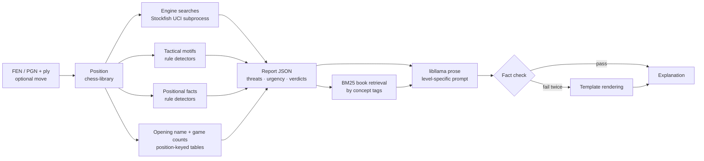

# ChessWhy — Project Vision

Status: accepted vision, 2026-10-17. Milestone plans live in `Planning/milestones/`;
receipts in `Planning/receipts/`. Decisions in §13 are the Captain's; change them only
with her approval.

## 1. Problem

A player looks at a position and asks one of two questions:

- "What should I play here, and why?"
- "Why is *this* move good or bad?"

Engines answer with a number and a line. ChessWhy answers with the reasons: what each
side threatens, which threat matters more, and whether the move deals with it. It is a
small, local, targeted tool, not a chess GUI, trainer or game reviewer.

## 2. Principles

1. **Facts first, words last.** Every chess claim is computed in C++ and stored in the
   report. The language model only verbalises the report; it never decides chess content.
   A sentence in the explanation that cannot be traced to a report field is a bug.
2. **Honest provenance.** Each fact is tagged `engine` (Stockfish search), `rule`
   (deterministic board rule, e.g. "the knight on c3 is pinned"), `book` (reference
   material: retrieved book passages as general advice, opening names) or `games`
   (counts from game collections, §5.7). Heuristic labels are never presented as engine
   truth, and game counts are never presented as move quality.
3. **Reproducible.** Default analysis uses Stockfish with `Threads=1`, a fixed hash size
   and fixed node budgets, so the same input gives the same report. Tests depend on it.
4. **Small.** Prefer the simplest design that meets a milestone's frozen acceptance
   criteria. New ideas become scope proposals, not blockers.
5. **Local.** No cloud services at runtime. Linux only.

## 3. User-facing behaviour

```text
chesswhy --fen "<FEN>"                       # best move(s) + why
chesswhy --fen "<FEN>" --move Nf3            # why / why not Nf3 (SAN or UCI: g1f3)
chesswhy --pgn game.pgn [--game 2] [--ply 31] [--move ...]
         [--level beginner|club|advanced] [--budget quick|standard|deep]
         [--json] [--no-llm] [--threads N]
chesswhy serve [--port 8765]                 # local HTTP API (M6)
```

- PGN: mainline only; variations and comments are ignored. `--ply N` is the position
  after N half-moves (default: final position); `--game` picks a game from a
  multi-game file (default 1).
- No move given: list every move that is "fine" (§5.4), best first, with reasons.
- `--json` prints the report. `--no-llm` prints the deterministic template rendering
  (§7.3) instead of model prose. Default output is model prose.
- `standard` budget: about 10 s of engine time on the development laptop
  (i7-8565U, CPU only), expressed as fixed node counts calibrated in M1. Measured in
  M0: Stockfish 19 searches ~0.32 M nodes/s single-threaded (MultiPV 5), so `standard`
  is roughly 3 M nodes shared by all searches of §5.1. `--threads N` trades
  reproducibility for speed and marks the report non-reproducible.

## 4. Pipeline



## 5. Analysis method

Notation: `S` = side to move, `O` = opponent. `ES` = expected score `W + D/2` from
Stockfish's WDL output (`UCI_ShowWDL`), from a stated side's point of view. Centipawns
are reported for display only; all thresholds use `ES`.

### 5.1 Engine searches

| ID | Position | Search | Purpose |
|---|---|---|---|
| A | current, `S` to move | MultiPV `K` (default 5) | best moves, `S`'s threat (A's PV), "fine" set |
| B | null move: same placement, `O` to move, en-passant square cleared | single PV | `O`'s threat (what `O` does if `S` passes) |
| C(m) | after candidate `m` | `go searchmoves m` from the current position, or the A entry if `m` is in the MultiPV | verdict and refutation line for `m` |
| D(m, t) | after `m`, `O` to move | `searchmoves t`, where `t` is `O`'s threat move from B | does `m` parry the threat? |
| E(m) | after `m`, null move (`S` to move again) | single PV | threat that `m` creates |

B is skipped when `S` is in check (the check *is* the problem) and flagged unreliable
when the position is zugzwang-prone (few non-pawn pieces); the flag is in the report.
Node budgets per search are split from the `--budget` total; exact numbers are frozen
in M1 after calibration.

### 5.2 Threats (vision items 4a, 4b)

A threat is what a side would do if it were its move. `O`'s threat is B's PV; `S`'s
threat is A's PV. Each threat is reported with its **consequence**, computed along the
first plies of the line:

1. mate (in `N`);
2. material: net gain after the line's captures settle, in pawn units;
3. promotion;
4. positional only: `ES` swing without material change (with the motif/positional tags
   that change along the line, M2–M3).

"White's biggest problem" is Black's threat and vice versa, whichever side is to move.

### 5.3 Urgency (4c)

Rules, applied in order and frozen with fixtures in M1:

1. `S` in check: answering the check is the problem.
2. Compare consequence classes (mate > decisive material ≥ 3 > material ≥ 1 >
   promotion > positional). The higher class is more urgent; within a class the larger
   or faster consequence (fewer plies, mate distance) wins.
3. "Who is faster": if `S`'s best move does not parry `O`'s threat (D shows the threat
   still works) yet keeps `S`'s `ES`, `S`'s threat is more urgent (counterattack);
   if the best move parries it, `O`'s threat was the urgent one.
4. If neither threat reaches the material class, the position is "quiet" and the
   explanation leads with positional facts.

### 5.4 Move verdict (4d)

- `loss(m) = ES_S(best) − ES_S(m)`. Moves with `loss ≤ τ_fine` are **fine**; worse
  moves are graded inaccuracy / mistake / blunder. Starting proposal (frozen in M1):
  `τ_fine = 0.03`, inaccuracy `0.05`, mistake `0.10`, blunder `0.20`.
- Reasons attached to each verdict: parries or ignores `O`'s threat (D), executes or
  keeps `S`'s threat, creates a new threat (E), the refutation line and its
  consequence when `m` is bad, and tactical/positional facts that change (M2–M3).

### 5.5 Tactical motifs (M2)

Rule detectors on the board and along report lines: hanging piece (static exchange
evaluation), fork, pin (absolute/relative), skewer, discovered attack/check, double
check, back-rank weakness, mate threat, overloaded defender, removal of the defender,
trapped piece, promotion threat. Validated against the theme tags of the Lichess
puzzle database (CC0); per-motif precision/recall targets are frozen in M2.

### 5.6 Positional facts (M3)

Rule detectors, reported as before/after diffs along the relevant lines:

- pawn structure: isolated, doubled, backward, passed, connected, islands, chains, and
  named structure families (IQP, hanging pawns, Carlsbad, Maróczy, ...);
- king safety: pawn shield, open files toward the king, attackers in the king zone,
  castling rights;
- pieces: mobility, outposts, bad bishop, bishop pair, rooks on open files/7th rank;
- space and development lead; material imbalance (Silman's imbalances).

Positional facts enter the explanation only when tied to a line or verdict, so the text
does not list every feature of the board.

### 5.7 Opening names (M1) and game statistics (M3)

- **Lookup key**: the position (piece placement, side to move, castling rights, en
  passant square only when a legal capture exists), so transpositions match. Move
  counters are ignored.
- **Names (M1, `book`)**: [lichess-org/chess-openings](https://github.com/lichess-org/chess-openings)
  (CC0, pinned commit, 3,865 named lines with ECO codes), fetched to
  `assets/data/openings/`. The report gives the name of the current position if it is
  a named one. For PGN input it also gives the last named position on the mainline.
  No name is ever guessed for an unnamed position.
- **Statistics (M3, `games`)**: a position → move-count table built offline by our own
  C++ tool from pinned monthly files of two sources, kept apart and labelled by
  platform:

  | Source id | Platform label | Content | License |
  |---|---|---|---|
  | `lichess_broadcast` | over the board | official Lichess broadcasts of real tournaments | CC0 (Lichess export header) |
  | `lichess_elite` | online, Lichess | Lichess Elite Database: 2500+ vs 2300+, no bullet | filtered from CC0 Lichess exports; no license stated by the compiler |

  Per source and position: game count, White wins / draws / Black wins, and the
  count for each move played. Sources are never merged into one number; every figure
  names its source and platform ("Bc4: 1,140 of 1,840 over-the-board games;
  9,212 of 15,003 online Lichess Elite games"). The table covers positions up to a
  fixed ply limit, and drops rare positions below a minimum game count. Both
  thresholds, the input months and the table's SHA-256 are frozen in the M3 plan,
  and the report records the table id so reruns stay reproducible.
- **Use**: game counts describe what players chose, never whether it is good;
  the verdict stays with the engine (§5.4). Counts are reported for the candidate
  moves and the asked move, plus "not in the table" when a move is absent.

## 6. Report

One JSON document per query, versioned (`schema_version`), with a JSON Schema checked
in. Sketch:

```json
{
  "schema_version": 1,
  "input": {"fen": "...", "move": "Nf3", "level": "club", "budget": "standard"},
  "engine": {"name": "Stockfish 19", "nodes": 0, "threads": 1, "reproducible": true},
  "position": {"side_to_move": "white", "in_check": false, "es_white": 0.54},
  "threats": {
    "white": {"line": ["..."], "consequence": {"class": "material", "gain": 3}, "tags": []},
    "black": {"line": ["..."], "consequence": {"class": "mate", "in": 2}, "tags": ["back_rank"]},
    "more_urgent": "black", "urgency_rule": "consequence_class", "null_move_reliable": true
  },
  "candidates": [
    {"move": "h3", "es": 0.53, "loss": 0.01, "verdict": "fine",
     "parries_threat": true, "creates_threat": null, "refutation": null,
     "facts": [{"source": "rule", "tag": "luft", "detail": "..."}]}
  ],
  "asked_move": {"move": "Nf3", "verdict": "blunder", "refutation": {"line": ["..."]}},
  "opening": {"source": "book", "eco": "C50", "name": "Italian Game",
              "dataset": "lichess-org/chess-openings@a6189a3", "last_named_ply": 5},
  "games": {"source": "games", "table": "<sha256>", "by_source": [
    {"id": "lichess_broadcast", "platform": "over the board", "games": 1840,
     "white": 640, "draw": 790, "black": 410, "moves": [{"move": "Bc4", "games": 1140}]},
    {"id": "lichess_elite", "platform": "online, Lichess", "games": 15003, "...": "..."}]},
  "book": [{"book": "<author>, <title>", "page": 123, "excerpt": "..."}]
}
```

## 7. Explanation layer (M4)

### 7.1 Runtime

llama.cpp linked as a library (`libllama`, pinned submodule), one binary. Model is a
GGUF file chosen by config/flag; the chat template comes from the model's metadata.
Greedy or low-temperature sampling with a fixed seed; bounded output length.

### 7.2 Prompt

Level-specific system prompt (`beginner`, `club`, `advanced`) plus a compact fact sheet
serialised from the report (not raw JSON, to save tokens on a CPU-only machine), plus
retrieved book passages (M5).

### 7.3 Fact check and template rendering

After generation, every move, square and piece reference in the text is checked against
the report. Unsupported references cause one regeneration; a second failure falls back
to the deterministic template rendering with a notice. The template renderer is also
the `--no-llm` output and the readable output of M1–M3.
Opening names and game counts in the text must match the report's `opening` and
`games` fields exactly, including the source and platform of each count.

### 7.4 Model choice

Deferred to the Captain. M4 ships a benchmark harness that runs shortlisted GGUF models
over fixture reports and records unsupported-reference rate, coverage of key facts
(threat, urgency, verdict), and prefill/decode speed on the development laptop.
Initial shortlist (Q4_K_M): Qwen3.5-0.8B, Qwen3.5-2B, Gemma-4-E2B, Qwen3.5-4B,
Gemma-4-E4B. Only Qwen3.5-0.8B is downloaded now, for build smoke tests.

## 8. Book retrieval (M5)

- Corpus: the Captain's local book collection in `Resources/`. Text-layer PDFs via
  `pdftotext`, DjVu via `djvutxt`, image scans via OCRmyPDF/Tesseract, into
  `Resources/Prepared/<book>.txt` with page markers. Which books are present is
  machine-local and never recorded in tracked files.
- Index: BM25 over page/paragraph chunks, built offline in C++, stored under
  `Resources/Index/`. Query: the report's motif/concept tags, expanded through a
  checked-in tag→keyword map (e.g. `isolated_queen_pawn` → "isolated queen pawn IQP
  isolani").
- Use: top 1–3 short excerpts per answer, cited by book and page, presented as general
  advice. Move notation inside excerpts refers to other games and is marked as such so
  the fact check does not confuse it with the current position.
- Copyright: books, extracts and indexes stay local and git-ignored; nothing derived
  from them is committed or served beyond localhost.
- Maybe, if the M5 retrieval proves insufficient for opening positions:
  [Wikibooks *Chess Opening Theory*](https://en.wikibooks.org/wiki/Chess_Opening_Theory)
  (per-move prose, CC BY-SA 4.0, extracted from the Wikibooks dump) as an extra corpus,
  cited with attribution. Decided by the Captain after the base M5 corpus is measured.

## 9. Local HTTP API (M6)

cpp-httplib, bound to `127.0.0.1` only. `POST /v1/explain` takes the CLI inputs as
JSON and returns `{report, text}`; `GET /v1/health`. One worker keeps the engine and
model loaded; requests queue. No authentication, no multi-user features.

## 10. Technology

| Component | Choice | Version (pinned) | License | Role |
|---|---|---|---|---|
| Language / build | C++20, CMake + Ninja | GCC 14 / Clang 19, CMake 3.31 | — | |
| Board, FEN, PGN, SAN | Disservin/chess-library | `53e6a84` (2026-07-26) | MIT | single header |
| JSON | nlohmann/json | v3.12.0 | MIT | report I/O |
| Tests | Catch2 | v3.16.1 | BSL-1.0 | unit/fixture tests |
| HTTP | cpp-httplib | v0.61.0 | MIT | M6 |
| LLM runtime | llama.cpp (`libllama`) | b11712 | MIT | M4 |
| Engine | Stockfish | 19 (official Linux universal build) | GPL-3.0 | separate process over UCI; never linked, copied or redistributed |
| Tactics test data | Lichess puzzle DB | fetched, hash recorded | CC0 | M2 validation |
| Opening names | lichess-org/chess-openings | commit `a6189a3` (2026-10-06) | CC0 | M1 `opening` field |
| Opening statistics | Lichess broadcasts + Lichess Elite Database | months pinned in M3 | CC0 / derived from CC0 | M3 `games` table, built by our tool |

Dependencies are git submodules under `third_party/`; engine, models and datasets are
fetched by `tools/fetch_assets.sh` into git-ignored `assets/` with SHA-256 checks.

## 11. Milestones

Breadth first: all analysis layers before the language model. Each milestone gets its
own plan with frozen acceptance criteria; the bullets below are the intent.

| M | Delivers | Acceptance intent |
|---|---|---|
| M0 | Repository, pinned dependencies, assets, agent setup, this vision | builds of dependencies smoke-tested; assets verified |
| M1 | CLI, FEN/PGN/ply input, SAN/UCI moves, UCI engine wrapper, searches A–E, threats, urgency, verdicts, opening names, report v1 + schema, template rendering | ~20 hand-checked fixture positions (check, mate threat, hanging piece, counterattack, quiet, zugzwang-prone, promotion, castling/en passant input); opening name found through a transposition; no name for an unnamed position; identical report on rerun; clear errors for bad FEN/PGN/move; `standard` ≤ ~12 s wall time |
| M2 | Tactical motif detectors in the report | per-motif precision/recall on a fixed Lichess puzzle sample |
| M3 | Positional fact detectors and diffs; opening statistics table and builder | hand-labelled fixture positions, including book positions transcribed to FEN; per-source move counts for fixture positions match counts computed directly from the pinned PGN files; table rebuild is byte-identical |
| M4 | libllama prose, three levels, fact check, benchmark harness | Captain picks the default model from benchmark results; fact-check rejects seeded false statements |
| M5 | Book text extraction, OCR, BM25 index, cited excerpts | retrieval returns relevant pages for a fixed tag set; citations resolve |
| M6 | Local HTTP API | CLI and API return identical reports for the fixture set |

## 12. Non-goals

Playing engine or GUI; whole-game annotation; opening repertoire training or move
recommendations from game statistics; online opening explorers; chess variants;
cloud LLMs; model fine-tuning; Windows/macOS; multi-user or remote serving; endgame
tablebases; our own evaluation function.

## 13. Decisions

| Topic | Decision |
|---|---|
| Interface | CLI plus local HTTP API |
| LLM runtime | llama.cpp linked as `libllama` |
| Model | deferred; benchmark harness in M4, Captain decides |
| Fact depth | engine facts + tactical motifs + positional facts |
| Budget | `standard` ≈ 10 s, fixed nodes, `Threads=1` by default |
| Audience | selectable level: beginner / club / advanced |
| Books | method reference and BM25 retrieval corpus |
| Retrieval | BM25 keyed on concept tags, no embedding model |
| Scanned books | OCR them |
| Platform | Linux only |
| Milestone order | breadth first (analysis layers before LLM) |
| Process | trimmed multi-model workflow (`.omp/AGENTS.md`) |
| Git | local repository now, remote later |
| Prior code | ChessPGNAnalyzer is not a port source; ChessWhy starts clean |
| Openings | names in M1 (lichess chess-openings); per-platform game statistics in M3 (Lichess broadcasts over the board + Lichess Elite online, never merged); Wikibooks prose is an M5 maybe |

Open for the Captain: default model (M4), project license, HTTP consumer details (M6).

## 14. Risks

| Risk | Mitigation |
|---|---|
| Small model invents moves or ideas | facts-only prompt, fact check, template fallback |
| Null-move threat is wrong in zugzwang or check | skip in check, reliability flag, fixtures |
| Motif/positional detectors overfire | precision targets, facts shown only when tied to a line |
| CPU latency of a 2–4B model plus book excerpts | compact fact sheet, short excerpts, benchmark before choosing |
| OCR errors in chess notation | spot-check pages; excerpts are advice, notation marked foreign |
| Scope: three of the Captain's picks widen the tool | strict milestone order; JSON + template output usable from M1 |
| Game counts read as advice ("most played, so best") | `games` provenance, counts phrased as frequencies per platform, verdict only from the engine |
