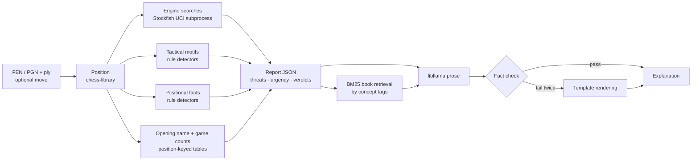

# ChessWhy — Project Vision

Status: accepted vision, 2026-10-17. Milestone plans live in `Planning/milestones/`;
receipts in `Planning/receipts/`. Decisions in §13 are the Captain's; change them only
with her approval.

## 1. Problem

A player looks at a position and asks one of two questions:

- "What should I play here, and why?"
- "Why is *this* move good or bad?"

Engines answer with a number and a line. ChessWhy answers with the reasons: what each
side threatens, which threat matters more, and whether the move deals with it. It is a
small, local, targeted tool, not a chess GUI, trainer or game reviewer.

## 2. Principles

1. **Facts first, words last.** Every chess claim is computed in C++ and stored in the
   report. The language model only verbalises the report; it never decides chess content.
   A sentence in the explanation that cannot be traced to a report field is a bug.
2. **Honest provenance.** Each fact is tagged `engine` (Stockfish search), `rule`
   (deterministic board rule, e.g. "the knight on c3 is pinned"), `book` (reference
   material: retrieved book passages as general advice, opening names) or `games`
   (counts from game collections, §5.7). Heuristic labels are never presented as engine
   truth, and game counts are never presented as move quality. Verdicts and losses are
   engine judgements read through frozen thresholds (§5.4): the scores are the engine's,
   the cut-offs are ChessWhy's.
3. **Reproducible.** Default analysis uses Stockfish with `Threads=1`, a fixed hash size
   and fixed search depths (the search budget and the explanation budget, PostM4_EM6), so
   the same input gives the same report. Tests depend on it.
   "Reproducible" means the same configuration (budgets, threads, hash); the report
   does not identify the engine binary or the ChessWhy revision. Data files are
   identified by the digest of the loaded bytes (PostM3_EM2).
4. **Small.** Prefer the simplest design that meets a milestone's frozen acceptance
   criteria. New ideas become scope proposals, not blockers.
5. **Local.** No cloud services at runtime. Linux and Windows; Android possibly later
   (§9).

## 3. User-facing behaviour

```text
chesswhy --fen "<FEN>"                       # the best move + why
chesswhy --fen "<FEN>" --moves top3          # the engine's top 3 moves
chesswhy --fen "<FEN>" --moves Nf3           # why / why not Nf3 (SAN or UCI: g1f3)
chesswhy --fen "<FEN>" --moves best,Nf3      # my move next to the best one
chesswhy --fen "<FEN>" --moves playable      # every playable move (slow)
chesswhy --pgn game.pgn [--game 2] [--ply 31] [--moves ITEM[,ITEM...]]
         [--search-budget N] [--explanation-budget N]
         [--json] [--full-report] [--no-llm] [--threads N]
```

- PGN: mainline only; variations and comments are ignored. `--ply N` is the position
  after N half-moves (default: final position); `--game` picks a game from a
  multi-game file (default 1).
- `--moves` names what to report as a comma-separated list without spaces; items
  combine, each move reported once. An item is a move (SAN or UCI) or a keyword:
  `best` (the engine's top line; the default), `topN` (the engine's first N lines,
  whatever their verdict), `playable` (verdict best or okay), `inaccuracies`,
  `mistakes`, `blunders`, `unplayable` (all three), `all` (every legal move). The
  last six judge every legal move and are slow; `--help` says so. The output never
  calls a move a "candidate": chess literature uses the word for moves considered, many
  of them rejected (Captain, 2026-10-23; M4).
- Analysis is position-only: the moves that led to the position (PGN history) are not
  an input, so repetition and the fifty-move counter beyond the FEN do not affect
  verdicts.
- The output is one **move report** per reported move, holding only the facts that bear
  on that move (relevance filter, M4 §4.6). Two independent flags (Captain,
  2026-10-23): `--json` chooses the format (JSON instead of text), `--full-report` the
  content (the full report, every computed fact, instead of the move reports). Text is
  model prose from M5 for move reports and the deterministic template rendering
  (§7.3) with `--no-llm` or until then; the full report text is always the template.
- Two budgets, each a Stockfish depth the user may set (Captain, 2026-10-25;
  PostM4_EM6): `--search-budget N` (default 18) for the searches that find and rank the
  moves (A-best, A-rest, C) and `--explanation-budget N` (default 14) for the searches that
  explain them (B, D, E, R, L); both accept 1–60. Run longer, a search's line 1 can
  change; the defaults keep a default report within about 25 s on the development
  laptop (i7-8565U, CPU only). `--threads N` trades reproducibility for speed and marks
  the report non-reproducible. Audience levels (`--level`, removed in PostM4_EM6) are an
  open question for M5.

## 4. Pipeline



## 5. Analysis method

Notation: `S` = side to move, `O` = opponent. `ES` = expected score `W + D/2` from
Stockfish's WDL output (`UCI_ShowWDL`), from a stated side's point of view. Centipawns
are reported for display only; all thresholds use `ES`.

### 5.1 Engine searches

| ID | Position | Search | Purpose |
|---|---|---|---|
| A-best | current, `S` to move | single PV at the search budget | the best move, `S`'s threat (A-best's PV) |
| A-rest | current, `S` to move | MultiPV `K − 1` at the search budget, `searchmoves` every legal move but A-best's; `K` is 5, or N for `topN` > 5, or every legal move for `playable`, `inaccuracies`, `mistakes`, `blunders`, `unplayable`, `all` | the other reported moves, playable moves |
| B | null move: same placement, `O` to move, en-passant square cleared | single PV | `O`'s threat (what `O` does if `S` passes) |
| C(m) | after move `m` | `go searchmoves m` from the current position at the search budget, or the A entry if `m` is one of A's lines | verdict and refutation line for `m` |
| D(m, t) | after `m`, `O` to move | `searchmoves t`, where `t` is `O`'s threat move from B | does `m` parry the threat? |
| E(m) | after `m`, null move (`S` to move again) | single PV | threat that `m` creates |

B is skipped when `S` is in check (the check *is* the problem) and flagged unreliable
when the position is zugzwang-prone (few non-pawn pieces); the flag is in the report.
A is A-best's line followed by A-rest's lines in A-rest's order (not re-sorted by score); a line of A-rest
that scores at least A-best's is `best` (§5.4). B, D, E and every explanation search run at
the explanation budget (PostM4_EM6). Each line reports the depth it reached, and the text
names the engine and both budgets, since a different budget can change a close verdict.

### 5.2 Threats (vision items 4a, 4b)

A threat is what a side would do if it were its move. `O`'s threat is B's PV; `S`'s
threat is A's PV. Each threat is reported with its **consequence**, computed along the
first plies of the line:

1. mate (in `N`);
2. material: net gain after the line's captures settle, in pawn units;
3. promotion;
4. positional only: the residual class — none of mate, material or promotion within
   the walked plies; no `ES` swing is measured (motif and positional changes along the
   line, M2–M3, are listed separately).

"White's biggest problem" is Black's threat and vice versa, whichever side is to move.

### 5.3 Urgency (4c)

Rules, applied in order, frozen with fixtures in M1 (`Planning/milestones/M1.md` §4.6;
the earlier within-class "larger or faster" rule picked the wrong side when `S`, who
moves first, had a forcing line):

1. `S` in check: answering the check is the problem.
2. Rank each threat's consequence (mate > decisive material ≥ 3 > material ≥ 1 >
   promotion > positional). If neither reaches material ≥ 1, the position is "quiet"
   and the explanation leads with positional facts.
3. Different ranks: the higher one is more urgent.
4. Same rank, "who is faster": if `S`'s best move does not parry `O`'s threat (D shows
   the threat still works), `S`'s threat is more urgent (counterattack); if it parries
   it, `O`'s threat was the urgent one.

### 5.4 Move verdict (4d)

- `loss(m) = ES_S(best) − ES_S(m)`. Scale decided by the Captain on 2026-10-23 (M4),
  replacing M1's fine ≤ 0.03 < inaccuracy < 0.13 ≤ mistake < 0.27 ≤ blunder:
  *playable* moves (loss ≤ 0.05) are **best** (A-best's line and every A-rest line whose engine
  score is at least A-best's, PostM4_EM6; "exactly the same" before) or **okay**; worse moves are **inaccuracy**
  (≤ 0.10), **blunder** (> 0.10 and the move allows a tactic: along its own line `S`
  loses at least 1 pawn net or is mated) or **mistake** (> 0.10 otherwise).
- Reasons attached to each verdict: parries or ignores `O`'s threat (D: "parries" means
  the threat no longer wins against the pass baseline, not that it was prevented; a
  checking move only defers it), executes or keeps `S`'s threat, the threat `S` would
  have after `m` if `O` passed (E; a premise, printed as such; when not searched, the
  reason: `m` checks, ends the game, or leaves `S` no legal move after the pass), the
  refutation line and its consequence when `m` is bad, and tactical/positional facts
  that change (M2–M3), read up to the walked ply the report states.

### 5.5 Tactical motifs (M2) and tactics (PostM2_EM1)

Motifs are deterministic patterns of one position (plus the move that produced it where a tag
needs it), with `rule` provenance; they state that the pattern is present and claim no gain. Mate
and promotion threats come from engine consequences, not motif detectors. Overloaded defender,
back-rank weakness and the tactical pin (`pin_tactical`: a piece held in place because removing it
would enable a threat) are validated by fixtures; definitions are in M2 §4 and PostM2_EM1 §4.5.
Other measured motifs are validated against Lichess puzzle themes (CC0); per-motif recall targets
are frozen in M2 and measure coverage of Lichess-tagged puzzles, not precision.

Pins, overloaded defenders and tactical pins print as **restricted movement** (Captain,
2026-10-22): restricted does not mean the piece cannot move at all; it means it cannot move in
all the ways it otherwise could. Each such motif names the held piece, how it is held ("at
square e5", "along file e", "along rank 7", "along diagonal a4-e8", "only to squares a2, d1,
g8"), its **restricted moves** (the moves the motif makes illegal or costly) and its **free
moves**, and exists only when at least one move is restricted (PostM3_EM2 §4.1; approved at
checkpoint 1, 2026-10-22).

A **tactic** (M4, Captain, 2026-10-23) is a line whose consequence class is mate or
material: with best replies the side playing it mates or wins at least 1 pawn net over the
walked plies, so a sacrifice is a tactic only when it wins back more within them. The
PostM2_EM1 margin rule is now called **opportunity**: a judged line (the best move's line,
each refutation) whose expected score beats the best alternative first move by the
only-move margin (≥ 0.13, `engine`); a lone legal move is **forced** (`rule`). A line that
is an opportunity or a tactic is a **tactic line**. On a tactic line each motif gets a
contribution (`rule`):
`direct` when the tactic's moves make the motif or capture its pieces; `indirect` when the motif
takes away an answer the defender would have to a tactic move (a recapture, an escape, an
interposition); `none` when the tactic works without it (PostM3_EM2 §4.2). The tactic label
`removal_of_defender` (after lichess-puzzler's `capturing_defender`) marks a capture of a
piece's only defender followed by winning that same piece on its square, the piece still
standing there when it is captured (PostM3_EM2 §4.3).

### 5.6 Positional facts (M3a)

Rule detectors, reported as before/after diffs along the relevant lines:

- pawn structure: isolated, doubled, backward, passed, connected, islands, chains, and
  named structure families (IQP, hanging pawns, Carlsbad, Maróczy, ...);
- king safety: pawn shield, open files toward the king, attackers in the king zone,
  castling rights;
- pieces: mobility, outposts, bad bishop, bishop pair, rooks on open files/7th rank;
- space and development lead; material imbalance (Silman's imbalances).

Positional facts enter the explanation only when tied to a line or verdict, so the text
does not list every feature of the board.

M3a builds the pawn-structure basics, king safety, pieces, space, development lead and
the material balance. Named structure families and Silman's imbalances wait for a later
milestone (Captain, 2026-10-21): their boundaries are fuzzy, and a wrong label would
still carry `rule` provenance.

Where changes are measured (Captain, 2026-10-21): at every ply of a line within its
walked plies, each feature that appears or disappears is listed at that ply, with a flag
saying whether the change still holds at the end of the walked plies. Lines: the
candidate lines and the asked move's line with its refutation; threat lines are not read.

### 5.7 Opening names (M1) and game statistics (M3b)

- **Lookup key**: the position (piece placement, side to move, castling rights, en
  passant square only when a legal capture exists), so transpositions match. Move
  counters are ignored.
- **Names (M1, `book`)**: [lichess-org/chess-openings](https://github.com/lichess-org/chess-openings)
  (CC0, pinned commit, 3,865 named lines with ECO codes), fetched to
  `assets/data/openings/`. The report gives the name of the current position if it is
  a named one. For PGN input it also gives the last named position on the mainline.
  No name is ever guessed for an unnamed position.
- **Statistics (M3, `games`)**: a position → move-count table built offline by our own
  C++ tool from pinned monthly files of one source (Captain, 2026-10-21; before that
  date the plan also had the online Lichess Elite Database, dropped because fast online
  games say little about considered opening choices, and the set has no stated license
  and no files after November 2025):

  | Source id | Platform label | Content | License |
  |---|---|---|---|
  | `lichess_broadcast` | over the board, both players 2200+ | official Lichess broadcasts of real tournaments, January 2020 to the latest month at freeze; only games whose `WhiteElo` and `BlackElo` are both 2200 or more | CC BY-SA 4.0 (Lichess database page, broadcasts section) |

  Per position: game count, White wins / draws / Black wins, and the count for each
  move played. Every figure names its source and platform ("Bc4: 1,140 of 1,840
  over-the-board games between players rated 2200+"). The table covers positions up to
  a fixed ply limit, and drops rare positions below a minimum game count. Both
  thresholds, the rating floor, the input months and the table's SHA-256 are frozen in
  the M3 plan, and the report records the table id so reruns stay reproducible. The
  table stays in git-ignored `assets/`; the report credits the source.
- **Use**: game counts describe what players chose, never whether it is good;
  the verdict stays with the engine (§5.4). Counts are reported for the candidate
  moves and the asked move, plus "not in the table" when a move is absent.

## 6. Report

Two JSON documents per query, versioned together (`schema_version`, JSON Schemas checked
in): the **full report** (`--full-report`) holds every computed fact; the **move report
document** (default content) holds the selection and one move report per reported move, each a
filtered copy of full-report fields (M4 §4.6). Sketch of the full report (field names
as of v3; v6 renames the verdict scale and `tactic` → `opportunity`, M4 §5):

```json
{
  "schema_version": 3,
  "input": {"fen": "...", "move": "Nf3", "level": "club", "budget": "standard"},
  "engine": {"name": "Stockfish 19", "nodes": 0, "threads": 1, "reproducible": true},
  "position": {"side_to_move": "white", "in_check": false, "es_white": 0.54, "motifs": []},
  "threats": {
    "white": {"line": ["..."], "consequence": {"class": "material", "gain": 3}, "tags": [], "motifs": []},
    "black": {"line": ["..."], "consequence": {"class": "mate", "in": 2}, "tags": ["back_rank"], "motifs": []},
    "more_urgent": "black", "urgency_rule": "consequence_class", "null_move_reliable": true
  },
  "candidates": [
    {"move": "h3", "es": 0.53, "loss": 0.01, "verdict": "fine",
     "parries_threat": true, "creates_threat": null, "refutation": null,
     "facts": [{"source": "rule", "tag": "luft", "detail": "..."}], "motifs": [],
     "tactic": {"source": "engine", "forced": false, "alternative": {"san": "Nf3", "eval": {}},
                "margin": 0.21, "is_tactic": true, "labels": []}}
  ],
  "asked_move": {"move": "Nf3", "verdict": "blunder", "refutation": {"line": ["..."], "motifs": [], "tactic": {}}},
  "opening": {"source": "book", "eco": "C50", "name": "Italian Game",
              "dataset": "lichess-org/chess-openings@a6189a3", "last_named_ply": 5},
  "games": {"source": "games", "table": "<sha256>", "by_source": [
    {"id": "lichess_broadcast", "platform": "over the board, both players 2200+", "games": 1840,
     "white": 640, "draw": 790, "black": 410, "moves": [{"move": "Bc4", "games": 1140}]}]},
  "book": [{"book": "<author>, <title>", "page": 123, "excerpt": "..."}]
}
```

## 7. Explanation layer (M5)

### 7.1 Runtime

llama.cpp linked as a library (`libllama`, pinned submodule), one binary. Model is a
GGUF file chosen by config/flag; the chat template comes from the model's metadata.
Greedy or low-temperature sampling with a fixed seed; bounded output length.

### 7.2 Prompt and fact selection

System prompt (whether it depends on an audience level is open, §11 M5) plus a compact fact sheet
serialised from the report (not raw JSON, to save tokens on a CPU-only machine), plus
retrieved book passages (M6).

Fact selection (PostM3_EM2, decided 2026-10-22):

- The core claims are mandatory in every prompt: verdict, refutation, and the conditions
  they depend on (threat premise, deferred parry, walked plies).
- Tactic and blunder evidence comes first; root positional features are mentioned only
  when they are linked to a line or a verdict.
- A feature that holds at the end of a line is phrased as "holds at the end of the
  analysed walk", not as a permanent fact.
- Role phrasing follows the tag (a pin's actor pins, an overloaded defender's actor is
  the overloaded piece).
- An empty refutation motif list does not mean "no mechanism"; the prose says the line
  wins without naming a motif.
- Near-equal moves are worded as close ("about as good as"), since a different
  budget can reorder them (§5.1).

### 7.3 Fact check and template rendering

The prose is built from **claim units**: each unit states one fact or one relation
between report fields (who threatens what, at which ply, under which condition). After
generation, the text is split into claim units and every unit is checked against the
report, relations included, not only the moves, squares and pieces it names.
Unsupported claims cause one regeneration; a second failure falls back
to the deterministic template rendering with a notice. The template renderer is also
the `--no-llm` output and the readable output of M1–M3.
Opening names and game counts in the text must match the report's `opening` and
`games` fields exactly, including the source and platform of each count.

### 7.4 Model choice

Deferred to the Captain. M5 ships a benchmark harness that runs shortlisted GGUF models
over fixture reports and records the unsupported-claim rate on a seeded relational test
set (seeded from the 2026-10-22 audit's cases X1–X13), coverage of key facts (threat,
urgency, verdict), and prefill/decode speed on the development laptop.
Initial shortlist (Q4_K_M): Qwen3.5-0.8B, Qwen3.5-2B, Gemma-4-E2B, Qwen3.5-4B,
Gemma-4-E4B. Only Qwen3.5-0.8B is downloaded now, for build smoke tests.

## 8. Book retrieval (M6)

- Corpus: the Captain's local book collection in `Resources/`. Text-layer PDFs via
  `pdftotext`, DjVu via `djvutxt`, image scans via OCRmyPDF/Tesseract, into
  `Resources/Prepared/<book>.txt` with page markers. Which books are present is
  machine-local and never recorded in tracked files.
- Index: BM25 over page/paragraph chunks, built offline in C++, stored under
  `Resources/Index/`. Query: the report's motif/concept tags, expanded through a
  checked-in tag→keyword map (e.g. `isolated_queen_pawn` → "isolated queen pawn IQP
  isolani").
- Use: top 1–3 short excerpts per answer, cited by book and page, presented as general
  advice. Move notation inside excerpts refers to other games and is marked as such so
  the fact check does not confuse it with the current position. An excerpt is shown only
  when it is on topic (it discusses a tag the report carries), applicable (the position
  has the features the excerpt assumes) and its stance is kept (M6 acceptance).
- Copyright: books, extracts and indexes stay local and git-ignored; nothing derived
  from them is committed or served beyond localhost.
- Maybe, if the M6 retrieval proves insufficient for opening positions:
  [Wikibooks *Chess Opening Theory*](https://en.wikibooks.org/wiki/Chess_Opening_Theory)
  (per-move prose, CC BY-SA 4.0, extracted from the Wikibooks dump) as an extra corpus,
  cited with attribution. Decided by the Captain after the base M6 corpus is measured.

## 9. Presentation layer (M7)

Native apps on Linux and Windows, possibly Android: chess players should not need
technical skills to use ChessWhy (Captain, 2026-10-22; replaces the local HTTP API).
The bar: install with one click, then ask without any setup; no builds, terminals,
servers or addresses. Design and scope are discussed with the Captain later.

## 10. Technology

| Component | Choice | Version (pinned) | License | Role |
|---|---|---|---|---|
| Language / build | C++20, CMake + Ninja | GCC 14 / Clang 19, CMake 3.31 | — | |
| Board, FEN, PGN, SAN | Disservin/chess-library | `53e6a84` (2026-07-26) | MIT | single header |
| JSON | nlohmann/json | v3.12.0 | MIT | report I/O |
| Tests | Catch2 | v3.16.1 | BSL-1.0 | unit/fixture tests |
| LLM runtime | llama.cpp (`libllama`) | b11712 | MIT | M5 |
| Engine | Stockfish | 19 (official Linux universal build) | GPL-3.0 | separate process over UCI; never linked, copied or redistributed |
| Tactics test data | Lichess puzzle DB; committed sample `tests/fixtures/puzzles/test.csv` | 2026-10-05 export `assets/data/lichess_db_puzzle.csv.zst`; source SHA-256 `76335bfa7d7c4a7f93c1366d81549e53951ebb79dd43d34904cab8f22d962f8d` | CC0 | 6,157,341 source puzzles; 1,326,623 eligible (`RatingDeviation ≤ 80`, `NbPlays ≥ 1000`, `Popularity ≥ 80`, ≤7 moves); sample 9,300 puzzles (9,301 CSV lines, ≈1.4 MB); M2 validation |
| Opening names | lichess-org/chess-openings | commit `a6189a3` (2026-10-06) | CC0 | M1 `opening` field |
| Opening statistics | Lichess broadcasts, both players 2200+ | months pinned in M3 | CC BY-SA 4.0 | M3 `games` table, built by our tool |

Dependencies are git submodules under `third_party/`; engine, models and datasets are
fetched by `tools/fetch_assets.sh` into git-ignored `assets/` with SHA-256 checks.

## 11. Milestones

Breadth first: all analysis layers before the language model. Each milestone gets its
own plan with frozen acceptance criteria; the bullets below are the intent.

| M | Delivers | Acceptance intent |
|---|---|---|
| M0 | Repository, pinned dependencies, assets, agent setup, this vision | builds of dependencies smoke-tested; assets verified |
| M1 | CLI, FEN/PGN/ply input, SAN/UCI moves, UCI engine wrapper, searches A–E, threats, urgency, verdicts, opening names, report v1 + schema, template rendering | ~20 hand-checked fixture positions (check, mate threat, hanging piece, counterattack, quiet, zugzwang-prone, promotion, castling/en passant input); opening name found through a transposition; no name for an unnamed position; identical report on rerun; clear errors for bad FEN/PGN/move; `standard` ≤ ~12 s wall time |
| M2 | Tactical motif detectors in the report: patterns of one position, no claim of gain | exact motif recognition against the written definitions (reference implementation on a fixed Lichess puzzle sample); per-motif recall on that sample |
| PostM2_EM1 | Tactic recognition: a line is a tactic when it gains in engine evaluation against the second-best move (only-move margin); per-motif contribution (direct, indirect, none); `removal_of_defender` as a tactic-side label; tactical pin (`pin_tactical`) and "restricted movement" wording | tactic labels follow mechanically from the engine lines; contribution judgements match hand-labelled fixtures — complete, merged into `main` 2026-10-21 (receipt `Planning/receipts/PostM2_EM1.md`) |
| M3a | Positional fact detectors and diffs: pawn structure, king safety, pieces, space, development lead, material balance (Captain, 2026-10-21: named structure families and Silman's imbalances move to a later milestone) | hand-labelled fixture positions, including book positions transcribed to FEN — complete, merged into `main` 2026-10-22 (receipt `Planning/receipts/M3a.md`) |
| M3b | Opening statistics table and builder (Lichess broadcasts, both players 2200+); built in parallel with M3a | move counts for fixture positions match counts computed directly from the pinned PGN files; table rebuild is byte-identical — complete, merged into `main` 2026-10-22 (receipt `Planning/receipts/M3b.md`) |
| PostM3_EM2 | Fixes from the 2026-10-22 conceptual audit (`Planning/milestones/PostM3_EM2.md`): restricted and free moves for restricted movement; contribution `none` means the tactic works without the motif; `removal_of_defender` continuity; conditions printed in the template (threat premise, deferred parry, skipped threat, walked plies, engine and budget, candidate count); report v5 with a semantic checker; data digests | every fixed finding has a fixture, test or doc row that fails on the old behaviour; all reports pass the semantic checks |
| M4 | Playable moves and move reports (`Planning/milestones/M4.md`): one `--moves` flag (asked moves, `best`, `topN`, verdict keywords, `all`), verdict scale best/okay/inaccuracy/mistake/blunder, tactic (mate or material) and opportunity (only-move margin), one move report per reported move with a relevance filter, JSON and template text from the same move reports | every rule has a fixture or test that fails on the old behaviour; every move report fact is a full-report field (projection check); the output never says "candidate" |
| M5 | libllama prose, fact check, benchmark harness; audience levels are an open question (Captain, 2026-10-25: `--level` removed in PostM4_EM6) | Captain picks the default model from benchmark results; prose is limited to claim units built from move report fields; the fact check rejects every case of a seeded relational test set (wrong move, square or piece, and wrong relations: who threatens whom, which ply, which condition) |
| M6 | Book text extraction, OCR, BM25 index, cited excerpts | retrieval returns relevant pages for a fixed tag set; citations resolve; each shown excerpt is on topic for the report's tags, applicable to the position's type, and its stance (advice vs. warning) is not inverted in the prose |
| M7 | Native apps (Linux, Windows; possibly Android) | to be set with the Captain |

## 12. Non-goals

Playing engine or chess-playing GUI; whole-game annotation; opening repertoire training
or move recommendations from game statistics; online opening explorers; chess variants;
cloud LLMs; model fine-tuning; macOS; multi-user or remote serving; endgame
tablebases; our own evaluation function.

## 13. Decisions

| Topic | Decision |
|---|---|
| Interface | CLI now; native apps on Linux and Windows, possibly Android (M7, 2026-10-22; the local HTTP API is dropped) |
| LLM runtime | llama.cpp linked as `libllama` |
| Model | deferred; benchmark harness in M5, Captain decides |
| Fact depth | engine facts + tactical motifs + positional facts |
| Budget | two depths the user may set: search budget 18 and explanation budget 14 by default, `Threads=1` (PostM4_EM6, 2026-10-25; `standard` ≈ 10 s of fixed nodes before) |
| Audience | open for M5; the `--level` flag was removed in PostM4_EM6 (2026-10-25) |
| Books | method reference and BM25 retrieval corpus |
| Retrieval | BM25 keyed on concept tags, no embedding model |
| Scanned books | OCR them |
| Platform | Linux for development and tests; apps for Linux and Windows, possibly Android (2026-10-22) |
| Milestone order | breadth first (analysis layers before LLM) |
| Process | trimmed multi-model workflow (`.omp/AGENTS.md`) |
| Git | local repository now, remote later |
| Prior code | ChessPGNAnalyzer is not a port source; ChessWhy starts clean |
| License | MIT for ChessWhy's own code; dependencies keep their licenses; Stockfish (GPL-3.0) runs as a separate, separately fetched process |
| Verdict thresholds | M4 (2026-10-23): playable ≤ 0.05 (best: same engine score as the top line; okay otherwise) < inaccuracy ≤ 0.10 < mistake, or blunder when the move allows a tactic (ES loss); M1–PostM3_EM2: fine ≤ 0.03 < inaccuracy < 0.13 ≤ mistake < 0.27 ≤ blunder |
| Openings | names in M1 (lichess chess-openings); game statistics in M3 from Lichess broadcasts over the board, both players 2200+ (online Lichess Elite dropped 2026-10-21); Wikibooks prose is an M6 maybe |

Open for the Captain: default model (M5), native app design and platforms (M7).

## 14. Risks

| Risk | Mitigation |
|---|---|
| Small model invents moves or ideas | facts-only prompt, fact check, template fallback |
| Null-move threat is wrong in zugzwang or check | skip in check, reliability flag, fixtures |
| Motif/positional detectors overfire | precision targets, facts shown only when tied to a line |
| CPU latency of a 2–4B model plus book excerpts | compact fact sheet, short excerpts, benchmark before choosing |
| OCR errors in chess notation | spot-check pages; excerpts are advice, notation marked foreign |
| Scope: three of the Captain's picks widen the tool | strict milestone order; JSON + template output usable from M1 |
| Game counts read as advice ("most played, so best") | `games` provenance, counts phrased as frequencies per platform, verdict only from the engine |
